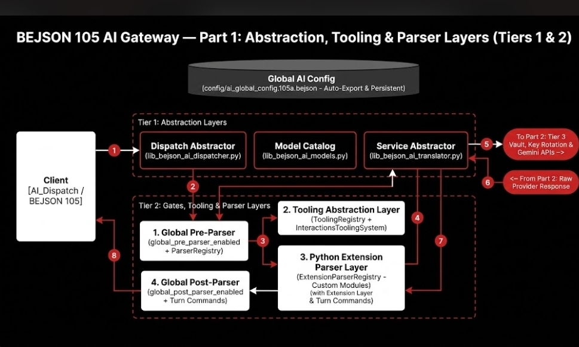
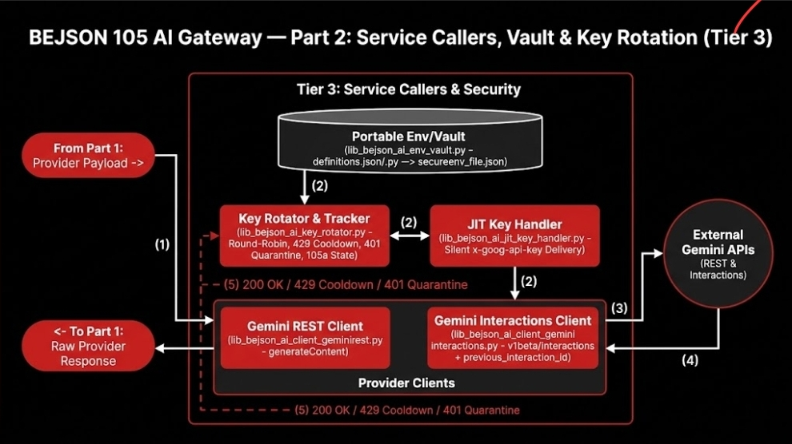
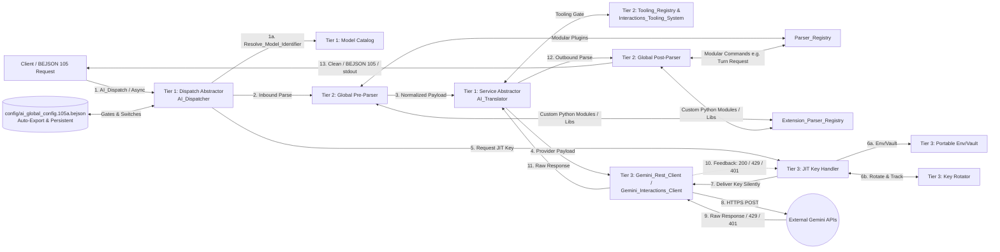

# Hardened AI API Gateway Architecture (`v1.5.0` — Implemented Tooling, Modular Parser & Extension Layers)

## Implemented Architecture (`v1.5.0`)
- **Global Persistent Config (`config/ai_global_config.105a.bejson`)**: Auto-exported on first use via `AIGlobalConfigManager` (`AI_Global_Config_Manager`); persistently stores `tooling_enabled`, `active_tooling_system`, `default_provider`, `default_model`, `max_tool_roundtrips`, `stdout_routing`, `global_pre_parser_enabled`, `global_post_parser_enabled`, and `extension_parser_enabled`.
- **Tier 1:** `AIDispatcher` (`AI_Dispatcher`), `AITranslator` (`AI_Translator`), and `lib_bejson_ai_models.py` (`Resolve_Model_Identifier`, `ACTIVE_TEXT_MODELS_REGISTRY`).
- **Tier 2:** `AIPreprocessor`, `AIPostprocessor`, `ToolingRegistry` (`Tooling_Registry` + `Base_Tooling_System` + `Interactions_Tooling_System`), `ParserRegistry` (`Parser_Registry` + `Base_Modular_Parser`), `ExtensionParserRegistry` (`Extension_Parser_Registry` + `Base_Extension_Module_Parser`), and `lib_bejson_ai_features_common.py`.
- **Tier 3:** `AIEnvVault`, `KeyRotator`, `JITKeyHandler`, `GeminiRestClient` (`Gemini_Rest_Client`), and `GeminiInteractionsClient` (`Gemini_Interactions_Client`).

## Config-Gated Tier 2 Abstraction Layers (`v1.5.0`)
Sitting alongside `Tooling_Registry` in Tier 2, governed by persistent switches in `config/ai_global_config.105a.bejson`:
1. **Modular Parser Abstraction Layer (`Parser_Registry` + `Base_Modular_Parser`)**:
   - Config-gated via `global_pre_parser_enabled` / `global_post_parser_enabled`.
   - Allows attaching modular parsers (such as an AI command parser that detects `<request_turn>` to populate `_ai_turn_continuation_command` via `Get_Turn_Continuation_Command`) without modifying core code.
2. **Localized Custom Python Module / Library Extension Parser Layer (`Extension_Parser_Registry` + `Base_Extension_Module_Parser`)**:
   - Config-gated via `extension_parser_enabled`; sits next to `Tooling_Registry` and `Parser_Registry` as an abstraction layer so custom Python modules and downstream extension libraries can attach localized pre/post parsers through the global parser pipeline.

## Pipeline Diagram

