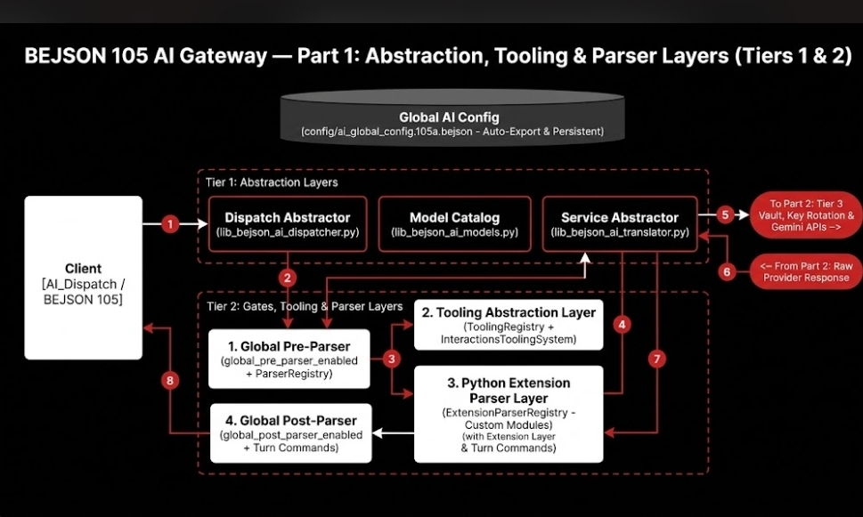
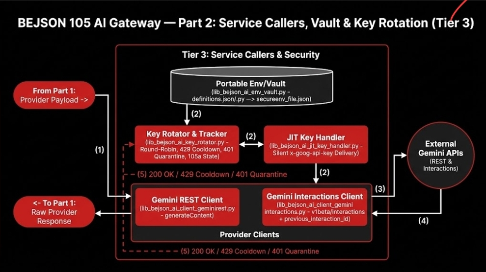

# `Lib_PY/AI` — BEJSON 105 Multi-AI Provider Gateway (`v1.5.0`)

3-tier implementation of the `lib_bejson_ai_*` architecture featuring **Gemini REST** (`geminirest`), **Gemini Interactions** (`geminiinteractions`), a persistent **Global AI Config** (`config/ai_global_config.105a.bejson`), a **Config-Gated Tooling Abstraction Layer** (`interactions_tools`), a **Modular Parser Abstraction Layer** (`ParserRegistry`), and a **Localized Custom Python Module Extension Parser Layer** (`ExtensionParserRegistry`).


*_Figure 1: BEJSON 105 AI Gateway — Part 1: Abstraction, Tooling & Parser Layers (Tiers 1 & 2)_*


*_Figure 2: BEJSON 105 AI Gateway — Part 2: Service Callers, Vault & Key Rotation (Tier 3)_*

- See [ARCHITECTURE.md](./ARCHITECTURE.md) for the complete 3-tier architecture and pipeline flow.
- See [ARCHITECTURE_MAP.md](./ARCHITECTURE_MAP.md) for the art specialist node-and-edge specification.
- See [NEXT_STEP_PLAN.md](./NEXT_STEP_PLAN.md) for architectural roadmap and specifications, including the **Planned `v1.6.0` Modular Renderer Post-Processing Abstraction Layer** (`Renderer_Registry` / `Base_Renderer`, placed immediately after `AIPostprocessor.process()` for custom rendering of parsed content into HTML/CMS, SVG/Canvas, or ANSI/Standards outputs).

## Implemented Module Map (`v1.5.0`)

- **Error Registry (`200–235`)**: `lib_bejson_AI_bejson_errors.py`
- **Tier 1 — Abstraction Layers**:
  - `lib_bejson_ai_dispatcher.py` (`AIDispatcher`, `AI_Dispatch`, `AI_Dispatch_Async`, `Get_Response_Text`, `Get_Response_JSON`, `Get_Response_Usage`, `Get_Interaction_ID`, `Get_Tool_Calls`, `Get_Turn_Continuation_Command`)
  - `lib_bejson_ai_translator.py` (`AITranslator`, `AI_Translator`)
  - `lib_bejson_ai_models.py` (`Name_Case` model constants, `Resolve_Model_Identifier`, `List_Active_Gemini_Models`, `Query_Live_Gemini_Models`)
- **Tier 2 — Model Features, Gates, Tooling & Modular Parsers**:
  - `lib_bejson_ai_preprocessor.py` (`AIPreprocessor`)
  - `lib_bejson_ai_postprocessor.py` (`AIPostprocessor`)
  - `lib_bejson_ai_tooling_base.py` (`BaseToolingSystem`, `Base_Tooling_System`)
  - `lib_bejson_ai_tooling_registry.py` (`AIGlobalConfigManager`, `AI_Global_Config_Manager`, `ToolingRegistry`, `Tooling_Registry`)
  - `lib_bejson_ai_tooling_interactions.py` (`InteractionsToolingSystem`, `Interactions_Tooling_System`)
  - `lib_bejson_ai_parser_base.py` (`BaseModularParser`, `Base_Modular_Parser`)
  - `lib_bejson_ai_parser_registry.py` (`ParserRegistry`, `Parser_Registry`)
  - `lib_bejson_ai_extension_parser.py` (`BaseExtensionModuleParser`, `Base_Extension_Module_Parser`, `ExtensionParserRegistry`, `Extension_Parser_Registry`)
  - `lib_bejson_ai_features_common.py`
- **Tier 3 — Service Callers & Security**:
  - `lib_bejson_ai_client_base.py` (`BaseAIClient`, `Base_AI_Client`)
  - `lib_bejson_ai_client_geminirest.py` (`GeminiRestClient`, `Gemini_Rest_Client`)
  - `lib_bejson_ai_client_geminiinteractions.py` (`GeminiInteractionsClient`, `Gemini_Interactions_Client`)
  - `lib_bejson_ai_env_vault.py` (`AIEnvVault` — Policy §5.3.3 dynamic path/vault loader)
  - `lib_bejson_ai_key_rotator.py` (`KeyRotator`)
  - `lib_bejson_ai_jit_key_handler.py` (`JITKeyHandler`)

## Running Tests

```bash
python3 -m unittest discover -s Lib_PY/AI/tests -v
```
