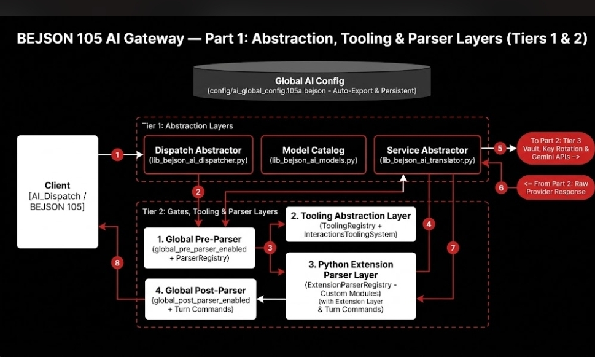
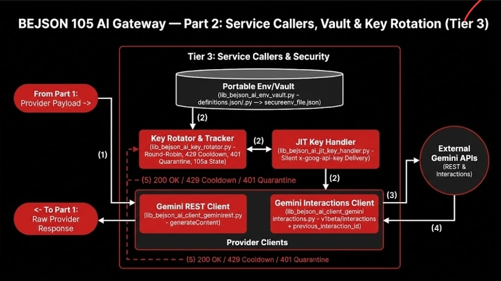
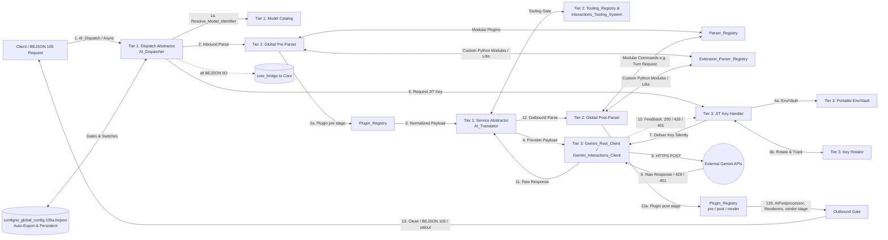

# Hardened AI API Gateway Architecture (`v2.1.0` — Core bridge, plugins, profiles, validator)

## Implemented Architecture (`v2.1.0`)
- **Global Persistent Config (`config/ai_global_config.105a.bejson`)**: Auto-exported on first use via `AIGlobalConfigManager` (`AI_Global_Config_Manager`); persistently stores `plugins_enabled`, `tooling_enabled`, `active_tooling_system`, `default_provider`, `default_model`, `max_tool_roundtrips`, `stdout_routing`, `global_pre_parser_enabled`, `global_post_parser_enabled`, and `extension_parser_enabled`, `renderer_enabled`, `active_renderer`.
- **Tier 1:** `AIDispatcher` (`AI_Dispatcher`), `AITranslator` (`AI_Translator`), and `lib_bejson_AI_Core_models.py` (`Resolve_Model_Identifier`, `ACTIVE_TEXT_MODELS_REGISTRY`).
- **Tier 2:** `AIPreprocessor`, `AIPostprocessor`, `ToolingRegistry` (`Tooling_Registry` + `Base_Tooling_System` + `Interactions_Tooling_System`), `ParserRegistry` (`Parser_Registry` + `Base_Modular_Parser`), `ExtensionParserRegistry` (`Extension_Parser_Registry` + `Base_Extension_Module_Parser`), and `lib_bejson_AI_Core_features_common.py`.
- **Tier 3:** `AIEnvVault`, `KeyRotator`, `JITKeyHandler`, `GeminiRestClient` (`Gemini_Rest_Client`), and `GeminiInteractionsClient` (`Gemini_Interactions_Client`).

## Core bridge (single data layer)
`lib_bejson_AI_Core_core_bridge.py` is the only AI_Core module that imports `lib_bejson_Core_*`. Everything that touches a BEJSON file (global config, key-rotator state, 105 `AI_Response` envelopes, profiles, plugin manifests, freeze manifest) calls `core_load`, `core_save` (validate, then atomic write), `core_new_document`, `core_add_record`, `core_write_cell`, `core_field_map`, `core_rows_as_dicts` or `core_quarantine` (a corrupt file is renamed to `.corrupt-<stamp>`, never deleted). 105 records use implicit `record_uuid`; it is not a declared field.

## Plugin layer (`plugin_schema` / `plugin_base` / `plugin_registry`)
Three stages, run by `AIDispatcher` through `PluginRegistry.run_stage`, all behind the persistent `plugins_enabled` gate (default off; off means a no-op):
1. **`pre`** — after `AIPreprocessor`, modular pre-parsers and extension pre-parsers, before the tooling gate.
2. **`post`** — after modular and extension post-parsers, before `AIPostprocessor`.
3. **`render`** — after `AIPostprocessor` and `RendererRegistry`, before stdout routing / 105 envelope.

Order is `priority` then `plugin_id`. A plugin that raises is logged and skipped. Discovery reads `extension.105a.bejson` manifests, only from the trusted `Lib_PY/AI_Extensions` directory (or `BEJSON_AI_EXTENSIONS_DIR`) unless `allow_external_directory=True`, and skips any module whose SHA-256 differs from the manifest pin.

## Profiles (`profiles`)
AI Profile 1.0 (22 fields) and 2.0 (31) as Format 105 documents; optional `Parser_Language`, `Parser`, `Renderer` columns; `ai_profiles_embedded_fingerprint` hashes language + parser + renderer. The `Mode` column is forbidden. A global switch (`ai_profiles_set_affective_features_disabled`) nulls the temper/irritation/pleasure fields so the compiler omits those blocks. Execution, compilation and abstraction of profiles live in `AI_Extensions`, gated by approved fingerprints.

## Governance (`validator`)
Static family rules (see README) plus a SHA-256 freeze manifest (`freeze_manifest_write/verify/verify_or_raise`; changed, missing and unpinned files are reported; mismatch raises error 226). AI_Core is not frozen yet. Error block: `200–249` (236–244 plugins, 246–248 profiles; 245 unused).

## Config-Gated Tier 2 Abstraction Layers (`v1.6.0`)
Sitting alongside `Tooling_Registry` in Tier 2, governed by persistent switches in `config/ai_global_config.105a.bejson`:
1. **Modular Parser Abstraction Layer (`Parser_Registry` + `Base_Modular_Parser`)**:
   - Config-gated via `global_pre_parser_enabled` / `global_post_parser_enabled`.
   - Allows attaching modular parsers (such as an AI command parser that detects `<request_turn>` to populate `_ai_turn_continuation_command` via `Get_Turn_Continuation_Command`) without modifying core code.
2. **Localized Custom Python Module / Library Extension Parser Layer (`Extension_Parser_Registry` + `Base_Extension_Module_Parser`)**:
   - Config-gated via `extension_parser_enabled`, `renderer_enabled`, `active_renderer`; sits next to `Tooling_Registry` and `Parser_Registry` as an abstraction layer so custom Python modules and downstream extension libraries can attach localized pre/post parsers through the global parser pipeline.

## Pipeline Diagram

