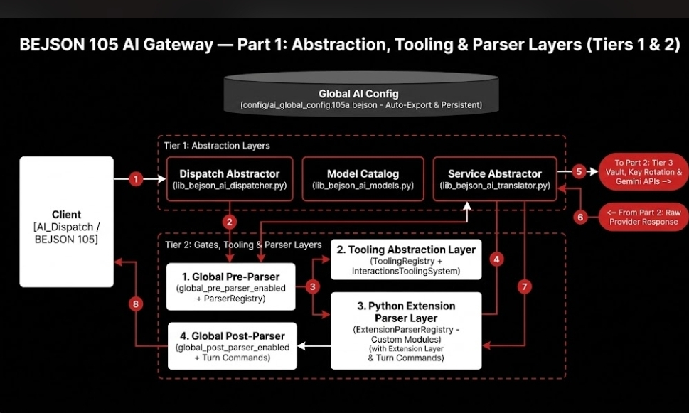
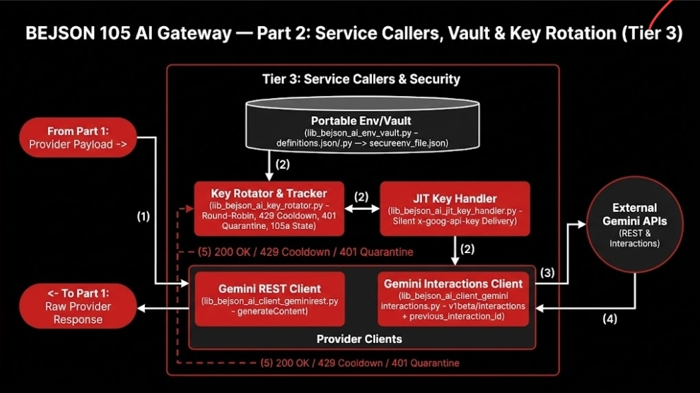

# `Lib_PY/AI_Core` — BEJSON 105 Multi-AI Provider Gateway (`v2.1.0`, Release 301)

3-tier implementation of the `lib_bejson_AI_Core_*` architecture featuring **Gemini REST** (`geminirest`), **Gemini Interactions** (`geminiinteractions`), a persistent **Global AI Config** (`config/ai_global_config.105a.bejson`), a **Config-Gated Tooling Abstraction Layer** (`interactions_tools`), a **Plugin Subsystem** (`PluginRegistry`), a **Modular Parser Abstraction Layer** (`ParserRegistry`), and **BEJSON 105 Profiles** (`lib_bejson_AI_Core_profiles.py`). Extension plugins and runtimes are isolated in sibling family `Lib_PY/AI_Extensions`.


*_Figure 1: BEJSON 105 AI Gateway — Part 1: Abstraction, Tooling & Parser Layers (Tiers 1 & 2)_*


*_Figure 2: BEJSON 105 AI Gateway — Part 2: Service Callers, Vault & Key Rotation (Tier 3)_*

- See [ARCHITECTURE.md](./ARCHITECTURE.md) for the complete 3-tier architecture and pipeline flow.
- See [ARCHITECTURE_MAP.md](./ARCHITECTURE_MAP.md) for the art specialist node-and-edge specification.
- See [NEXT_STEP_PLAN.md](./NEXT_STEP_PLAN.md) for architectural roadmap and specifications, including the **Implemented `v1.6.0` Modular Renderer Post-Processing Abstraction Layer** (`RendererRegistry` / `BaseRenderer`, placed immediately after `AIPostprocessor.process()`; see [docs/MODULAR_PARSER_AND_RENDERER_GUIDE.md](./docs/MODULAR_PARSER_AND_RENDERER_GUIDE.md)).

## Implemented Module Map (`v2.0.0`)

- **Error Registry (`200–249`)**: `lib_bejson_AI_Core_errors.py`
- **Core Bridge & Architecture Guards**:
  - `lib_bejson_AI_Core_core_bridge.py` (sole authorized BEJSON read/write data layer for AI_Core)
  - `lib_bejson_AI_Core_validator.py` (AST & architectural compliance validator)
- **Profiles Subsystem**:
  - `lib_bejson_AI_Core_profiles.py` (BEJSON 105 AI profile creation, validation, update, and non-destructive 104->105 conversion)
- **Plugin Subsystem**:
  - `lib_bejson_AI_Core_plugin_base.py` (`BaseAIPlugin`)
  - `lib_bejson_AI_Core_plugin_schema.py` (`PluginManifest`)
  - `lib_bejson_AI_Core_plugin_registry.py` (`PluginRegistry`)
- **Tier 1 — Abstraction Layers**:
  - `lib_bejson_AI_Core_dispatcher.py` (`AIDispatcher`, `AI_Dispatch`, `AI_Dispatch_Async`, `Get_Response_Text`, `Get_Response_JSON`, `Get_Response_Usage`, `Get_Interaction_ID`, `Get_Tool_Calls`, `Get_Turn_Continuation_Command`)
  - `lib_bejson_AI_Core_translator.py` (`AITranslator`, `AI_Translator`)
  - `lib_bejson_AI_Core_models.py` (`Name_Case` model constants, `Resolve_Model_Identifier`, `List_Active_Gemini_Models`, `Query_Live_Gemini_Models`)
- **Tier 2 — Model Features, Gates, Tooling & Modular Parsers**:
  - `lib_bejson_AI_Core_preprocessor.py` (`AIPreprocessor`)
  - `lib_bejson_AI_Core_postprocessor.py` (`AIPostprocessor`)
  - `lib_bejson_AI_Core_tooling_base.py` (`BaseToolingSystem`, `Base_Tooling_System`)
  - `lib_bejson_AI_Core_tooling_registry.py` (`AIGlobalConfigManager`, `AI_Global_Config_Manager`, `ToolingRegistry`, `Tooling_Registry`)
  - `lib_bejson_AI_Core_tooling_interactions.py` (`InteractionsToolingSystem`, `Interactions_Tooling_System`)
  - `lib_bejson_AI_Core_parser_base.py` (`BaseModularParser`, `Base_Modular_Parser`)
  - `lib_bejson_AI_Core_parser_registry.py` (`ParserRegistry`, `Parser_Registry`)
  - `lib_bejson_AI_Core_extension_parser.py` (`BaseExtensionModuleParser`, `Base_Extension_Module_Parser`, `ExtensionParserRegistry`, `Extension_Parser_Registry`)
  - `lib_bejson_AI_Core_renderer_base.py` (`BaseRenderer`, `Base_Renderer`)
  - `lib_bejson_AI_Core_renderer_registry.py` (`RendererRegistry`, `Renderer_Registry`)
  - `lib_bejson_AI_Core_features_common.py`
- **Tier 3 — Service Callers & Security**:
  - `lib_bejson_AI_Core_client_base.py` (`BaseAIClient`, `Base_AI_Client`)
  - `lib_bejson_AI_Core_client_geminirest.py` (`GeminiRestClient`, `Gemini_Rest_Client`)
  - `lib_bejson_AI_Core_client_geminiinteractions.py` (`GeminiInteractionsClient`, `Gemini_Interactions_Client`)
  - `lib_bejson_AI_Core_env_vault.py` (`AIEnvVault` — Policy §5.3.3 dynamic path/vault loader)
  - `lib_bejson_AI_Core_key_rotator.py` (`KeyRotator`)
  - `lib_bejson_AI_Core_jit_key_handler.py` (`JITKeyHandler`)

## Release 301 (`v2.1.0`): geminirest carries tools

Additive change so a caller that runs tools itself (for example Modern_Agent_Design) can use `geminirest`:

- **Outbound:** `tool_declarations` (`name`, `description`, `parameters`) become Gemini `functionDeclarations`. Messages may carry `tool_calls` and `wire_parts` (echoed verbatim, thought signatures included). `role: "tool"` messages become `functionResponse` parts, and consecutive results share one user content. The generic Interactions-shaped `tools` key is never forwarded to `geminirest`.
- **Inbound:** `functionCall` parts are returned as `tool_calls` (`id`, `name`, `arguments`) together with the candidate's parts as `wire_parts`. A malformed `functionCall` raises `ERR_AI_TRANSLATION_FAILED`. Text-only responses are unchanged (no new keys).
- **`AIPostprocessor`:** a turn with `tool_calls` may have empty text.
- **`AIDispatcher.dispatch` / `dispatch_async`:** new `tool_loop_enabled=True`. Pass `False` when the caller executes tools itself: AI_Core then neither injects tools nor runs its internal tool loop. Without this switch a `geminirest` response containing a call would be executed by an active tooling system.

## Remediation Log (`v2.0.0`)

Renamed family from `AI` to `AI_Core` with zero-violation validator gate, Core bridge encapsulation, plugin architecture, and sibling `AI_Extensions` family. Rules for future changes: [AGENTS.md](./AGENTS.md).

## Quickstart (run and verified 2026-11-20)

```python
import sys
from pathlib import Path
from tempfile import TemporaryDirectory

LIB_PY = Path("libraries_105/Lib_PY")          # adjust to your libraries_105 location
sys.path[:0] = [str(LIB_PY / "AI_Core"), str(LIB_PY / "AI_Extensions")]

from lib_bejson_AI_Core_dispatcher import AI_Dispatcher
from lib_bejson_AI_Core_extension_parser import ExtensionParserRegistry
from lib_bejson_AI_Core_models import Gemini_3_1_Flash_Lite, Resolve_Model_Identifier
from lib_bejson_AI_Core_parser_registry import ParserRegistry
from lib_bejson_AI_Core_plugin_registry import PluginRegistry
from lib_bejson_AI_Core_tooling_registry import AIGlobalConfigManager, ToolingRegistry
import lib_bejson_AI_Core_profiles as profiles
import lib_bejson_AI_Extensions_profile_compiler as compiler

with TemporaryDirectory() as tmp:
    config = AIGlobalConfigManager(Path(tmp) / "ai_global_config.105a.bejson")
    tooling = ToolingRegistry(config_manager_instance=config)
    dispatcher = AI_Dispatcher(
        tooling_registry=tooling,
        parser_registry=ParserRegistry(config_manager_instance=config),
        extension_parser_registry=ExtensionParserRegistry(config_manager_instance=config),
    )
    plugins = PluginRegistry(config)
    print("model:", Resolve_Model_Identifier(Gemini_3_1_Flash_Lite))
    print("plugins:", plugins.discover_plugins())          # trusted AI_Extensions dir only
    plugins.set_enabled(True)

profile = profiles.ai_profiles_create("Ada", "Auditor", "Dry and exact.", "Be precise.", v2=True, Job="Auditor")
print(compiler.compiler_compile_profile(profile).splitlines()[0])
```

Modules are imported flat (the family directory goes on `sys.path`); `AI_Core` is not a dotted package.

## Profiles in one paragraph

`ai_profiles_create(..., v2=True)` builds a 105 profile; `ai_profiles_validate` / `ai_profiles_problems` check it (the `Mode` column is forbidden); `ai_profiles_convert_104_to_105` / `ai_profiles_convert_file` convert 104 profiles **without touching the source** (never in place); `ai_profiles_save` / `ai_profiles_load` go through the bridge. `ai_profiles_set_affective_features_disabled(True)` nulls temper/irritation/pleasure fields globally. Compiling a Profile 2.0 row into a system instruction, adapting it for on-device models, and running embedded parsers are in `AI_Extensions`. Embedded code only runs after its SHA-256 fingerprint is on an approved list.

## Rules that are enforced (validator `2.1.0`)

Naming `lib_bejson_AI_Core_<module>.py`; header fields incl. `Release_Version`; `VERSION` matches header; no `print()`; no absolute paths; no API key in a URL; stdlib-only imports; Core only via the bridge; no raw `open(..., "w")` / `json.load` on BEJSON; logger present where exceptions are caught. A line may opt out with `# ai-core: allow <rule> -- <reason>` (reason mandatory; used once, in `profile_runtime`). The freeze manifest (`freeze_manifest_write/verify`) exists but **AI_Core is not frozen yet**.

## Extension Plugins Outside `AI_Extensions`

**Can any script or tool act as an extension plugin outside `AI_Extensions`?**

**Yes.** Any Python script, CLI tool, or external repository can implement and run as an AI extension plugin or parser in one of three ways:

### 1. Direct In-Memory Registration (Programmatic)
Any external script can subclass `BasePlugin` (or `Base_Plugin`) from `lib_bejson_AI_Core_plugin_base.py`, implement `process(payload) -> payload`, and register the instance directly into `PluginRegistry`:
```python
from lib_bejson_AI_Core_plugin_base import BasePlugin
from lib_bejson_AI_Core_plugin_registry import PluginRegistry

class MyCustomToolPlugin(BasePlugin):
    plugin_id = "my_custom_tool"
    stage = "post"  # "pre" | "post" | "render"

    def process(self, payload: dict) -> dict:
        # Inspect or transform payload in-place
        return payload

registry = PluginRegistry()
registry.register_plugin(MyCustomToolPlugin(), priority=50)
```
This bypasses file scanning and requires no manifest, allowing any script to hook directly into the AI pipeline.

### 2. External Directory Manifest Discovery
Any folder outside `Lib_PY/AI_Extensions` can serve as a plugin directory if it contains an `extension.105a.bejson` manifest conforming to `PluginManifest`:
```python
registry = PluginRegistry()
# allow_external_directory=True is required for any path outside the trusted root
registered_ids = registry.discover_plugins(
    directory=Path("/path/to/my_tool_plugins"),
    allow_external_directory=True,
)
```
- **Trust Boundary Policy**: Because discovering a plugin imports and executes Python code, passing an external directory without `allow_external_directory=True` raises `AIException(ERR_AI_PLUGIN_UNTRUSTED_DIRECTORY)` (Error code `242`).
- **Integrity Pinning**: Manifests may specify `module_sha256` to ensure external scripts cannot be altered without detection.

### 3. Environment Variable Override (`BEJSON_AI_EXTENSIONS_DIR`)
Setting the environment variable:
```bash
export BEJSON_AI_EXTENSIONS_DIR="/path/to/my_custom_plugins"
```
replaces the default sibling `AI_Extensions` folder as the primary trusted root. `PluginRegistry.discover_plugins()` will scan this folder directly without needing `allow_external_directory=True`.

### 4. Downstream Extension Parsers (`ExtensionParserRegistry`)
External scripts can also attach domain-specific AST or text parsers into the pre/post pipeline via `ExtensionParserRegistry` by subclassing `BaseExtensionModuleParser` from `lib_bejson_AI_Core_extension_parser.py`.

## Running Tests

```bash
python3 -m unittest discover -s Lib_PY/AI_Core/tests -v        # 107 tests
python3 -m unittest discover -s Lib_PY/AI_Extensions/tests -v  # 21 tests
```
