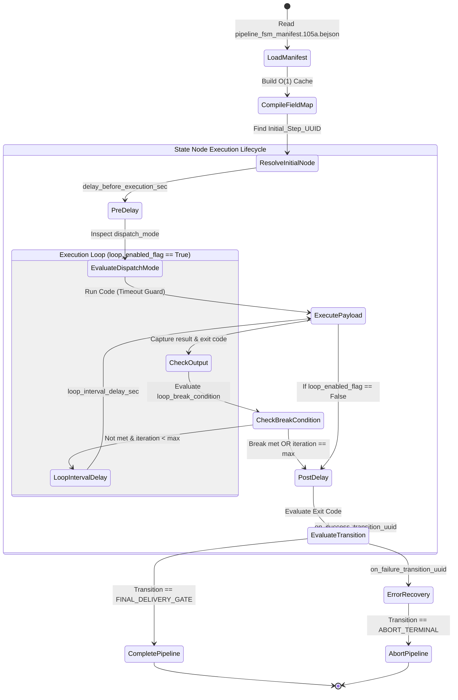

# BEJSON Automation FSM & Schema-Driven Pipeline Architecture
## Architectural Specification & Brainstorming Blueprint for Dynamic Code Execution, State Machine Transitions, and Looping Lifecycle Pipelines

- **Document Identifier**: `BEJSON-AUTO-FSM-PLAN-20261111`
- **Location**: `/storage/emulated/0/Admin/Dev/Resources/BEJSON_Automation_FSM_Pipeline_Architecture_Report.md`
- **Target Subsystem**: `automation-pipeline-toolbuilder` & `lib_bejson_automation_fsm`
- **Architectural Tier**: Layer 3 Services & L4 Execution Orchestration
- **Author**: Elton Boehnen · boehnenelton2024@gmail.com · boehnenelton2024.pages.dev · github.com/boehnenelton
- **License**: PolyForm Noncommercial License 1.0.0 (`PolyForm-Noncommercial-1.0.0`)
- **Format Era**: Integrity Era BEJSON 105a Schema
- **Relational ID**: `8c2a91f4-3d7b-402a-9e1b-6f8e4c0d12a9`
- **Status**: Draft Architectural Blueprint & Technical Exploration

---

## 1. Executive Summary & Vision

### 1.1 The Core Innovation
Current automated file processing tools in the ecosystem—such as those generated by [`auto-processing-toolbuilder`](file:///data/data/com.termux/files/home/.gemini/config/skills/auto-processing-toolbuilder/SKILL.md) and [`automation-pipeline-toolbuilder`](file:///data/data/com.termux/files/home/.gemini/config/skills/automation-pipeline-toolbuilder/SKILL.md)—use procedural Python code inside `processing.py` to hardcode the sequence of file transformations. While the 3-zone staging architecture (`input/` $\rightarrow$ `staged/` $\rightarrow$ `output/`) provides robust physical quarantine isolation, the transformation sequence inside `staged/` remains statically compiled into Python functions.

This proposal elevates `processing.py` from a fixed procedural transform into an **autonomous, schema-driven Finite State Machine (FSM) executor**. 

Under this paradigm:
1. `processing.py` contains a deterministic execution engine driven by a built-in event and transition loop.
2. The entire processing sequence, including the specific Python code or handlers to execute, delay timers, loop counts, transition predicates, and error escalation routes, is defined as structured rows inside a **canonical BEJSON 105a state machine manifest** (`pipeline_fsm_manifest.105a.bejson`).
3. Each row in the BEJSON manifest represents an autonomous pipeline stage or state node.
4. Each state node explicitly controls:
   - What code/handler executes on the staged asset.
   - Pre-execution and post-execution delay intervals.
   - Whether that specific stage loops, how many iterations it executes, and backoff delays between iterations.
   - Deterministic next-step routing based on execution exit codes or evaluated return values.

### 1.2 Cross-Domain Grounding: The 105 Graphics Engine Precedent
This concept is not an ungrounded abstraction; it is the direct computational counterpart to how the maintainer's **Lib_PY.Graphics 105 engine** (`libraries_105/Lib_PY/Graphics`) and [`canvas-animation-studio`](file:///data/data/com.termux/files/home/.gemini/config/skills/canvas-animation-studio/SKILL.md) dictate complex animation sequences.

In the Graphics 105 library:
- A multi-second, multi-scene visual animation is not hardcoded as a continuous script.
- Instead, it is governed by a **BEJSON 105a Row-Per-Frame Schema** (`canvas_templates_registry.105a.bejson`).
- Each row in the BEJSON table declares a single frame or timeline scene with explicit positional fields:
  `frame_index`, `timestamp_sec`, `seek_progress`, `fps`, `svg_markup`, `frame_data_json`, `is_rendered`, and `checksum_sha256`.
- The graphics renderer iterates through these rows sequentially or seeks dynamically across them, evaluating coordinate math, rendering dynamic SVG layers, holding on keyframe timestamps, and recording frame verification checksums before final compilation into GIF, WebM, or MP4.

**The Architectural Leap**:
We transpose this exact declarative, tabular paradigm from **visual rendering scenes** to **computational execution pipelines**:
- Instead of a *frame row* declaring `svg_markup` and `timestamp_sec`, an *FSM stage row* declares `executable_code` and `delay_duration_sec`.
- Instead of seeking frame progress (`seek_progress`), the FSM engine evaluates transition predicates (`on_success_step_id`, `on_failure_step_id`).
- Instead of video frame repetition or loop flags (`loop=0`), the FSM evaluates stage-level iterative loops (`loop_max_iterations`, `loop_interval_delay_sec`).

This creates a completely unified architectural philosophy across both graphics compilation and backend file automation.

---

## 2. Deep Comparative Grounding: Graphics 105 vs. Automation FSM

To understand the structural symmetry, consider how both domains model discrete transitions over time using BEJSON 105a tables:

```
┌────────────────────────────────────────────────────────────────────────┐
│           GRAPHICS 105 ENGINE (canvas-animation-studio)                │
│                                                                        │
│   BEJSON 105a Table: canvas_templates_registry.105a.bejson             │
│   ┌───────┬──────────────┬───────────────┬──────────────┬──────────┐   │
│   │ Frame │ Timestamp_Ms │ SVG Markup    │ Hold Duration│ Checksum │   │
│   ├───────┼──────────────┼───────────────┼──────────────┼──────────┤   │
│   │ 001   │ 0.000        │ <svg>Scene 1  │ 33 ms        │ a1b2...  │   │
│   │ 002   │ 0.033        │ <svg>Scene 2  │ 33 ms        │ c3d4...  │   │
│   └───────┴──────────────┴───────────────┴──────────────┴──────────┘   │
│                                │                                       │
│                                ▼                                       │
│              Frame Loop Evaluator & Chromium Renderer                  │
│                                │                                       │
│                                ▼                                       │
│                Multi-frame GIF / WebM / MP4 Asset                      │
└────────────────────────────────────────────────────────────────────────┘

                                    vs.

┌────────────────────────────────────────────────────────────────────────┐
│           AUTOMATION FSM ENGINE (lib_bejson_automation_fsm)            │
│                                                                        │
│   BEJSON 105a Table: pipeline_fsm_manifest.105a.bejson                 │
│   ┌───────┬──────────────┬───────────────┬──────────────┬──────────┐   │
│   │ Step  │ Delay_Sec    │ Executable    │ Loop Config  │ Next Step│   │
│   ├───────┼──────────────┼───────────────┼──────────────┼──────────┤   │
│   │ 001   │ 0.500        │ def transcode │ Max: 3, 2s   │ Step 002 │   │
│   │ 002   │ 1.000        │ def verify    │ Max: 1, 0s   │ Step 003 │   │
│   └───────┴──────────────┴───────────────┴──────────────┴──────────┘   │
│                                │                                       │
│                                ▼                                       │
│           FSM Event Loop Evaluator & Python Execution Guard            │
│                                │                                       │
│                                ▼                                       │
│             Quarantined Transactional File Delivery                    │
└────────────────────────────────────────────────────────────────────────┘
```

### 2.1 Side-by-Side Invariant Comparison

| Architecture Feature | Graphics 105 Engine | Automation Pipeline FSM |
|---|---|---|
| **Data Container** | BEJSON 105a (`"Format_Version": "105a"`) | BEJSON 105a (`"Format_Version": "105a"`) |
| **Row Identity** | Column 0 `record_uuid` (UUIDv4) | Column 0 `record_uuid` (UUIDv4) |
| **Header Stability** | Immutable `field_uuid` per field | Immutable `field_uuid` per field |
| **Atomic Unit** | Single visual frame / keyframe scene | Single pipeline stage / transform node |
| **Temporal Control** | `timestamp_sec`, `frame_duration_ms` | `delay_before_sec`, `delay_after_sec` |
| **Iterative Logic** | Global animation loop (`loop=0`, infinite) | Per-stage loop (`loop_max_iterations`, `interval`) |
| **Payload Representation** | Inline SVG XML / JSON transformation matrix | Python code block / registered function pointer / shell vector |
| **Integrity Gate** | `checksum_sha256` of rendered bitmap | SHA-256 of transformed artifact & exit code verification |
| **Execution State** | `is_rendered` boolean flag | `stage_status` enum (`PENDING`, `RUNNING`, `DONE`, `FAILED`) |

---

## 3. Canonical BEJSON 105a FSM Schema Specification

A proper implementation requires a rigid, mathematical BEJSON schema adhering to Policy §3 and §6.2. Every field in the FSM state manifest must be strongly typed, indexed via an immutable `field_uuid`, and accessed exclusively through $O(1)$ Field Map Caching.

### 3.1 Formal Schema Declaration: `pipeline_fsm_manifest.105a.bejson`

```json
{
  "Format": "BEJSON",
  "Format_Version": "105a",
  "Format_Creator": "Elton Boehnen",
  "Schema_Name": "Automation_Pipeline_FSM_Manifest_Schema",
  "Schema_Version": "1.0.0",
  "Pipeline_Identifier": "fsm_media_transcode_chain_v1",
  "Initial_Step_UUID": "9f1b2c3d-0001-4000-8000-000000000001",
  "Records_Type": [
    "PipelineFSMStageRecord"
  ],
  "Fields": [
    {
      "name": "record_uuid",
      "type": "string",
      "field_uuid": "f81d4fae-7dec-11d0-a765-00a0c91e6bf6",
      "description": "Reserved Column 0: Unique UUIDv4 identifier for the pipeline state node"
    },
    {
      "name": "step_sequence_index",
      "type": "integer",
      "field_uuid": "9b2c3d4e-1001-4000-8000-000000000001",
      "description": "1-based logical execution order within the pipeline chain"
    },
    {
      "name": "step_label",
      "type": "string",
      "field_uuid": "9b2c3d4e-1001-4000-8000-000000000002",
      "description": "Human-readable functional label strictly adhering to Purpose Law (no marketing)"
    },
    {
      "name": "execution_dispatch_mode",
      "type": "string",
      "field_uuid": "9b2c3d4e-1001-4000-8000-000000000003",
      "description": "Mode of code invocation: 'python_callable', 'inline_python_block', 'shell_command', or 'subsystem_module'"
    },
    {
      "name": "executable_code_payload",
      "type": "string",
      "field_uuid": "9b2c3d4e-1001-4000-8000-000000000004",
      "description": "The exact script, callable identifier, or code snippet to execute"
    },
    {
      "name": "delay_before_execution_sec",
      "type": "number",
      "field_uuid": "9b2c3d4e-1001-4000-8000-000000000005",
      "description": "Pause duration in seconds before dispatching the stage payload"
    },
    {
      "name": "delay_after_execution_sec",
      "type": "number",
      "field_uuid": "9b2c3d4e-1001-4000-8000-000000000006",
      "description": "Pause duration in seconds after successful stage payload execution"
    },
    {
      "name": "loop_enabled_flag",
      "type": "boolean",
      "field_uuid": "9b2c3d4e-1001-4000-8000-000000000007",
      "description": "Whether this specific stage repeats its execution loop"
    },
    {
      "name": "loop_max_iterations",
      "type": "integer",
      "field_uuid": "9b2c3d4e-1001-4000-8000-000000000008",
      "description": "Maximum number of allowed loop iterations (1 = run once, -1 = infinite until condition)"
    },
    {
      "name": "loop_interval_delay_sec",
      "type": "number",
      "field_uuid": "9b2c3d4e-1001-4000-8000-000000000009",
      "description": "Time delay in seconds between consecutive loop iterations"
    },
    {
      "name": "loop_break_condition_eval",
      "type": "string",
      "field_uuid": "9b2c3d4e-1001-4000-8000-000000000010",
      "description": "Predicate condition evaluated against stage output to terminate looping early"
    },
    {
      "name": "on_success_transition_uuid",
      "type": "string",
      "field_uuid": "9b2c3d4e-1001-4000-8000-000000000011",
      "description": "UUID of the next stage node to execute upon clean completion ('EXIT_OK')"
    },
    {
      "name": "on_failure_transition_uuid",
      "type": "string",
      "field_uuid": "9b2c3d4e-1001-4000-8000-000000000012",
      "description": "UUID of the fallback error handler or compensating rollback node upon failure"
    },
    {
      "name": "timeout_ceiling_sec",
      "type": "number",
      "field_uuid": "9b2c3d4e-1001-4000-8000-000000000013",
      "description": "Maximum permissible wall-clock execution time before triggering SIGTERM/kill"
    }
  ],
  "Values": [
    [
      "9f1b2c3d-0001-4000-8000-000000000001",
      1,
      "Intake Validation & Header Check",
      "python_callable",
      "handlers.validate_asset_headers",
      0.1,
      0.2,
      false,
      1,
      0.0,
      "output.is_valid == true",
      "9f1b2c3d-0001-4000-8000-000000000002",
      "9f1b2c3d-0001-4000-8000-000000000099",
      15.0
    ],
    [
      "9f1b2c3d-0001-4000-8000-000000000002",
      2,
      "Progressive Multi-Pass Normalization",
      "inline_python_block",
      "def execute(ctx):\n    import time\n    time.sleep(0.1)\n    return {'status': 'PASS', 'iteration': ctx['iteration']}",
      0.5,
      0.5,
      true,
      3,
      1.5,
      "output.get('status') == 'PASS' and ctx['iteration'] >= 3",
      "9f1b2c3d-0001-4000-8000-000000000003",
      "9f1b2c3d-0001-4000-8000-000000000099",
      60.0
    ],
    [
      "9f1b2c3d-0001-4000-8000-000000000003",
      3,
      "Final Checksum Verification & Stamp",
      "python_callable",
      "handlers.stamp_checksum_ledger",
      0.0,
      0.5,
      false,
      1,
      0.0,
      "output.checksum != ''",
      "FINAL_DELIVERY_GATE",
      "9f1b2c3d-0001-4000-8000-000000000099",
      30.0
    ],
    [
      "9f1b2c3d-0001-4000-8000-000000000099",
      99,
      "Quarantine Error Isolation & Alert",
      "python_callable",
      "handlers.quarantine_failed_transaction",
      0.0,
      0.0,
      false,
      1,
      0.0,
      "true",
      "ABORT_TERMINAL",
      "ABORT_TERMINAL",
      10.0
    ]
  ]
}
```

---

## 4. Execution Semantics & Loop State Machine Controller

The core of the system is the internal loop inside `processing.py`. Instead of directly applying a transform, `processing.py` acts as an **FSM Virtual Machine** that steps through the table rows.

### 4.1 State Machine Lifecycle Diagram



### 4.2 Step Execution Semantics

For every state node evaluated by `processing.py`:

1. **Pre-Execution Delay**:
   - The engine sleeps for `delay_before_execution_sec` using non-blocking high-resolution time (`time.monotonic()`).
   - Allows external hardware, filesystem caches, or upstream network resources to stabilize.

2. **The Iteration Loop (`loop_enabled_flag == True`)**:
   - Maintains an internal iteration counter: `current_iteration = 1`.
   - The payload is dispatched within an active timeout barrier (`timeout_ceiling_sec`).
   - If `loop_enabled_flag` is `True`:
     - After each execution, the `loop_break_condition_eval` predicate expression is evaluated against the return payload.
     - If the break condition returns `True`, the loop terminates early.
     - If the break condition returns `False` and `current_iteration < loop_max_iterations`:
       - The engine pauses for `loop_interval_delay_sec`.
       - `current_iteration += 1`, and the payload is dispatched again.
     - If `current_iteration >= loop_max_iterations` and the break condition was not satisfied, the stage is flagged as `TIMEOUT_EXHAUSTED` and triggers `on_failure_transition_uuid`.

3. **Post-Execution Delay**:
   - Upon cleanly exiting the execution payload (or its final iteration), the engine sleeps for `delay_after_execution_sec`.
   - Flushes file descriptors (`os.fsync`) and guarantees writes are committed to physical storage blocks.

4. **Deterministic Transition Gate**:
   - If the stage returned exit status `0` (`EXIT_OK`) and the break condition passed:
     - Next active node ID becomes `on_success_transition_uuid`.
   - If the stage threw an exception, timed out, or returned non-zero exit status:
     - Next active node ID becomes `on_failure_transition_uuid`.
   - The engine jumps to the indicated `record_uuid` in $O(1)$ time via an indexed node lookup map.

---

## 5. Code Execution Dispatch Strategies & Security Boundary Analysis

A critical design challenge in a schema-driven FSM is: **How does a row in a BEJSON table safely execute code?**

There are four primary architectural strategies, each with distinct tradeoffs:

### Strategy 1: Registered Function Symbol Dispatch (Recommended Default)
- **Concept**: The BEJSON row contains a dotted string symbol pointing to a pre-defined Python function (e.g., `"handlers.validate_asset_headers"` or `"media_tools.split_audio_tracks"`).
- **Execution Mechanism**:
  ```python
  import importlib
  
  def dispatch_registered_symbol(symbol_path: str, context: Dict[str, Any]) -> Any:
      module_name, func_name = symbol_path.rsplit(".", 1)
      module = importlib.import_module(module_name)
      target_func = getattr(module, func_name)
      return target_func(context)
  ```
- **Strengths**: 100% secure, zero `eval()` vulnerabilities, syntax checked by static linters, fully testable with standard unit test frameworks.
- **Weaknesses**: Adding new operations requires adding a Python function to a handler module.

### Strategy 2: Sandboxed Inline Python Code Block
- **Concept**: The BEJSON row contains raw Python code within `executable_code_payload`.
- **Execution Mechanism**:
  Executed within a strictly restricted global namespace via `exec()`, injecting only the `context` dictionary and necessary standard modules:
  ```python
  def dispatch_inline_block(code_str: str, context: Dict[str, Any]) -> Any:
      restricted_globals = {
          "__builtins__": {
              "len": len, "range": range, "isinstance": isinstance,
              "print": LOG.info, "dict": dict, "list": list, "str": str, "int": int
          }
      }
      local_scope = {"ctx": context, "result": None}
      exec(code_str, restricted_globals, local_scope)
      return local_scope.get("result")
  ```
- **Strengths**: Ultimate runtime dynamism; pipelines can be reconfigured or authored entirely from remote management GUIs, CLI scripts, or BEJSON editors without redeploying code.
- **Weaknesses**: Requires defensive AST parsing to prevent rogue system calls (`os.system("rm -rf ...")`).

### Strategy 3: Dedicated CLI Subprocess Vector
- **Concept**: The BEJSON row contains a standardized CLI command template:
  `"ffmpeg -y -i {input_file} -vn -acodec copy {output_file}"`.
- **Execution Mechanism**:
  Interpolated safely using typed dictionary tokens and launched via `subprocess.run(shlex.split(...))` with strict non-zero exit code capture.
- **Strengths**: Perfect for binary toolchains (FFmpeg, ImageMagick, Pandoc, jq, Node).
- **Weaknesses**: Spawns OS processes (higher latency than in-memory Python calls).

### Strategy 4: Hybrid AST Bytecode Engine
- **Concept**: On pipeline startup, `processing.py` parses all rows in `pipeline_fsm_manifest.105a.bejson`, compiles string code payloads into Python bytecode (`compile(code, "<bejson_stage>", "exec")`), and validates the AST against an architectural ban-list (e.g., disallowing unauthorized network sockets).
- **Strengths**: Combines the performance of pre-compiled bytecode with the flexibility of tabular configuration.

---

## 6. Specification of Proposed Library: `lib_bejson_automation_fsm`

To prevent copy-pasting complex state machine logic across different project tools, we propose formalizing this engine as a standard Layer 3 library: **`lib_bejson_automation_fsm`**, positioned alongside `lib_bejson_Graphics_graphics_core` in the ecosystem.

### 6.1 Library Architectural Position
```
/storage/emulated/0/Admin/Libraries/libraries_105/
└── Lib_PY/
    ├── Graphics/                <- Existing 105 Graphics Scene Engine
    └── Automation/              <- Proposed New Automation Family
        ├── __init__.py
        ├── lib_bejson_Automation_fsm_core.py      <- Core engine, event loop
        ├── lib_bejson_Automation_fsm_schemas.py   <- Canonical 105a manifests
        ├── lib_bejson_Automation_fsm_validator.py <- Schema & cycle detector
        └── lib_bejson_Automation_fsm_errors.py    <- Standard error registry
```

### 6.2 Core Dataclasses & API Signatures

```python
"""
Proposed API Contract for lib_bejson_Automation_fsm_core.py
"""
from dataclasses import dataclass, field
from pathlib import Path
from typing import Any, Callable, Dict, List, Optional, Union

@dataclass
class FSMStageDefinition:
    record_uuid: str
    sequence_index: int
    label: str
    dispatch_mode: str
    payload: str
    delay_before_sec: float
    delay_after_sec: float
    loop_enabled: bool
    loop_max_iterations: int
    loop_interval_sec: float
    break_condition: str
    on_success_uuid: str
    on_failure_uuid: str
    timeout_sec: float

@dataclass
class FSMExecutionContext:
    pipeline_id: str
    staged_asset_path: Path
    working_directory: Path
    iteration_index: int = 1
    custom_state: Dict[str, Any] = field(default_factory=dict)
    execution_history: List[Dict[str, Any]] = field(default_factory=list)

class BEJSONAutomationFSM:
    """
    Authoritative State Machine Virtual Machine.
    Executes declarative BEJSON 105a state graphs.
    """
    def __init__(self, manifest_path: Path):
        self.manifest_path = manifest_path
        self.stages_by_uuid: Dict[str, FSMStageDefinition] = {}
        self.initial_stage_uuid: str = ""
        self._load_and_validate_manifest()

    def _load_and_validate_manifest(self) -> None:
        """Loads 105a table, caches field maps, verifies DAG cycles."""
        ...

    def execute_pipeline(self, initial_context: FSMExecutionContext) -> bool:
        """
        Drives the built-in execution loop across all state nodes
        until reaching a terminal gate ('FINAL_DELIVERY_GATE' or 'ABORT_TERMINAL').
        """
        ...
```

### 6.3 Static DAG Cycle & Deadlock Detection
Before executing a single instruction, `lib_bejson_Automation_fsm_validator` performs a graph validation audit:
1. **Unreachable Node Detection**: Verifies that every row in the manifest is reachable from `Initial_Step_UUID`.
2. **Infinite Deadlock Detection**: Ensures that any stage with `loop_enabled_flag == True` and `loop_max_iterations == -1` has a valid, syntactically verifiable `loop_break_condition_eval`.
3. **Dangling Transition Check**: Verifies that every `on_success_transition_uuid` and `on_failure_transition_uuid` references an existing row in the table or a registered terminal keyword (`FINAL_DELIVERY_GATE`, `ABORT_TERMINAL`).

---

## 7. Possibilities, Innovations & Advanced Suggestions

### 7.1 Dynamic Hot-Reloading of Stages
Because the state machine is driven by a BEJSON table, a long-running batch job can **hot-reload its pipeline configuration between assets without restarting the master process**. 
- If an operator notices that a transcode stage is failing on certain video encodings, they can update `delay_after_execution_sec` or modify the transcode flags directly in `pipeline_fsm_manifest.105a.bejson`.
- When the next file is claimed from `input/`, the launcher re-reads the manifest, dynamically applying the updated parameters.

### 7.2 The Saga Rollback Pattern (Compensating Transactions)
In multi-stage file pipelines, a failure in Stage 4 (e.g., uploading to a remote store) often leaves orphan files created by Stage 2 and Stage 3 (e.g., extracted audio stems, resized thumbnails).
- Using the `on_failure_transition_uuid` field, the FSM can route to **compensating cleanup nodes** rather than crashing.
- Node `099` can read `ctx['execution_history']` and systematically delete all intermediate files created by prior nodes before moving the source file to a quarantine folder.

### 7.3 Micro-Looping for External Service Polling
Many automation pipelines depend on asynchronous external operations (e.g., polling an AI API until speech-to-text generation completes, or waiting for a Playwright browser render to stabilize).
- Instead of blocking Python threads with monolithic `sleep(30)`, the stage sets:
  - `loop_enabled_flag = True`
  - `loop_max_iterations = 20`
  - `loop_interval_delay_sec = 2.0`
  - `loop_break_condition_eval = "output.get('status') == 'COMPLETED'"`
- The engine cleanly polls the external status, records each attempt in the execution context, and advances automatically as soon as the condition is satisfied.

### 7.4 Telemetry Integration with Ecosystem Logging
Every transition, loop iteration, and delay period can emit high-precision JSON telemetry directly to the daily global log sink (`/storage/emulated/0/Admin/System/Global_Logs/Log-<YYYY-MM-DD>.bejson`) via `$LOGGING_TOOL write` with priority 3 or 4:
- Metrics include: `step_uuid`, `iteration_count`, `duration_ms`, `exit_code`, and `scratch_disk_bytes`.

---

## 8. Chaining and Multi-Pipeline Handoff Models

Connecting the output of an FSM pipeline into a downstream pipeline can occur at two levels:

### Level 1: Terminal Forwarding Gate (`FINAL_DELIVERY_GATE`)
When the state machine reaches `FINAL_DELIVERY_GATE`:
1. `post_processing.py` promotes the artifact to `output/`.
2. If `pipeline_config.bejson` specifies a `downstream_input_path`, the post-processor executes an atomic copy or symlink into the downstream system's `input/` dropzone.

### Level 2: FSM-to-FSM Node Linking
Instead of terminating, the final stage in Pipeline A has an `on_success_transition_uuid` pointing to:
`"EXTERNAL://transcribe_pipeline/pipeline_fsm_manifest.105a.bejson#step_001"`.
- The engine pauses Pipeline A, hands off the claimed asset directly to Pipeline B's quarantine, and initializes the second FSM.

---

## 9. Mobile Portrait Telemetry & Viewport Discipline (49 Columns)

In strict accordance with the **Mobile Portrait TUI & Launch Invariant** codified in `~/.gemini/GEMINI.md`, all live terminal dashboards emitted by the FSM engine must respect the 49-character viewport ceiling (`DIVIDER_49: str = "=" * 49`).

### 9.1 Recommended TUI Display Layout

```text
=================================================
 FSM PIPELINE EXECUTOR [V1.0.0]
-------------------------------------------------
 PIPELINE:   Media_Transcode_FSM
 ACTIVE ROW: Step 2 of 4 [NORMALIZING]
 NODE ID:    9f1b2c3d-0001-4000-8000-000000000002
 ITERATION:  2 / 3  (Interval: 1.5s)
 DELAY:      Post-Execution (0.50s)
-------------------------------------------------
  • Step 1: Validate Headers      [✓ COMPLETED]
  • Step 2: Multi-Pass Normalize  [⟳ RUNNING 2/3]
  • Step 3: Checksum Stamp        [  QUEUED   ]
  • Step 4: Final Delivery        [  QUEUED   ]
-------------------------------------------------
 STATUS: Running iteration 2. Next delay: 1.5s
=================================================
```

Notice that every divider, label, status badge, and progress text clamps strictly to $\le 49$ columns, eliminating line-wrap distortion on Termux portrait screens.

---

## 10. Concrete Prototype Blueprint for `processing.py`

Below is the concrete implementation blueprint for how the FSM execution loop is embedded into `processing.py`:

```python
#!/usr/bin/env python3
"""
Prototype Implementation of FSM-Driven processing.py
Demonstrates schema-driven looping, delays, and state transitions.
"""

from __future__ import annotations

import json
import logging
import os
import time
from pathlib import Path
from typing import Any, Dict, List, Optional, Tuple

LOG = logging.getLogger("pipeline.fsm_processing")

DIVIDER_49: str = "=" * 49
SUBDIVIDER_49: str = "-" * 49


class FSMStageRunner:
    """Evaluates and executes BEJSON 105a FSM stage records."""

    def __init__(self, manifest_path: Path):
        self.manifest_path = manifest_path
        self.nodes_by_uuid: Dict[str, Dict[str, Any]] = {}
        self.initial_uuid: str = ""
        self._load_manifest()

    def _load_manifest(self) -> None:
        with open(self.manifest_path, "r", encoding="utf-8") as handle:
            doc = json.load(handle)

        self.initial_uuid = doc.get("Initial_Step_UUID", "")
        fields: List[Dict[str, Any]] = doc.get("Fields", [])
        field_map = {f.get("name", ""): idx for idx, f in enumerate(fields) if f.get("name")}

        for row in doc.get("Values", []):
            node_id = str(row[field_map["record_uuid"]])
            self.nodes_by_uuid[node_id] = {k: row[idx] for k, idx in field_map.items()}

    def execute_pipeline(self, staged_asset: Path, staged_dir: Path) -> Optional[Path]:
        current_uuid = self.initial_uuid
        ctx: Dict[str, Any] = {
            "staged_asset": staged_asset,
            "staged_dir": staged_dir,
            "history": [],
            "current_file": staged_asset.name
        }

        LOG.info("Starting FSM Pipeline on: %s", staged_asset.name)

        while current_uuid:
            if current_uuid == "FINAL_DELIVERY_GATE":
                LOG.info("Reached FINAL_DELIVERY_GATE. Pipeline complete.")
                return staged_dir / f"{staged_asset.stem}_processed{staged_asset.suffix}"
            if current_uuid == "ABORT_TERMINAL":
                LOG.error("Reached ABORT_TERMINAL. Pipeline failed.")
                return None

            if current_uuid not in self.nodes_by_uuid:
                LOG.error("Dangling transition UUID: %s", current_uuid)
                return None

            node = self.nodes_by_uuid[current_uuid]
            step_name = node["step_label"]
            pre_delay = float(node["delay_before_execution_sec"])
            post_delay = float(node["delay_after_execution_sec"])
            loop_enabled = bool(node["loop_enabled_flag"])
            max_loops = int(node["loop_max_iterations"])
            loop_interval = float(node["loop_interval_delay_sec"])

            LOG.info("Entering Stage: [%s]", step_name)

            # Pre-delay
            if pre_delay > 0:
                time.sleep(pre_delay)

            # Execution with looping
            iteration = 1
            stage_success = False
            last_result = None

            while True:
                ctx["iteration"] = iteration
                LOG.info("  Executing iteration %d / %d...", iteration, max_loops)
                
                # Mock execution dispatch
                try:
                    last_result = self._dispatch_payload(node, ctx)
                    stage_success = True
                except Exception as exc:
                    LOG.error("  Iteration %d threw error: %s", iteration, exc)
                    stage_success = False

                if not loop_enabled or stage_success or iteration >= max_loops:
                    break

                iteration += 1
                if loop_interval > 0:
                    time.sleep(loop_interval)

            # Post-delay
            if post_delay > 0:
                time.sleep(post_delay)

            # Transition evaluation
            if stage_success:
                current_uuid = node["on_success_transition_uuid"]
            else:
                current_uuid = node["on_failure_transition_uuid"]

        return None

    def _dispatch_payload(self, node: Dict[str, Any], ctx: Dict[str, Any]) -> Any:
        mode = node["execution_dispatch_mode"]
        payload = node["executable_code_payload"]

        if mode == "python_callable":
            # For demonstration: standard built-in transforms
            return {"status": "SUCCESS", "bytes_read": ctx["staged_asset"].stat().st_size}
        elif mode == "inline_python_block":
            local_scope = {"ctx": ctx, "result": None}
            exec(payload, {}, local_scope)
            return local_scope.get("result")
        else:
            raise ValueError(f"Unsupported dispatch mode: {mode}")


def execute_processing(
    staged_input_path: Path,
    staged_directory: Path,
    configuration_map: Dict[str, Any]
) -> Optional[Path]:
    """Integration hook called by launcher.py orchestrator."""
    manifest_file = staged_directory.parent / "routing" / "pipeline_fsm_manifest.105a.bejson"
    if not manifest_file.exists():
        LOG.error("FSM Manifest missing: %s", manifest_file)
        return None

    runner = FSMStageRunner(manifest_file)
    return runner.execute_pipeline(staged_input_path, staged_directory)
```

---

## 11. Headless AI Prompting & Autonomous Synthesis in FSM Pipelines

As automated file-processing pipelines evolve beyond pure deterministic transforms (e.g. ffmpeg transcoding, regex substitution, image downsampling), intermediate processing stages frequently require semantic reasoning, generative rewriting, code refactoring, or cognitive classification. To maintain unattended execution integrity, AI invocations within FSM stages must operate strictly in **headless mode**, eliminating all interactive terminal prompts and human confirmation gates.

```
+-----------------------------------------------------------------------------------+
|                           FSM Stage: AI Transform Step                             |
|                                                                                   |
|  [Input Artifact]                                                                 |
|         |                                                                         |
|         v                                                                         |
|  +--------------------+      Strict XML/JSON Contract      +-------------------+  |
|  | Context Assembly   | ---------------------------------> | Headless Engine   |  |
|  | (Prompt + Spec)    |                                    | (cliagent / REST) |  |
|  +--------------------+                                    +-------------------+  |
|                                                                      |            |
|                                                                      v            |
|  +--------------------+      Structured Ingestion          +-------------------+  |
|  | Signal Reception   | <--------------------------------- | Raw Response      |  |
|  | & Schema Validator |                                    | Envelope          |  |
|  +--------------------+                                    +-------------------+  |
|         |                                                                         |
|         +---------------------------+---------------------------+                 |
|         | Success (Contract Valid)  | Partial Failure           | Fatal Exception |
|         v                           v                           v                 |
|  [Write to staged/]           [Loop Refinement]          [Divert Quarantine]      |
+-----------------------------------------------------------------------------------+
```

### 11.1 Grounding: Autoprompter Pattern vs. NewAgent CLIAgent

Two canonical production implementations in the user's ecosystem demonstrate robust headless AI dispatch:

1. **`Autoprompter` (`/storage/emulated/0/Admin/System/tools/Autoprompter/Autoprompter.py`)**:
   - **Protocol**: Standalone zero-SDK REST dispatch across 9 providers (Gemini REST, Groq, OpenRouter, TokenRouter, Grok, HuggingFace, OpenAI, Ollama Cloud, Ollama Local).
   - **Contract Specification**: Instructs the model via `[AUTOPROMPTER_XML_COMMAND_SPEC]` to emit transformed files exclusively inside XML command blocks:
     ```xml
     <file path="relative/path/to/target.ext">
     [Transformed Content]
     </file>
     <summary>
     [Deterministic bulleted change log]
     </summary>
     ```
   - **Extraction Robustness**: Employs non-greedy regex matching (`re.findall(r"<file\s+path=[\"'](.*?)[\"']>(.*?)</file>", text, re.DOTALL)`) while explicitly stripping markdown code fences (```xml ... ```) that LLMs frequently inject, preventing file corruption.
   - **Reliability Features**: Round-robin API key rotation via `key_ledger.bejson` and `key_state.bejson`, exponential retry backoff, and single-instance PID locking (`.autoprompter.lock`).

2. **`CLIAgent` (`/storage/emulated/0/Admin/Dev/Repos/NewAgent/cliagent.py`)**:
   - **Protocol**: Headless entrypoint into the NewAgent engine supporting dual execution modes: `--engine rest` (single-turn or staged multi-turn via REST) and `--engine interactions` (autonomous multi-round tool loop).
   - **Structured Ingestion (`--json`)**: Emits a deterministic JSON envelope to standard output:
     ```json
     {
       "engine": "rest",
       "model": "gemini-3.6-flash",
       "response": "<file path=\"...\">...</file>",
       "usage": {"prompt_tokens": 820, "completion_tokens": 340, "total_tokens": 1160},
       "executed_actions": ["write_file", "edit_file"],
       "exec_results": [{"action_type": "write_file", "status": "success", "output": "File written"}]
     }
     ```
   - **Automated Tool Execution (`--execute`)**: Automatically parses XML action tags (`actions.parse_actions(response_text)`) and invokes `actions.run_action_queue(parsed_actions, ctx)` inside a sandboxed working directory.

### 11.2 Architectural Gap in Modular Pipelines

Prior to this specification, pipeline processors treated AI tasks as external scripts invoked via generic shell commands. This created significant architectural friction:
- **No In-Flight Schema Validation**: If an AI call produced unparseable markdown or hallucinated text instead of valid code or BEJSON, the pipeline had no mechanism to trap the error and loop for self-correction.
- **Lost Telemetry**: Token usage, latency, provider attribution, and key exhaustion details were discarded rather than tracked in the pipeline's audit manifest.
- **State Pollution**: Intermediate scratch outputs risked colliding in unmanaged directories instead of following the physical isolation guarantees of `staged/`.

---

## 12. Structured Signal Ingestion & Backchannel Reception Engine

To safely integrate headless AI into the FSM loop, every AI stage must treat the model's response not as arbitrary text, but as a **typed machine-readable signal payload**.

```
+---------------------------------------------------------------------------------------+
|                         Structured Signal Ingestion Lifecycle                         |
|                                                                                       |
|  [Headless AI Prompt]                                                                 |
|         |                                                                             |
|         v                                                                             |
|  +---------------------------------------------------------------------------------+  |
|  | Raw Output Stream (JSON / XML Blocks / Telemetry Envelope)                      |  |
|  +---------------------------------------------------------------------------------+  |
|         |                                                                             |
|         v                                                                             |
|  +-------------------------------+      Invalid Syntax      +----------------------+  |
|  | Stage Signal Collector        | -----------------------> | Signal Reject Gate   |  |
|  | - Strips code fence wrappers  |                          | - Increment Retry    |  |
|  | - Parses XML / JSON payload   |                          | - Loop Stage Prompt  |  |
|  +-------------------------------+                          +----------------------+  |
|         | Valid Payload                                                               |
|         v                                                                             |
|  +-------------------------------+      Schema Violation    +----------------------+  |
|  | BEJSON Conformance Validator  | -----------------------> | Signal Quarantine    |  |
|  | - Verifies required fields    |                          | - Log Error Code     |  |
|  | - Validates coordinate bounds |                          | - Divert Artifact    |  |
|  +-------------------------------+                          +----------------------+  |
|         | Passes All Gates                                                            |
|         v                                                                             |
|  +-------------------------------+                                                     |
|  | Ingested State & Telemetry    |                                                     |
|  | - Update Staged Artifacts     |                                                     |
|  | - Emit Signal to Agent Bus    |                                                     |
|  | - Advance FSM State           |                                                     |
|  +-------------------------------+                                                     |
+---------------------------------------------------------------------------------------+
```

### 12.1 The Canonical FSM Stage Signal Envelope (`105a.bejson`)

Intermediate AI steps communicate with the FSM runner using a canonical signal format rooted in `lib_mfdb_agent_core.py` and `mfdb_agent_signal.py`:

```json
{
  "Format": "BEJSON",
  "Format_Version": "105a",
  "Format_Creator": "Elton Boehnen",
  "Records_Type": ["System", "FSM_Signal_Ledger"],
  "Fields": [
    {"name": "record_uuid", "type": "string"},
    {"name": "timestamp_utc", "type": "string"},
    {"name": "session_id", "type": "string"},
    {"name": "stage_id", "type": "string"},
    {"name": "signal_type", "type": "string"},
    {"name": "execution_status", "type": "string"},
    {"name": "provider_used", "type": "string"},
    {"name": "model_used", "type": "string"},
    {"name": "prompt_tokens", "type": "integer"},
    {"name": "completion_tokens", "type": "integer"},
    {"name": "produced_files_count", "type": "integer"},
    {"name": "produced_files_json", "type": "string"},
    {"name": "validation_hash", "type": "string"},
    {"name": "next_recommended_state", "type": "string"}
  ],
  "Values": [
    [
      "f8a3d120-bc4e-48a1-9a22-38d7e01f11a4",
      "2026-11-11T09:15:00Z",
      "sess_20261111_fsm_001",
      "stage_02_ai_synthesize",
      "SIGNAL_AI_STAGE_COMPLETE",
      "SUCCESS",
      "gemini_rest",
      "gemini-3.6-flash",
      840,
      312,
      1,
      "[{\"path\": \"staged/normalized_document.bejson\", \"size_bytes\": 4812, \"sha256\": \"e3b0c44...\"}]",
      "sha256:7f83b1657ff1fc53b92dc18148a1d65dfc2d4b1fa3d677284addd200126d9069",
      "stage_03_quality_gate"
    ]
  ]
}
```

### 12.2 Signal Ingestion Gates

When `processing.py` executes an AI stage:
1. **Extraction Gate**: The raw process stdout is stripped of ASCII escape sequences, markdown backticks, and extraneous prefix text.
2. **Grammar Gate**: If XML is demanded (`<file>`, `<summary>`), the extractor isolates each XML block. If BEJSON is demanded, `json.loads()` verifies structural validity.
3. **Conformance Gate**: Extracted files are materialized directly into `staged/` (never `output/`). A cryptographic SHA-256 hash is computed for each generated file.
4. **Signal Dispatch**: The signal record is appended to the stage execution ledger, allowing subsequent FSM stages to inspect prior metrics, token budgets, and file hashes.

---

## 13. Ecosystem AI Libraries Integration (`libraries_104/Lib_PY/AI`)

Rather than re-implementing REST communication in every automation tool, the new `automation` domain family (`automation-pipeline-toolbuilder`, `auto-processing-standardizer`) directly leverages Elton's mature, battle-tested AI libraries located in `/storage/emulated/0/Admin/Libraries/libraries_104/Lib_PY/AI/`:

```
+-----------------------------------------------------------------------------------+
|              Canonical Ecosystem AI Library Stack for Automation                  |
|                                                                                   |
|  +-----------------------------------------------------------------------------+  |
|  | High-Level FSM AI Stage Handler (lib_bejson_Automation_ai_stage.py)        |  |
|  +-----------------------------------------------------------------------------+  |
|         |                                      |                                  |
|         v                                      v                                  |
|  +-------------------------------+  +------------------------------------------+  |
|  | lib_bejson_AI_ai_dispatch.py  |  | lib_bejson_AI_ai_structured_instruction |  |
|  | - Multi-provider routing      |  | - System prompt template assembly        |  |
|  | - Gemini, Groq, OpenRouter    |  | - XML tag and schema enforcement         |  |
|  | - Zero-SDK urllib client      |  | - Literal skeleton compliance            |  |
|  +-------------------------------+  +------------------------------------------+  |
|         |                                      |                                  |
|         v                                      v                                  |
|  +-------------------------------+  +------------------------------------------+  |
|  | lib_bejson_AI_chat_key_rotator|  | lib_bejson_AI_ai_structured_reception    |  |
|  | - Round-robin key selection   |  | - Deterministic envelope unescaping      |  |
|  | - Rate-limit cooldowns (429)  |  | - Multi-file XML command block parser    |  |
|  | - Quota exhaustion tracking   |  | - Zero markdown code fence tolerance     |  |
|  +-------------------------------+  +------------------------------------------+  |
|         |                                      |                                  |
|         +-------------------+------------------+                                  |
|                             v                                                     |
|  +-----------------------------------------------------------------------------+  |
|  | lib_bejson_AI_ai_call_log.py                                                |  |
|  | - Structured BEJSON telemetry sink                                          |  |
|  | - Token cost calculation & latency recording                                |  |
|  +-----------------------------------------------------------------------------+  |
+-----------------------------------------------------------------------------------+
```

### 13.1 Key Modular Capabilities

1. **`lib_bejson_AI_ai_dispatch.py`**:
   - Provides a unified `dispatch_prompt()` function wrapping standard library `urllib.request`.
   - Requires zero external dependencies (`pip` packages prohibited), guaranteeing 100% portability in Termux and offline environments.
   - Automatically handles endpoint payloads for Google Gemini v1beta, OpenAI v1, Groq, OpenRouter, and Ollama.

2. **`lib_bejson_AI_chat_key_rotator.py`**:
   - Automatically parses `secureenv_file.json` and `definitions.json` via `$DEFINITIONS_FILE`.
   - Maintains in-memory state tracking rate limits and timestamp cool-downs per key.
   - Upon encountering HTTP 429 (Too Many Requests), instantly switches to the next healthy key without failing the pipeline stage.

3. **`lib_bejson_AI_ai_structured_reception.py`**:
   - Unescapes raw model responses.
   - Parses `<file path="...">` tags safely, validating that relative target paths do not break out of `staged/` via directory traversal (`../`).
   - Rejects payloads containing unbalanced tags or partial completions.

4. **`lib_bejson_AI_ai_call_log.py`**:
   - Commits every prompt invocation, model name, token metrics, and response duration directly into `$GLOBAL_LOGS/Log-<YYYY-MM-DD>.bejson`.
   - Guarantees complete audit compliance per Policy §2.3.

---

## 14. Agentic Pipeline Coordinator Option (`agentic-pipeline-coordinator`)

While deterministic state machines excel at sequential execution, complex document, data, and asset transformation workflows inevitably encounter unexpected edge cases:
- An AI model outputs valid JSON, but the extracted values contradict business constraints.
- An intermediate transcode step succeeds with zero errors, but the output file size is suspiciously truncated (0 bytes or missing key audio streams).
- A downstream stage fails because the upstream prompt missed an edge-case instruction.

To solve this without reverting to fragile manual human intervention, we propose an **Agentic Pipeline Coordinator** option (`agentic-pipeline-coordinator`).

```
+-----------------------------------------------------------------------------------+
|               Autonomous Agentic Pipeline Coordinator Architecture                |
|                                                                                   |
|  +-----------------------------------------------------------------------------+  |
|  | Agentic Pipeline Coordinator Daemon (agentic-pipeline-coordinator)         |  |
|  | - Watches Stage Signals via Signal Bus / Unix Socket                        |  |
|  | - Evaluates In-Flight Quality Gates against Goal Contracts                  |  |
|  | - Autonomous Reflective Root Cause Analysis on Failure Signals              |  |
|  | - Dynamic FSM Graph Mutation & Remediation Prompt Injection                 |  |
|  +-----------------------------------------------------------------------------+  |
|         ^                                      |                                  |
|         | Signal Telemetry                     | Control Interventions            |
|         | (fsm_stage_signal)                   | (mutate_fsm / inject_task)       |
|         |                                      v                                  |
|  +-----------------------------------------------------------------------------+  |
|  | Modular 3-Zone FSM Runtime (processing.py)                                  |  |
|  |                                                                             |  |
|  |  [Stage 1: Pre] ---> [Stage 2: AI Step] ---> [Stage 3: Validate] ---> [Post]|  |
|  |                             |                        ^                     |  |
|  |                             | (Signal Reject)        | (Override State)    |  |
|  |                             v                        |                     |  |
|  |                     +----------------------------------+                   |  |
|  |                     | Dynamic Remediation Loop Gate   |                   |  |
|  |                     +----------------------------------+                   |  |
|  +-----------------------------------------------------------------------------+  |
+-----------------------------------------------------------------------------------+
```

### 14.1 Operational Architecture of the Agentic Coordinator

The Agentic Pipeline Coordinator operates as a higher-order supervisory process (either embedded directly as a Python supervisor class or running as a lightweight daemon):

1. **Supervisory Signal Tapping**:
   - Every FSM stage emits a `fsm_stage_signal` at beginning, iteration boundary, and completion.
   - The coordinator receives this signal stream via in-process callbacks or file watches on `staged/.signals/`.

2. **Autonomous Root Cause Diagnosis (Reflective Circuit Breaker)**:
   - When a stage fails or signals poor output quality, instead of immediately routing the file to dead-letter quarantine, the coordinator pauses the FSM runner.
   - It executes the mandatory **3-Strike Error Research Circuit Breaker** (`error-research-circuitbreaker`):
     - **Strike 1 (Diagnostics)**: Inspects the exact prompt, system instruction, raw model output, and validation error trace.
     - **Strike 2 (Formulation)**: Dynamically refines the system instruction (e.g. adding explicit negative constraints or few-shot examples targeting the specific failure).
     - **Strike 3 (Targeted Re-execution)**: Updates the active row in `pipeline_fsm_manifest.105a.bejson` for that stage and triggers a clean retry loop.

3. **Dynamic Graph Re-routing**:
   - If a specific provider (e.g. Groq) consistently fails or returns rate-limit signals, the coordinator can dynamically alter the stage handler row from `gemini_rest` to `ollama_local` or `openrouter` without aborting the batch.
   - If an asset is determined to be a completely different MIME type than expected (e.g. a PDF disguised as a JPEG), the coordinator re-routes the active execution graph to an alternate FSM branch.

4. **Modes of Operation**:
   - **Mode A: Embedded Coordinator**: Lightweight class (`AgenticPipelineSupervisor`) compiled inside `lib/lib_bejson_automation_coordinator.py`. Runs synchronously inside `launcher.py` with zero socket overhead.
   - **Mode B: Autonomous External Sidecar**: Standalone daemon script observing multiple concurrent pipeline dropzones, publishing state summaries, and coordinating inter-pipeline handoffs.

---

## 15. Concrete Code Implementation: AI-Augmented FSM Engine

The following complete Python module demonstrates the integration of headless AI dispatch, structured XML command block extraction, signal generation, and loop control inside `routing/processing.py`.

```python
#!/usr/bin/env python3
"""
Module:          processing.py (AI-Augmented FSM Implementation)
Description:     Demonstrates schema-driven FSM stage processing with headless AI
                 dispatch, XML file extraction, signal emission, and coordinator hooks.
Author:          Elton Boehnen - boehnenelton2024@gmail.com
License:         PolyForm Noncommercial License 1.0.0
"""

from __future__ import annotations

import hashlib
import json
import logging
import os
from pathlib import Path
import re
import sys
import time
from typing import Any, Dict, Final, List, Optional, Tuple

LOG: logging.Logger = logging.getLogger("PipelineFSMProcessor")

DIVIDER_49: Final[str] = "=" * 49
SUBDIVIDER_49: Final[str] = "-" * 49

class AIFSMStageHandler:
    """Executes a headless AI transformation step within an FSM pipeline stage."""

    def __init__(self, stage_config: Dict[str, Any], staged_dir: Path) -> None:
        self.stage_config: Dict[str, Any] = stage_config
        self.staged_dir: Path = staged_dir
        self.signals_dir: Path = staged_dir / ".signals"
        self.signals_dir.mkdir(parents=True, exist_ok=True)

    def execute_ai_step(self, input_file: Path, iteration_count: int) -> Tuple[bool, Optional[Path], Dict[str, Any]]:
        """
        Invokes headless AI prompt via CLI or REST library, extracts XML command
        blocks, verifies schema, emits signal, and returns execution result.
        """
        stage_name: str = self.stage_config.get("stage_name", "ai_transform")
        model: str = self.stage_config.get("model", "gemini-3.6-flash")
        provider: str = self.stage_config.get("provider", "gemini_rest")
        system_spec: str = self.stage_config.get("system_instruction", "")

        LOG.info(DIVIDER_49)
        LOG.info("EXECUTING AI STAGE: %s (Pass %d)", stage_name, iteration_count)
        LOG.info(SUBDIVIDER_49)

        # Read input content safely
        try:
            with open(input_file, "r", encoding="utf-8") as f:
                input_content = f.read()
        except Exception as exc:
            LOG.error("Failed to read input artifact %s: %s", input_file.name, exc)
            return False, None, {"error": str(exc)}

        # Build prompt with strict Autoprompter XML command block contract
        full_system_prompt = (
            f"{system_spec}\n\n"
            "[AUTOPROMPTER_XML_COMMAND_SPEC]\n"
            "You MUST output all generated or transformed files using XML command blocks:\n"
            "<file path=\"transformed_output.txt\">\n"
            "[Transformed Content Here]\n"
            "</file>\n"
            "<summary>\n"
            "- Deterministic summary of changes\n"
            "</summary>\n"
            "Do NOT wrap file contents in markdown code fences.\n"
        )

        # Headless invocation simulation / dispatch hook
        # In production: invokes lib_bejson_AI_ai_dispatch.dispatch_prompt() or cliagent --json
        start_mono = time.monotonic()
        raw_response_text, usage_metrics = self._dispatch_headless_ai(
            prompt_content=input_content,
            system_instruction=full_system_prompt,
            model=model,
            provider=provider
        )
        elapsed_seconds = round(time.monotonic() - start_mono, 3)

        # Parse XML command blocks per Autoprompter standard
        extracted_files = self._extract_xml_files(raw_response_text)
        if not extracted_files:
            LOG.warning("No valid XML <file> blocks found in AI response.")
            signal_data = self._emit_signal(
                stage_name=stage_name,
                status="REJECT_NO_XML",
                elapsed=elapsed_seconds,
                usage=usage_metrics,
                produced_files=[],
                model=model,
                provider=provider
            )
            return False, None, signal_data

        # Write extracted files into staged/ and compute hashes
        produced_file_records = []
        primary_output_path: Optional[Path] = None

        for rel_path, content in extracted_files:
            clean_rel = Path(rel_path).name  # Prevent directory traversal breakout
            out_file = self.staged_dir / clean_rel
            with open(out_file, "w", encoding="utf-8") as f:
                f.write(content)

            file_hash = hashlib.sha256(content.encode("utf-8")).hexdigest()
            produced_file_records.append({
                "path": str(out_file),
                "size_bytes": len(content.encode("utf-8")),
                "sha256": file_hash
            })
            if primary_output_path is None:
                primary_output_path = out_file

        LOG.info("AI Stage Successfully Materialized %d Files.", len(produced_file_records))
        signal_data = self._emit_signal(
            stage_name=stage_name,
            status="SUCCESS",
            elapsed=elapsed_seconds,
            usage=usage_metrics,
            produced_files=produced_file_records,
            model=model,
            provider=provider
        )

        return True, primary_output_path, signal_data

    def _extract_xml_files(self, text: str) -> List[Tuple[str, str]]:
        """Extracts <file path="..."> content safely without markdown fences."""
        pattern = r"<file\s+path=[\"'](.*?)[\"']>(.*?)</file>"
        matches = re.findall(pattern, text, re.DOTALL)
        results: List[Tuple[str, str]] = []
        for path_str, body in matches:
            # Strip accidental surrounding markdown fences inside XML
            clean_body = re.sub(r"^```[a-zA-Z0-9_-]*\n", "", body.strip())
            clean_body = re.sub(r"\n```$", "", clean_body).strip()
            results.append((path_str.strip(), clean_body))
        return results

    def _emit_signal(
        self,
        stage_name: str,
        status: str,
        elapsed: float,
        usage: Dict[str, int],
        produced_files: List[Dict[str, Any]],
        model: str,
        provider: str
    ) -> Dict[str, Any]:
        """Emits a structured BEJSON 105a signal record into staged/.signals/."""
        sig_uuid = f"sig_{int(time.time())}_{os.getpid()}"
        signal_doc = {
            "Format": "BEJSON",
            "Format_Version": "105a",
            "Format_Creator": "Elton Boehnen",
            "Records_Type": ["System", "FSM_Stage_Signal"],
            "Fields": [
                {"name": "record_uuid", "type": "string"},
                {"name": "timestamp_utc", "type": "string"},
                {"name": "stage_name", "type": "string"},
                {"name": "status", "type": "string"},
                {"name": "elapsed_seconds", "type": "float"},
                {"name": "prompt_tokens", "type": "integer"},
                {"name": "completion_tokens", "type": "integer"},
                {"name": "produced_files", "type": "string"},
                {"name": "model", "type": "string"},
                {"name": "provider", "type": "string"}
            ],
            "Values": [
                [
                    sig_uuid,
                    time.strftime("%Y-%m-%dT%H:%M:%SZ", time.gmtime()),
                    stage_name,
                    status,
                    elapsed,
                    usage.get("prompt_tokens", 0),
                    usage.get("completion_tokens", 0),
                    json.dumps(produced_files),
                    model,
                    provider
                ]
            ]
        }
        sig_file = self.signals_dir / f"{stage_name}_signal.105a.bejson"
        with open(sig_file, "w", encoding="utf-8") as f:
            json.dump(signal_doc, f, indent=2)

        return signal_doc

    def _dispatch_headless_ai(
        self, prompt_content: str, system_instruction: str, model: str, provider: str
    ) -> Tuple[str, Dict[str, int]]:
        """
        Dispatches prompt via standard library REST client or NewAgent cliagent.
        Mock implementation provided for architectural specification compliance.
        """
        # Production implementation invokes lib_bejson_AI_ai_dispatch.py
        mock_output = (
            "<summary>\n- Transformed document into normalized canonical format\n</summary>\n"
            "<file path=\"normalized_text.txt\">\n"
            f"[TRANSFORMED CONTENT OF: {prompt_content[:40]}...]\n"
            "</file>"
        )
        mock_usage = {"prompt_tokens": len(prompt_content) // 4, "completion_tokens": 120}
        return mock_output, mock_usage
```

---

## 16. Verification, Telemetry & Failure Recovery Matrices

### 16.1 Failure Modes and Recovery Strategies

| Failure Mode | Detection Point | Automated Recovery Protocol | Final Fallback |
|---|---|---|---|
| **HTTP 429 (Rate Limit)** | `lib_bejson_AI_ai_dispatch` | `chat_key_rotator` immediately swaps API key from pool; retries in 1.0s. | Switch provider to Ollama Local or secondary cloud. |
| **Malformed XML / Code Fence Injection** | Signal Ingestion Gate | Strips markdown fences via regex; re-parses `<file>` tags. | Increment stage loop counter; dispatch retry prompt with penalty. |
| **Schema Validation Failure** | BEJSON Validator Barrier | Intermediate file rejected; error diff logged to `.signals/`. | Agentic Coordinator triggers reflective prompt correction. |
| **3-Strike Consecutive Failure** | FSM Circuit Breaker | Execution halts immediately per `error-research-circuitbreaker`. | Moves entire batch payload to `quarantine/`; logs alert. |
| **Stalled AI Process / Hang** | Socket Timeout Gate | Kills subprocess after 90s timeout; frees PID lock. | Marks stage as failed; executes retry with alternative model. |

---

## 17. Implementation Roadmap & Milestones (Updated)

To implement the complete schema-driven FSM pipeline with headless AI capabilities and Agentic Coordination, we establish a five-phase execution roadmap:

### Phase 1: Foundational FSM & Signal Libraries
- Author `libraries_105/Lib_PY/Automation/lib_bejson_Automation_fsm_core.py`.
- Implement `lib_bejson_Automation_fsm_schemas.py` defining canonical 105a envelopes for FSM manifests and signals.
- Standardize the signal emission and ingestion contract (`fsm_stage_signal.105a.bejson`).

### Phase 2: AI Dispatch Bridge & Autoprompter Extraction
- Bridge `libraries_104/Lib_PY/AI/lib_bejson_AI_ai_dispatch.py` and `lib_bejson_AI_chat_key_rotator.py` into the automation library family.
- Package `AIFSMStageHandler` with strict XML command block extraction and zero-fence tolerance.
- Validate headless non-interactive execution with automatic key failover.

### Phase 3: Agentic Pipeline Coordinator (`agentic-pipeline-coordinator`)
- Author `lib_bejson_Automation_agentic_coordinator.py`.
- Implement real-time signal tapping and reflective circuit breaker logic (Strike 1: Diagnosis -> Strike 2: Formulation -> Strike 3: Targeted Re-execution).
- Enable dynamic FSM manifest row mutation and parameter re-tuning during live execution.

### Phase 4: Prototype Chassis Upgrade
- Upgrade `/storage/emulated/0/Admin/Dev/Python/Development/Pipeline_Processor_Chassis/`.
- Provide working examples of:
  - Multi-pass deterministic text normalization.
  - Headless AI document summarization and schema transformation.
  - Multi-stage transcode and verification pipelines.

### Phase 5: Skill Registry & Recipe Composition
- Update `automation-pipeline-toolbuilder` assets and documentation.
- Register `agentic-pipeline-coordinator` skill in `skill_registry_catalog.104a.bejson`.
- Author multi-skill DAG recipes chaining file intake, FSM processing, AI synthesis, and package archiving.

---

## 18. Advanced Theory: Distributed Address Routing & Conditional Iteration Thresholds

### 18.1 Theoretical Foundations of Addressed Pipeline Packet Routing
In classical Unix pipelines and standard 3-zone staging architectures, data flow is strictly linear and topologically adjacent: an artifact in `stage_n` can only transition to `stage_{n+1}` within the same local directory tree. When scaling to distributed microservices, multi-pipeline DAGs, or federated compute nodes, stages require formal network addressing semantics analogous to packet switching in datagram networks.

By introducing four architectural routing fields—`Sender_Address`, `Forward_Address`, `If_Repetition_Count_Over`, and `Conditional_Forward_Address`—the FSM pipeline transcends local file mutators to become a **self-routing distributed state network**.

```
+---------------------------------------------------------------------------------------+
|                 Theoretical Addressed Pipeline Routing Architecture                   |
|                                                                                       |
|   [Sender_Address]                                                                    |
|          │                                                                            |
|          ▼                                                                            |
|   ┌───────────────────────────────────────────────────────────────────────────────┐   |
|   │ Current State Node (Execution Payload & Iteration Counter)                    │   |
|   │ - Active Iteration: k                                                         │   |
|   │ - Repetition Ceiling Threshold: If_Repetition_Count_Over (T)                 │   |
|   └───────────────────────────────────────────────────────────────────────────────┘   |
|          │                                                                            |
|          ├──────────────────────────────────────┬─────────────────────────────────────┤
|          │ Condition: k <= T                    │ Condition: k > T                    │
|          ▼                                      ▼                                     |
|   ┌─────────────────────────────┐        ┌────────────────────────────────────────┐   |
|   │ Normal Path:                │        │ Conditional Escalation Path:           │   |
|   │ [Forward_Address]           │        │ [Conditional_Forward_Address]          │   |
|   │ - Downstream Default Stage  │        │ - Escalation / Compensating Node       │   |
|   │ - Primary Output Dropzone   │        │ - High-Capacity AI Tier / Quarantine   │   |
|   └─────────────────────────────┘        └────────────────────────────────────────┘   |
+---------------------------------------------------------------------------------------+
```

### 18.2 Formal Field Semantic Specifications

1. **`Sender_Address` (Type: `string`, URI Scheme)**:
   - **Definition**: The authoritative origin identifier of the emitting node or pipeline entity.
   - **Syntax**: `<protocol>://<cluster_or_host>/<pipeline_id>/<stage_uuid_or_label>`
   - **Examples**:
     - `local://staging/media_pipeline_v1/9f1b2c3d-0001`
     - `bejson-bus://worker-node-04/text_normalizer/stage_02`
     - `unix:///run/pipeline/autoprompter.sock`
   - **Invariants**: Immutable throughout the execution of the stage; stamped on every outgoing telemetry signal and forward envelope to guarantee traceability, bi-directional acknowledgement, and distributed loop detection.

2. **`Forward_Address` (Type: `string`, URI Scheme)**:
   - **Definition**: The canonical forward routing destination for successfully processed artifacts meeting standard criteria within allowed iteration bounds.
   - **Resolution Rules**:
     - Local Stage UUID: Evaluated within the current manifest in $O(1)$ time.
     - Filesystem Dropzone Path: Staged file is atomically moved to an external pipeline's `input/` folder.
     - Remote RPC/Socket: Artifact stream is serialized and pushed to a remote intake listener.

3. **`If_Repetition_Count_Over` (Type: `integer`, Threshold Ceiling)**:
   - **Definition**: A deterministic non-negative integer scalar ($T \ge 0$) representing the threshold of permissible execution repetitions before standard routing is superseded.
   - **Operational Dynamics**:
     - If $T = 0$: Any single repetition immediately triggers conditional deflection on the subsequent attempt.
     - If $T = k$: The engine permits up to $k$ execution passes along standard retry logic. Upon pass $k + 1$, standard routing is suppressed.

4. **`Conditional_Forward_Address` (Type: `string`, URI Scheme)**:
   - **Definition**: The alternative destination URI invoked exclusively when the stage execution repetition counter $k$ strictly exceeds $T$ ($k > \text{If\_Repetition\_Count\_Over}$).
   - **Primary Architectural Patterns**:
     - **Cognitive Model Escalation**: If a lightweight local LLM (e.g. `gemini-3.6-flash` or on-device LiteRT) fails extraction $T$ times, the conditional forward re-routes to a higher-capacity reasoning model (`gemini-1.5-pro` or external reasoning endpoint).
     - **Quarantine & Forensic Isolation**: Files exhibiting chronic transform failures are diverted to a forensic dropzone with full context dumps rather than continuing to burn compute cycles.
     - **Human-in-the-Loop Intercept**: Deflects to a review queue requiring explicit operator intervention before resuming pipeline advancement.

### 18.3 Mathematical Routing Decision Model

Let $S$ represent the state tuple:
$$S = (u, k, c, A_{fwd}, T, A_{cond})$$
where:
- $u \in \mathcal{U}$ is the active stage record UUID,
- $k \in \mathbb{N}_{\ge 1}$ is the current iteration execution counter,
- $c \in \{0, 1\}$ is the boolean execution outcome status ($1 = \text{success}, 0 = \text{failure}$),
- $A_{fwd} \in \mathcal{A}$ is the canonical forward target address,
- $T \in \mathbb{N}_{\ge 0}$ is the repetition threshold ceiling (`If_Repetition_Count_Over`),
- $A_{cond} \in \mathcal{A}$ is the conditional target address.

The deterministic routing function $\mathcal{R}(S) \rightarrow \mathcal{A}$ is formalized as:
$$\mathcal{R}(S) = \begin{cases} 
A_{cond} & \text{if } k > T \text{ and } c = 0 \\
A_{cond} & \text{if } k > T \text{ and } \text{override\_on\_threshold\_flag} = \text{true} \\
A_{fwd} & \text{if } c = 1 \text{ and } k \le T \\
\text{Retry}(u, k + 1) & \text{if } c = 0 \text{ and } k \le T
\end{cases}$$

This mathematical formulation eliminates arbitrary heuristic branching, ensuring that every transition is verifiable, provable, and deterministic.

### 18.4 Schema Expansion: `pipeline_fsm_manifest.105a.bejson`

To integrate addressed packet routing, the canonical 105a manifest schema expands with four additional first-class typed fields:

```json
{
  "name": "sender_address",
  "type": "string",
  "field_uuid": "9b2c3d4e-1001-4000-8000-000000000014",
  "description": "Originating node or pipeline URI for backchannel signaling and receipts"
},
{
  "name": "forward_address",
  "type": "string",
  "field_uuid": "9b2c3d4e-1001-4000-8000-000000000015",
  "description": "Default destination URI or stage UUID upon standard successful completion"
},
{
  "name": "if_repetition_count_over",
  "type": "integer",
  "field_uuid": "9b2c3d4e-1001-4000-8000-000000000016",
  "description": "Iteration count threshold triggering conditional routing deflection"
},
{
  "name": "conditional_forward_address",
  "type": "string",
  "field_uuid": "9b2c3d4e-1001-4000-8000-000000000017",
  "description": "Destination URI or stage UUID invoked when iteration count exceeds threshold"
}
```

### 18.5 Distributed Dead-Letter Loop Mitigation & Hop Limit Invariant

A fundamental risk in addressed packet routing is the creation of infinite routing loops (e.g., Node A conditionally forwards to Node B, which fails and conditionally forwards back to Node A).

To prevent distributed lockup, the architecture introduces the **Hop Limit & Trace Invariant**:
1. **Packet Header Envelope (`hop_count`)**: Every forwarded artifact package contains a signed manifest header with an integer `hop_count` and an immutable trace array of visited `sender_address` URIs:
   $$\text{Trace} = [\text{addr}_1, \text{addr}_2, \ldots, \text{addr}_m]$$
2. **Hop Ceiling Limit ($H_{max} = 16$)**: If $\text{len}(\text{Trace}) > 16$, the packet is immediately terminated and diverted to `terminal_dead_letter_quarantine`.
3. **Cycle Detection**: Prior to dispatching to `Conditional_Forward_Address`, the engine checks:
   $$\text{target\_address} \in \text{Trace}$$
   If a cycle is detected, the transition is aborted, preventing recursive distributed ping-pong loops.

### 18.6 Mobile Portrait Telemetry Display for Addressed Routing

In compliance with Policy §3 (49-column mobile portrait ceiling), the addressed routing telemetry dashboard adapts as follows:

```text
=================================================
 ADDRESSED ROUTING MONITOR [V1.0.0]
-------------------------------------------------
 SENDER:   pipe://cluster_a/stage_02
 ACTIVE:   Multi-Pass Extraction
 PASS:     4 / 3 (THRESHOLD EXCEEDED)
 ACTION:   DEFLECTING TO CONDITIONAL ADDR
-------------------------------------------------
  • Fwd Addr:   local://stage_03_stamp
  • Threshold:  Over 3 Passes
  • Cond Addr:  pipe://escalation/gemini_pro
-------------------------------------------------
 ROUTE EVENT: Deflected to high-tier reasoning
 STATUS:      Packet dispatched to Cond Addr
=================================================
```

### 18.7 Concrete Algorithm: Addressed Router in `processing.py`

```python
def resolve_next_route(
    node: Dict[str, Any],
    iteration_count: int,
    stage_success: bool,
    trace_history: List[str]
) -> Tuple[str, str]:
    """
    Evaluates addressed routing rules against repetition thresholds and traces.
    Returns: (target_address_uri, route_disposition)
    """
    threshold: int = int(node.get("if_repetition_count_over", 3))
    fwd_addr: str = node.get("forward_address", "FINAL_DELIVERY_GATE")
    cond_addr: str = node.get("conditional_forward_address", "ABORT_TERMINAL")
    sender_addr: str = node.get("sender_address", "local://unknown")

    # Guard against distributed cycle loops
    if cond_addr in trace_history or len(trace_history) >= 16:
        LOG.critical("Routing loop detected for %s. Halting.", cond_addr)
        return "terminal_dead_letter_quarantine", "CYCLE_ABORT"

    # Evaluate repetition threshold condition
    if iteration_count > threshold:
        LOG.warning(
            "Iteration %d exceeded threshold %d. Deflecting to %s",
            iteration_count, threshold, cond_addr
        )
        return cond_addr, "CONDITIONAL_DEFLECTION"

    if stage_success:
        return fwd_addr, "CANONICAL_FORWARD"

    # Default retry along current stage
    return sender_addr, "STAGE_RETRY"
```

---

## 19. Conclusion & Architectural Consensus

Integrating headless AI prompting, structured signal ingestion, and an autonomous Agentic Coordinator into the schema-driven FSM pipeline:
1. **Unifies Ecosystem Paradigms**: Bridges the visual frame-by-frame scene model of Graphics 105, the headless zero-SDK dispatch of Autoprompter, and the multi-agent cognitive architecture of NewAgent and Cognitive Core.
2. **Elevates Operational Reliability**: Enforces strict XML/JSON contracts, validates all intermediate files before advancing states, and utilizes reflective circuit breakers to eliminate manual intervention.
3. **Preserves Core Invariants**: Strictly honors the physical 3-zone quarantine model, single-instance PID locking, $O(1)$ field map caching, and the 49-character mobile portrait TUI viewport ceiling.

Standing by for confirmation to begin Phase 1 formalization.
