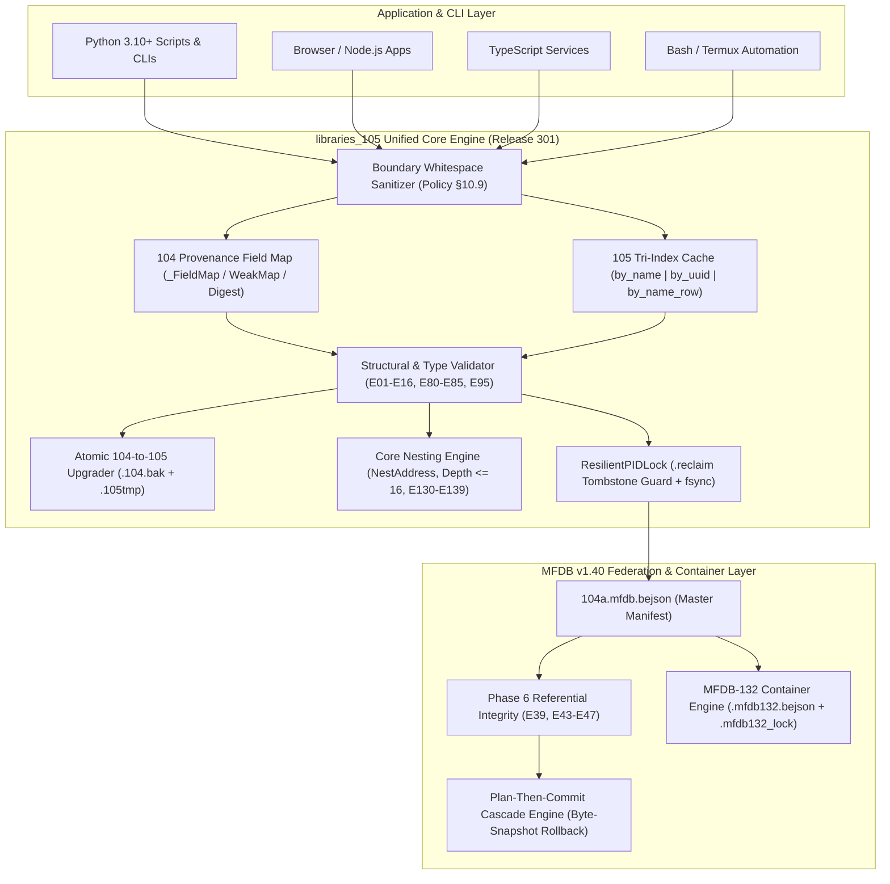
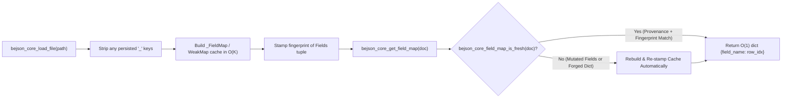
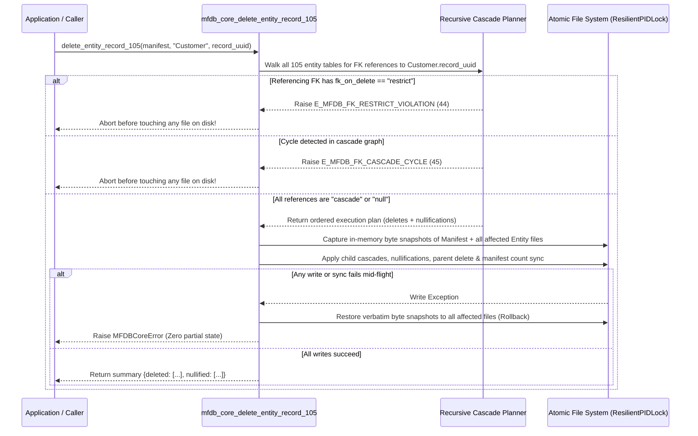
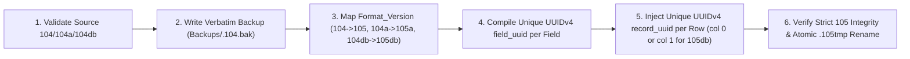

# BEJSON 105 Core Libraries & Specification Ecosystem (`libraries_105`)

> **The Official Multi-Language Reference Implementation, Integrity Era Runtime Engine (`105` / `105a` / `105db`), Foundational Era Parity Core (`104` / `104a` / `104db` / Nested `104`), Atomic Migration Tooling, and Multi-File Database (`MFDB v1.31` / `v1.32` / `v1.39` / `v1.40`) Referential Integrity Suite across Python, JavaScript, TypeScript, and Bash.**

[-brightgreen.svg)]()
[]()
[-000000.svg)]()
[]()
[]()
[-DE2626.svg)]()

---

## Document Metadata & Author Credits

| Field | Value |
| :--- | :--- |
| **Document Name** | `README.md` |
| **Project Name** | `libraries_105` (`BEJSON_105`) |
| **Description** | Comprehensive technical documentation, architectural reference, format specification, and 4-language API guide for the BEJSON 105 Core Libraries & MFDB v1.40 Ecosystem |
| **Author & Format Creator** | **Elton Boehnen** |
| **Email** | [boehnenelton2024@gmail.com](mailto:boehnenelton2024@gmail.com) |
| **Website** | [boehnenelton2024.pages.dev](https://boehnenelton2024.pages.dev) |
| **GitHub** | [github.com/boehnenelton](https://github.com/boehnenelton) |
| **Canonical Remote Repository** | [`https://github.com/boehnenelton/BEJSON_105`](https://github.com/boehnenelton/BEJSON_105) |
| **Canonical Host Path** | `/storage/emulated/0/Admin/Libraries/libraries_105` (`$ADMIN_LIBRARIES_105`) |
| **Project Version** | `5.8.0` (`VERSION = 50800`) |
| **Package Version** | `111` (`PKG111`) |
| **Release Version** | `301` (Integrity Era `libraries_105`) / `300` (Foundational Era `104` Core Parity) |
| **Date Created / Updated** | `2026-10-29` |
| **RELATIONAL_ID** | `f84d91a2-7c3e-4b90-8a15-2d6e4f9c0b31` |

---

## Table of Contents

- [Document Metadata & Author Credits](#document-metadata--author-credits)
- [1. Executive Overview & Naming Heritage](#1-executive-overview--naming-heritage)
  - [1.1 Authoritative Acronym Definitions](#11-authoritative-acronym-definitions)
  - [1.2 The Positional Integrity Paradigm](#12-the-positional-integrity-paradigm)
  - [1.3 Core Capabilities & Architectural Highlights](#13-core-capabilities--architectural-highlights)
  - [1.4 Primary & Enterprise Use Cases](#14-primary--enterprise-use-cases)
- [2. Ecosystem Architecture & Separation Governance (`libraries_104` vs. `libraries_105`)](#2-ecosystem-architecture--separation-governance-libraries_104-vs-libraries_105)
  - [2.1 Dual-Ecosystem Separation Mandate](#21-dual-ecosystem-separation-mandate)
  - [2.2 104-Series Baseline Parity Inside `libraries_105`](#22-104-series-baseline-parity-inside-libraries_105)
  - [2.3 Repository Directory Topology](#23-repository-directory-topology)
  - [2.4 System Architecture & Data Flow Diagrams](#24-system-architecture--data-flow-diagrams)
- [3. Complete BEJSON Format Specifications (`104` & `105` Series)](#3-complete-bejson-format-specifications-104--105-series)
  - [3.1 Six Mandatory Top-Level Keys](#31-six-mandatory-top-level-keys)
  - [3.2 Closed Data Type Taxonomy & Boundary Sanitization](#32-closed-data-type-taxonomy--boundary-sanitization)
  - [3.3 Unified Reserved `_` Prefix Rule (`E10`)](#33-unified-reserved-_-prefix-rule-e10)
  - [3.4 Format `104` — Foundational Single-Entity Standard](#34-format-104--foundational-single-entity-standard)
  - [3.5 Format `104a` — Primitive Metadata & Configuration Standard (`POL-002`)](#35-format-104a--primitive-metadata--configuration-standard-pol-002)
  - [3.6 Format `104db` — Multi-Entity Single-File Relational Standard](#36-format-104db--multi-entity-single-file-relational-standard)
  - [3.7 Format `105` & `105a` — Integrity Era UUID-Fingerprinted Standards](#37-format-105--105a--integrity-era-uuid-fingerprinted-standards)
  - [3.8 Format `105db` — Multi-Entity Integrity Standard & Row Offset Geometry](#38-format-105db--multi-entity-integrity-standard--row-offset-geometry)
  - [3.9 Nested BEJSON `104` — Recursive Cell Embedding & Path Query DSL](#39-nested-bejson-104--recursive-cell-embedding--path-query-dsl)
  - [3.10 Comparative Format Matrix (`104` through `105db`)](#310-comparative-format-matrix-104-through-105db)
- [4. Provenance-Guarded O(1) Field-Map Cache Architecture (Policy §6.2)](#4-provenance-guarded-o1-field-map-cache-architecture-policy-62)
  - [4.1 Strict Prohibition of Positional Row Indexing](#41-strict-prohibition-of-positional-row-indexing)
  - [4.2 In-Memory Provenance Verification (`104` / `104a` / `104db`)](#42-in-memory-provenance-verification-104--104a--104db)
  - [4.3 Self-Maintaining Multi-Index Cache (`105` / `105a` / `105db`)](#43-self-maintaining-multi-index-cache-105--105a--105db)
  - [4.4 Offset Arithmetic Invariant Table](#44-offset-arithmetic-invariant-table)
- [5. Multi-File Database (`MFDB`) & v1.40 Phase 6 Referential Integrity](#5-multi-file-database-mfdb--v140-phase-6-referential-integrity)
  - [5.1 Format vs. Architecture (`104db` vs. `MFDB`)](#51-format-vs-architecture-104db-vs-mfdb)
  - [5.2 Master Manifest (`104a.mfdb.bejson`) Specification](#52-master-manifest-104amfdbbejson-specification)
  - [5.3 Entity Table Architecture & `Parent_Hierarchy` Bidirectional Validation](#53-entity-table-architecture--parent_hierarchy-bidirectional-validation)
  - [5.4 MFDB v1.40 Phase 6 Cross-Entity Referential Integrity](#54-mfdb-v140-phase-6-cross-entity-referential-integrity)
    - [5.4.1 Foreign Key Field Declaration (`_fk`)](#541-foreign-key-field-declaration-_fk)
    - [5.4.2 Advisory vs. Strict Enforcement (`Ref_Integrity`)](#542-advisory-vs-strict-enforcement-ref_integrity)
    - [5.4.3 Transactional Plan-Then-Commit Cascade Deletes](#543-transactional-plan-then-commit-cascade-deletes)
  - [5.5 Master-Slave Topological Federation & Structural Blindness](#55-master-slave-topological-federation--structural-blindness)
  - [5.6 MFDB-132 Single-File Chunked Containers (`.mfdb132.bejson`)](#56-mfdb-132-single-file-chunked-containers-mfdb132bejson)
  - [5.7 Self-Healing, Meta-Debug Telemetry & Schema Drift Detection](#57-self-healing-meta-debug-telemetry--schema-drift-detection)
- [6. Atomic 104-to-105 Migration & Upgrade Engine](#6-atomic-104-to-105-migration--upgrade-engine)
  - [6.1 Why `E80` Fail-on-Switch Blocks Manual Re-Headering](#61-why-e80-fail-on-switch-blocks-manual-re-headering)
  - [6.2 Six-Stage Atomic Upgrade Pipeline](#62-six-stage-atomic-upgrade-pipeline)
  - [6.3 CLI & Programmatic Upgrade Workflows](#63-cli--programmatic-upgrade-workflows)
- [7. Multi-Language Runtime Usage Guides](#7-multi-language-runtime-usage-guides)
  - [7.1 Python 3.10+ Runtime Guide (`Lib_PY/Core`)](#71-python-310-runtime-guide-lib_pycore)
    - [7.1.1 Creating, Querying & Persisting `104` / `104a` / `104db` Documents](#711-creating-querying--persisting-104--104a--104db-documents)
    - [7.1.2 Format `105` UUID CRUD, Foreign Keys & Cell Mutation](#712-format-105-uuid-crud-foreign-keys--cell-mutation)
    - [7.1.3 Upgrading `104` Documents to `105` Programmatically](#713-upgrading-104-documents-to-105-programmatically)
    - [7.1.4 MFDB v1.40 Database Creation & Referential Integrity Cascades](#714-mfdb-v140-database-creation--referential-integrity-cascades)
    - [7.1.5 Recursive Cell Nesting (`NestAddress` & Path Query DSL)](#715-recursive-cell-nesting-nestaddress--path-query-dsl)
  - [7.2 JavaScript Runtime Guide (`Lib_JS/Core`)](#72-javascript-runtime-guide-lib_jscore)
    - [7.2.1 `104` & `105` Document Operations and `by_name_row` Caching](#721-104--105-document-operations-and-by_name_row-caching)
    - [7.2.2 MFDB v1.40 Operations & Cascade Deletes in Node.js / Browser](#722-mfdb-v140-operations--cascade-deletes-in-nodejs--browser)
  - [7.3 TypeScript Runtime Guide (`Lib_TS/Core`)](#73-typescript-runtime-guide-lib_tscore)
    - [7.3.1 Strictly Typed `104` & `105` Document Construction & Validation](#731-strictly-typed-104--105-document-construction--validation)
    - [7.3.2 Immutable `105` Operations, Upgrade & Web Crypto AES-GCM](#732-immutable-105-operations-upgrade--web-crypto-aes-gcm)
  - [7.4 Bash / POSIX Shell Runtime Guide (`Lib_SH/Core`)](#74-bash--posix-shell-runtime-guide-lib_shcore)
    - [7.4.1 Atomic File I/O, `ResilientPIDLock` & O(1) Field-Map Lookups](#741-atomic-file-io-resilientpidlock--o1-field-map-lookups)
    - [7.4.2 Shell MFDB v1.40 Referential Integrity & Archive Mounting](#742-shell-mfdb-v140-referential-integrity--archive-mounting)
- [8. Comprehensive 4-Language API Reference Matrix](#8-comprehensive-4-language-api-reference-matrix)
  - [8.1 Cross-Language Core Parity Matrix](#81-cross-language-core-parity-matrix)
  - [8.2 Python (`Lib_PY/Core`) Complete Module Reference](#82-python-lib_pycore-complete-module-reference)
  - [8.3 JavaScript (`Lib_JS/Core`) Complete Module Reference](#83-javascript-lib_jscore-complete-module-reference)
  - [8.4 TypeScript (`Lib_TS/Core`) Complete Module Reference](#84-typescript-lib_tscore-complete-module-reference)
  - [8.5 Bash (`Lib_SH/Core`) Complete Module Reference](#85-bash-lib_shcore-complete-module-reference)
  - [8.6 CLI Tools & Server Utilities (`Lib_PY/Core/cli`)](#86-cli-tools--server-utilities-lib_pycorecli)
- [9. Internal `BEJSON/` Self-Tracking MFDB Database Reference](#9-internal-bejson-self-tracking-mfdb-database-reference)
  - [9.1 Master Manifest (`BEJSON/104a.mfdb.bejson`)](#91-master-manifest-bejson104amfdbbejson)
  - [9.2 Registered Entity Tables (`BEJSON/data/*.bejson`)](#92-registered-entity-tables-bejsondatabejson)
- [10. Exhaustive Error Code Registry (Codes `1`–`159`)](#10-exhaustive-error-code-registry-codes-1159)
  - [10.1 BEJSON Structural & Type Validation Codes (`1`–`16`)](#101-bejson-structural--type-validation-codes-116)
  - [10.2 BEJSON Core Operational & Cryptographic Codes (`17`–`29`)](#102-bejson-core-operational--cryptographic-codes-1729)
  - [10.3 MFDB Manifest, Entity & Archive Validation Codes (`30`–`42`)](#103-mfdb-manifest-entity--archive-validation-codes-3042)
  - [10.4 MFDB v1.40 Phase 6 Referential Integrity Codes (`39`, `43`–`47`)](#104-mfdb-v140-phase-6-referential-integrity-codes-39-4347)
  - [10.5 MFDB Core Operational & Mount Codes (`50`–`72`)](#105-mfdb-core-operational--mount-codes-5072)
  - [10.6 Format `105` / `105a` / `105db` Integrity Era Codes (`80`–`85`)](#106-format-105--105a--105db-integrity-era-codes-8085)
  - [10.7 Core Recursive Nesting & Query DSL Codes (`130`–`139`)](#107-core-recursive-nesting--query-dsl-codes-130139)
- [11. Concurrency, Security & Cryptographic Architecture](#11-concurrency-security--cryptographic-architecture)
  - [11.1 `ResilientPIDLock` & Tombstone-Serialized Crash Recovery](#111-resilientpidlock--tombstone-serialized-crash-recovery)
  - [11.2 Path Traversal Guard (`bejson_path_guard`) & Zip-Slip Protection (`bejson_secure_zip`)](#112-path-traversal-guard-bejson_path_guard--zip-slip-protection-bejson_secure_zip)
  - [11.3 Zero-`exec()` AST Environment Sourcing (`bejson_env`)](#113-zero-exec-ast-environment-sourcing-bejson_env)
  - [11.4 Web Crypto AES-GCM 256-Bit Encryption & Non-Extractable Key Cache](#114-web-crypto-aes-gcm-256-bit-encryption--non-extractable-key-cache)
- [12. Verification, Stress Testing & Quality Gates](#12-verification-stress-testing--quality-gates)
  - [12.1 Running the 4-Language Unit & Parity Test Suites](#121-running-the-4-language-unit--parity-test-suites)
  - [12.2 Adversarial Remediation & Multi-Process Stress Suite (`run_stress.py`)](#122-adversarial-remediation--multi-process-stress-suite-run_stresspy)
  - [12.3 Policy §10.6 Five-Test Enforcement Suite](#123-policy-106-five-test-enforcement-suite)
- [13. Host Environment Topology & Antigravity CLI (`agy`) Skill Routing](#13-host-environment-topology--antigravity-cli-agy-skill-routing)
  - [13.1 Canonical `/storage/emulated/0/Admin` Path Roster](#131-canonical-storageemulated0admin-path-roster)
  - [13.2 Antigravity CLI (`agy`) 104 vs. 105 Skill Matrix](#132-antigravity-cli-agy-104-vs-105-skill-matrix)
- [14. Troubleshooting, FAQ, Governance & Polyglot License](#14-troubleshooting-faq-governance--polyglot-license)
  - [14.1 Technical Troubleshooting & Frequently Asked Questions](#141-technical-troubleshooting--frequently-asked-questions)
  - [14.2 Development Governance & Strict Negative Constraints (Policy §7.3)](#142-development-governance--strict-negative-constraints-policy-73)
  - [14.3 Polyglot Open-Source License](#143-polyglot-open-source-license)
  - [14.4 Author Credit & Maintainer Contact](#144-author-credit--maintainer-contact)

---

## 1. Executive Overview & Naming Heritage

The **BEJSON 105 Core Libraries & Specification Ecosystem (`libraries_105`)** is the official multi-language reference implementation for Elton Boehnen's **BEJSON** (`104`, `104a`, `104db`, `105`, `105a`, `105db`, and Nested `104`) data serialization standards and the **MFDB** (`v1.31`, `v1.32`, `v1.39`, and `v1.40`) federated local-first database architecture.

Designed for zero-daemon deployment across Linux, Android/Termux, Node.js, modern browsers, and agentic AI pipelines, `libraries_105` combines **Foundational Era (`104`-series)** full baseline compatibility with **Integrity Era (`105`-series)** cryptographic/UUID column and row fingerprinting, atomic migration pipelines, and transactional cross-entity foreign-key cascades.

### 1.1 Authoritative Acronym Definitions

Per global ecosystem governance (`BEJSON/data/metadata.bejson`), these acronyms carry strict, non-negotiable definitions:

- **BEJSON** stands exclusively for **BOEHNEN ELTON JSON** (named after format creator and architect **Elton Boehnen**). No other expansion of the acronym is valid.
- **MFDB** stands exclusively for **MULTI FILE DATABASE**. MFDB is not a `Format_Version` string; it is a relational database architecture layered on top of BEJSON files (`104a.mfdb.bejson` manifest + entity files linked via `Parent_Hierarchy`).

### 1.2 The Positional Integrity Paradigm

Standard JSON arrays of objects repeat every field name on every single row:

```json
[
  {"sensor_id": "SENS-01", "recorded_at": "2026-10-18T12:00:00Z", "reading_c": 23.4},
  {"sensor_id": "SENS-02", "recorded_at": "2026-10-18T12:01:00Z", "reading_c": 19.8}
]
```

At scale, repeating keys causes **35%–65% byte and LLM token waste**, repeated string hashing on every property read, and silent schema drift when individual objects omit or misspell keys.

**BEJSON eliminates key repetition** by decoupling the schema declaration (`Fields`) from the dense positional value matrix (`Values`):

```json
{
  "Format": "BEJSON",
  "Format_Version": "105",
  "Format_Creator": "Elton Boehnen",
  "Records_Type": ["SensorTelemetry"],
  "Fields": [
    {"name": "sensor_id",   "type": "string", "field_uuid": "a1b2c3d4-0001-4000-8000-000000000001"},
    {"name": "recorded_at", "type": "string", "field_uuid": "a1b2c3d4-0002-4000-8000-000000000002"},
    {"name": "reading_c",   "type": "number", "field_uuid": "a1b2c3d4-0003-4000-8000-000000000003"}
  ],
  "Values": [
    ["9f8e7d6c-0001-4000-8000-000000000001", "SENS-01", "2026-10-18T12:00:00Z", 23.4],
    ["9f8e7d6c-0002-4000-8000-000000000002", "SENS-02", "2026-10-18T12:01:00Z", 19.8]
  ]
}
```

By compiling an in-memory **O(1) Field-Map Cache** (`field_map["reading_c"] -> 3`), runtime libraries resolve any column in constant time while enforcing strict positional length, data-type conformance, and immutable UUID identity across schema migrations.

### 1.3 Core Capabilities & Architectural Highlights

1. **Four-Language Core Parity (`PY` / `JS` / `TS` / `SH`)**: Every core feature—parsing, boundary sanitization, provenance-guarded field maps, `104`/`105` validation, recursive cell nesting, MFDB orchestration, and Phase 6 Referential Integrity—is implemented with unified error codes (`1`–`159`) across Python 3.10+, JavaScript (ES2022/UMD), TypeScript 5.x, and Bash 5.x (`jq`).
2. **Integrity Era Format `105` / `105a` / `105db`**:
   - Mandatory per-column `field_uuid` (UUIDv4) preventing silent column-rename or reorder corruption.
   - Reserved per-row `record_uuid` (UUIDv4) at index `0` (`105`/`105a`) or index `1` (`105db`, immediately after `Record_Type_Parent`), providing a stable primary-key anchor for every row.
   - Strict **Fail-on-Switch Guard** (`E80 E_FIELD_INTEGRITY_MISMATCH`) rejecting any `104` file manually re-headered to `105` without compiled UUIDs.
3. **Provenance-Guarded O(1) Field-Map Caching**:
   - `104`-series documents use tamper-evident in-memory caches (`_FieldMap` in Python, `WeakMap` in JS/TS, SHA-256 digest files in Bash).
   - `105`-series documents maintain a tri-index cache (`{ by_name, by_uuid, by_name_row }`) that automatically accounts for the `+1` (`105`/`105a`) and `+2` (`105db`) row offsets.
4. **MFDB v1.40 Phase 6 Cross-Entity Referential Integrity**:
   - Declarative foreign keys (`fk_target_entity`, `fk_on_delete` referencing target entity `record_uuid`) on `105`-series fields.
   - Whole-database read-only referential integrity auditing (`mfdb_validator_check_referential_integrity` / `checkReferentialIntegrity`).
   - Transactional **Plan-Then-Commit** cascade deletion (`restrict`, `cascade`, `null`/`set_null`) with automatic multi-file byte-snapshot rollback if any downstream constraint or I/O operation fails.
5. **Crash-Safe Concurrency & Atomic Persistence**:
   - POSIX atomic `.tmp` + `fsync` + `os.replace` writes.
   - `ResilientPIDLock` with per-acquisition tokens and `.reclaim` tombstone serialization, verified under multi-process crash storms (`test_stress_suite.py`).

### 1.4 Primary & Enterprise Use Cases

- **Agentic AI & LLM Context Optimization**: Reduces structured data token consumption by up to 60% while keeping schemas self-describing. Combined with MFDB's **Master-Slave Federation**, operational slave agents remain structurally blind to administrative parent tables.
- **Zero-Daemon Embedded Relational Databases**: Build multi-table relational stores (`MFDB v1.40` or `105db`) with foreign-key enforcement, cascading deletes, and schema drift detection directly on the host filesystem without SQLite binary dependencies or server daemons.
- **Portable Single-File Application Bundles (`MFDB-132`)**: Collapse entire multi-file databases or project trees into a single `.mfdb132.bejson` container with SHA-256 lock verification (`.mfdb132_lock`), sticky session mounting, and pre-write validation gates.
- **Cryptographically Protected Configuration & State (`104a` / `105a`)**: Store application configurations (`config/config.json`), project trackers (`.bejson_project.json`), and AES-GCM-256 encrypted records (`ENC:AES-GCM:...`) with strict boundary whitespace sanitization.

---

## 2. Ecosystem Architecture & Separation Governance (`libraries_104` vs. `libraries_105`)

### 2.1 Dual-Ecosystem Separation Mandate

Per architectural governance ([`clarification.md`](file:///storage/emulated/0/Admin/Libraries/libraries_105/clarification.md)), the BEJSON library suite is partitioned into two distinct master ecosystems on the host filesystem and on GitHub:

| Attribute | `libraries_104` (Foundational Era) | `libraries_105` (Integrity Era — **This Repository**) |
| :--- | :--- | :--- |
| **Release Version** | `Release_Version: 300` | `Release_Version: 301` (`300` on shared 104-parity modules) |
| **Host Path** | `/storage/emulated/0/Admin/Libraries/libraries_104` | `/storage/emulated/0/Admin/Libraries/libraries_105` |
| **Environment Variable** | `$ADMIN_LIBRARIES` / `$ADMIN_LIBRARIES_104` | `$ADMIN_LIBRARIES_105` |
| **GitHub Repository** | [`github.com/boehnenelton/BEJSON_104`](https://github.com/boehnenelton/BEJSON_104) | [`github.com/boehnenelton/BEJSON_105`](https://github.com/boehnenelton/BEJSON_105) |
| **Family Scope** | `Core` + **All Vertical Domain Families** (`AI`, `BEHTML`, `Bookmaker`, `CMS`, `Diagrams`, `Gaming`, `Lists`, `Standards`, `Terminal_Menus`, etc.) | **`Core`** (`Lib_PY/Core`, `Lib_JS/Core` + `Lib_JS/External`, `Lib_TS/Core`, `Lib_SH/Core`, `BEJSON/`) + sanctioned 105 families (`Standards`, `Taxonomies`, `Tax_Scaffolds`, `Canvas`, `Graphics`) |
| **Supported Formats** | `104`, `104a`, `104db`, Nested `104`, `MFDB v1.31`/`v1.32`/`v1.39` | **All `104`-series formats** PLUS **`105`, `105a`, `105db`, and `MFDB v1.40` (Phase 6 Referential Integrity)** |

> [!IMPORTANT]
> **`Core` & Sanctioned Companion Families in `libraries_105`**: Alongside the 4-language `Core` engine and `Standards` (`Lib_PY`/`Lib_JS`), the `Taxonomies`, `Tax_Scaffolds`, `Canvas`, and `Graphics` families reside in `libraries_105`. Classic vertical domain families (`AI`, `Gaming`, `CMS`, `Lists`, `Diagrams`, `BEHTML`, `Bookmaker`, etc.) reside in `libraries_104` (`$ADMIN_LIBRARIES_104`). Applications that require classic vertical domain libraries alongside Format 105 Core capabilities load `Core` from `$ADMIN_LIBRARIES_105` and vertical families from `$ADMIN_LIBRARIES_104`.

### 2.2 104-Series Baseline Parity Inside `libraries_105`

While vertical families are excluded from `libraries_105`, the **104-series portion of `Core` inside `libraries_105` maintains 100% functional, API, and security parity with `libraries_104/Lib_*/Core`**. Every `104`, `104a`, `104db`, Nested `104`, and `MFDB v1.31`/`v1.32`/`v1.39` operation works identically in `libraries_105`, allowing seamless side-by-side operation and gradual migration from `104` to `105`.

### 2.3 Repository Directory Topology

```text
/storage/emulated/0/Admin/Libraries/libraries_105/
├── .bejson_project.json                      # BEJSON 104a root package tracker & changelog
├── README.md                                 # This comprehensive technical manual
├── clarification.md                          # Architectural & ecosystem separation standards
├── BEJSON/                                   # Self-tracking MFDB v1.40 database for Core
│   ├── 104a.mfdb.bejson                      # Master MFDB manifest (7 registered entities)
│   ├── Documentation/
│   │   ├── FORMAT_VS_ARCHITECTURE.md         # 104db vs. MFDB architectural guide
│   │   └── metadata_governance_instructions.md
│   ├── docs/
│   │   ├── BEJSON_CRASH_COURSE-v23.md        # Complete ecosystem crash course
│   │   └── metadata_governance_instructions.md
│   └── data/
│       ├── dependencies.bejson               # Cross-language module dependency graph (59 rows)
│       ├── errors.bejson                     # Global error code registry mirror (290 rows)
│       ├── families.bejson                   # Registered Core/Standards x Language families (6 rows)
│       ├── library_changes.bejson            # Granular per-file version audit log (116 rows)
│       ├── metadata.bejson                   # Ecosystem version & governance rules (12 rows)
│       ├── schemas.bejson                    # Canonical SCHEMA_* definitions (3 rows)
│       └── templates.bejson                  # File-header & skeleton templates (6 rows)
├── Lib_PY/                                   # Python 3.10+ Reference Implementation
│   └── Core/
│       ├── __init__.py
│       ├── lib_bejson_Core_bejson_core.py            # 104 & 105 CRUD, ResilientPIDLock, Field Maps
│       ├── lib_bejson_Core_bejson_validator.py       # 104 & 105 Validator (E01-E16, E80-E85)
│       ├── lib_bejson_Core_bejson_upgrade.py         # Atomic 104 -> 105 Upgrade Engine
│       ├── lib_bejson_Core_bejson_core_nesting.py    # Recursive Nested 104 & Query DSL (E130-E139)
│       ├── lib_bejson_Core_bejson_chunking.py        # Chunked-104a & MFDB-132 Container Engine
│       ├── lib_bejson_Core_bejson_104db_parser.py    # Multi-Entity 104db Parser & Unpacker
│       ├── lib_bejson_Core_bejson_env.py             # Safe AST Environment Sourcing (Zero exec)
│       ├── lib_bejson_Core_bejson_errors.py          # Unified Error Registry (Codes 1-159)
│       ├── lib_bejson_Core_bejson_parse.py           # Raw-Decode Stream Parser & Extractor
│       ├── lib_bejson_Core_bejson_path_guard.py      # Path Traversal & Safe ZIP Extraction Guard
│       ├── lib_bejson_Core_bejson_provider.py        # Abstract Data Provider Interface
│       ├── lib_bejson_Core_bejson_schema.py          # Schema Extraction, Validation & Inference
│       ├── lib_bejson_Core_bejson_state_management.py# Persistent Application State Manager
│       ├── lib_bejson_Core_bejson_static_backend.py  # Static File Persistence Backend
│       ├── lib_bejson_Core_mfdb_core.py              # MFDB Orchestrator, Federation & 105 Cascades
│       ├── lib_bejson_Core_mfdb_validator.py         # MFDB Manifest/Entity/FK/132 Validator
│       ├── cli/
│       │   ├── bejson_upgrade_cli.py                 # CLI for 104 -> 105 Upgrades & Dry Runs
│       │   ├── bejson_server.py                      # Local Flask Server Launcher & Port Manager
│       │   ├── gemini_showcase_intro.py              # Terminal Showcase Utility
│       │   ├── CLI_Doc_Chunker/                      # Document Chunker CLI Suite
│       │   └── showcase/                             # Interactive Python CLI Showcases
│       └── tests/                                    # 10 Python Test & Stress Suites (229+ tests)
├── Lib_JS/                                   # JavaScript (ES2022 / UMD / Node & Browser)
│   ├── GEMINI.md
│   ├── External/
│   │   └── jszip.min.js                              # Vendored JSZip for Archive Packaging
│   └── Core/
│       ├── lib_bejson_Core_bejson_core.js            # 104 & 105 CRUD, WeakMap Cache, AES-GCM
│       ├── lib_bejson_Core_bejson_validator.js       # 104 & 105 Structural & Strict Validator
│       ├── lib_bejson_Core_bejson_core_nesting.js    # Recursive Nested 104 & Query DSL
│       ├── lib_bejson_Core_bejson_chunking.js        # Chunked-104a & MFDB-132 Packaging
│       ├── lib_bejson_Core_bejson_errors.js          # Unified JS Error Registry
│       ├── lib_bejson_Core_bejson_parse.js           # Stream JSON Parser & Data Extractor
│       ├── lib_bejson_Core_bejson_schema.js          # Schema Extraction & Validation
│       ├── lib_bejson_Core_bejson_secure_zip.js      # Zip-Slip Guard for JSZip Archives
│       ├── lib_bejson_Core_bejson_state.js           # Browser/Node State Persistence
│       ├── lib_bejson_Core_bejson_bejson.js          # Browser Core Bundle Helper
│       ├── lib_bejson_Core_mfdb_core.js              # MFDB Orchestrator & 105 Cascade Engine
│       ├── lib_bejson_Core_mfdb_validator.js         # MFDB & Referential Integrity Validator
│       ├── bejson_cache.test.js
│       └── tests/                                    # 8 JavaScript Verification Suites
├── Lib_TS/                                   # TypeScript 5.x Strictly Typed Implementation
│   ├── index.ts                                      # Top-Level Re-Export Barrel
│   ├── tsconfig.json                                 # Zero-Error Strict TypeScript Configuration
│   └── Core/
│       ├── index.ts                                  # Core Barrel Exports
│       ├── lib_bejson_Core_bejson_types.ts           # Interfaces, Type Guards & Error Constants
│       ├── lib_bejson_Core_bejson_core.ts            # 104 CRUD & Web Crypto AES-GCM Engine
│       ├── lib_bejson_Core_bejson_core_105.ts        # 105 CRUD, FK Definitions & Upgrade Engine
│       ├── lib_bejson_Core_bejson_field_map.ts       # Provenance-Guarded 104 & 105 Field Maps
│       ├── lib_bejson_Core_bejson_validators.ts      # 104 & 105 Strict Validators
│       ├── lib_bejson_Core_bejson_core_nesting.ts    # Recursive Nested 104 & Query DSL
│       ├── lib_bejson_Core_bejson_chunking.ts        # Chunked-104a & MFDB-132 Engine
│       ├── lib_bejson_Core_bejson_schema.ts          # Typed Schema Management
│       ├── lib_bejson_Core_mfdb_core.ts              # MFDB Core, Federation & 105 FK Helpers
│       ├── lib_bejson_Core_mfdb_validators.ts        # MFDB & Phase 6 Referential Integrity Audit
│       └── tests/                                    # 7 TypeScript Verification Suites
└── Lib_SH/                                   # Bash 5.x / POSIX Shell + jq Implementation
    └── Core/
        ├── lib_bejson_Core_be_core.sh                # Environment Bootstrapping & State Helpers
        ├── lib_bejson_Core_be_deps.sh                # Runtime Dependency Checker (jq, sha256sum)
        ├── lib_bejson_Core_bejson_core.sh            # Resilient Lock, Digest Field Map & CRUD
        ├── lib_bejson_Core_bejson_validator.sh       # 104 & 105-Aware Shell Validator
        ├── lib_bejson_Core_bejson_core_nesting.sh    # Shell Nested 104 Scanner, Mutator & Query
        ├── lib_bejson_Core_bejson_chunking.sh        # Shell Chunking & MFDB-132 Archive Mount
        ├── lib_bejson_Core_bejson_errors.sh          # Readonly Shell Error Constants (1-159)
        ├── lib_bejson_Core_bejson_parse.sh           # jq-Backed JSON Stream Extractor
        ├── lib_bejson_Core_bejson_schema.sh          # Shell Schema Extraction & Comparison
        ├── lib_bejson_Core_mfdb_core.sh              # Shell MFDB Orchestrator & 105 Cascades
        ├── lib_bejson_Core_mfdb_validator.sh         # Shell MFDB & FK Referential Validator
        ├── cli/showcase/                             # Interactive Bash Terminal Showcases
        └── tests/                                    # 7 Bash Verification Suites
```

### 2.4 System Architecture & Data Flow Diagrams



---

## 3. Complete BEJSON Format Specifications (`104` & `105` Series)

### 3.1 Six Mandatory Top-Level Keys

Every valid BEJSON document across all six format versions (`104`, `104a`, `104db`, `105`, `105a`, `105db`) **must** contain these six top-level keys with exact case sensitivity:

| Key Name | Required Type | Valid Values / Rule | Error Code on Violation |
| :--- | :--- | :--- | :--- |
| `"Format"` | `string` | Must equal `"BEJSON"` | `E02` (missing) / `E03` (wrong value) |
| `"Format_Version"` | `string` | One of `"104"`, `"104a"`, `"104db"`, `"105"`, `"105a"`, `"105db"` | `E02` (missing) / `E04` (invalid version) |
| `"Format_Creator"` | `string` | Must equal `"Elton Boehnen"` | `E02` (missing) / `E16` (`E_INVALID_FORMAT_CREATOR`) |
| `"Records_Type"` | `array<string>` | Non-empty list of entity type strings (`len == 1` for `104`/`104a`/`105`/`105a`; `len >= 2` for `104db`/`105db`) | `E02` (missing) / `E05` (`E_INVALID_RECORDS_TYPE`) |
| `"Fields"` | `array<object>` | Non-empty array of field definition dicts (`{"name": "...", "type": "..."}`) | `E02` (missing) / `E06` (`E_INVALID_FIELDS`) |
| `"Values"` | `array<array>` | Array of positional record rows (may be empty `[]`) | `E02` (missing) / `E07` (`E_INVALID_VALUES`) |

### 3.2 Closed Data Type Taxonomy & Boundary Sanitization

Every field definition in `Fields` must declare a `"type"` from the **strict closed set of six data types** (or restricted to four primitives in `104a`/`105a`):

| Declared `type` | Allowed JSON Values | Allowed in `104` / `104db` / `105` / `105db` | Allowed in `104a` / `105a` (`POL-002`) |
| :--- | :--- | :---: | :---: |
| `"string"` | UTF-8 string or `null` | Yes | Yes |
| `"integer"` | Whole number (`int`, not `bool`) or `null` | Yes | Yes |
| `"number"` | Integer or floating-point (`int`/`float`, not `bool`/`NaN`/`Infinity`) or `null` | Yes | Yes |
| `"boolean"` | `true`, `false`, or `null` | Yes | Yes |
| `"array"` | JSON array `[...]` or `null` | Yes | **No (`E06`)** |
| `"object"` | JSON object `{...}` (including Nested 104 docs) or `null` | Yes | **No (`E06`)** |

> [!WARNING]
> **Rejection of Unrecognized Types (`"any"`)**: Across Python, JavaScript, TypeScript, and Bash, the validator enforces this closed set of 6 types (`4` for `104a`/`105a`). Non-standard types such as `"any"` in BEJSON data files are rejected with `E_INVALID_FIELDS` (`6`).

**Boundary-Layer Data Sanitization (Policy §10.9)**:
When loading or parsing BEJSON documents, boundary sanitization strips leading and trailing whitespace from dictionary keys and string values before generating the Field-Map Cache or validating records.

### 3.3 Unified Reserved `_` Prefix Rule (`E10`)

To prevent persisted files from carrying stale or forged runtime caches:
1. **Persisted Files on Disk**: Any top-level key starting with `_` (underscore) in a persisted file is **strictly rejected** with `E_RESERVED_KEY_COLLISION` (`10`) across all format versions—even in `104a` and `105a` where custom PascalCase headers are otherwise permitted.
2. **In-Memory Runtime Objects**: When validating an in-memory object via `validate_bejson(doc, is_file=False)` or `bejson_validator_validate_object(doc)`, only provenance-verified internal cache keys (`_bejson_field_map`, `_bejson_field_map_fp`, `_nesting_field_map` / `_nestingFieldMap`) are permitted. If `_bejson_field_map` is a plain unverified dict or disagrees with `Fields`, validation fails immediately with `E10`.
3. **Automatic Stripping on Write**: `bejson_core_atomic_write` and `bejson_core_serialize` automatically invoke `bejson_core_strip_persisted_cache(doc)` to strip all runtime `_` keys prior to disk serialization.

---

### 3.4 Format `104` — Foundational Single-Entity Standard

- **`Records_Type`**: Exactly 1 entity name (e.g., `["TelemetryEvent"]`).
- **Custom Top-Level Headers**: Forbidden, except the optional `"Parent_Hierarchy"` string when the file is registered as an entity inside an MFDB database.
- **Row Width**: Every row in `Values` has `len(row) == len(Fields)`.

```json
{
  "Format": "BEJSON",
  "Format_Version": "104",
  "Format_Creator": "Elton Boehnen",
  "Parent_Hierarchy": "../104a.mfdb.bejson",
  "Records_Type": ["TelemetryEvent"],
  "Fields": [
    {"name": "event_id",   "type": "string"},
    {"name": "latency_ms", "type": "integer"},
    {"name": "payload",    "type": "object"}
  ],
  "Values": [
    ["EVT-001", 12, {"region": "us-east", "ok": true}],
    ["EVT-002", 47, null]
  ]
}
```

---

### 3.5 Format `104a` — Primitive Metadata & Configuration Standard (`POL-002`)

- **`Records_Type`**: Exactly 1 entity name (e.g., `["ScriptConfig"]`, `["RootPackage"]`, `["mfdb"]`).
- **Custom Top-Level Headers**: Permitted for file-level metadata (e.g., `"DB_Name"`, `"MFDB_Version"`, `"Network_Role"`, `"Project_Name"`), provided they do not collide with the 6 mandatory keys and **never** begin with `_`.
- **Primitive-Only Fields (`POL-002`)**: Field types in `Fields` are restricted to primitives (`"string"`, `"integer"`, `"number"`, `"boolean"`). Declaring `"array"` or `"object"` in a `104a` file triggers `E_INVALID_FIELDS` (`6`).
- **Row Width**: `len(row) == len(Fields)`.

```json
{
  "Format": "BEJSON",
  "Format_Version": "104a",
  "Format_Creator": "Elton Boehnen",
  "Environment_Tier": "Production",
  "Records_Type": ["ScriptConfig"],
  "Fields": [
    {"name": "setting_name",  "type": "string"},
    {"name": "setting_value", "type": "string"},
    {"name": "is_enabled",    "type": "boolean"}
  ],
  "Values": [
    ["local_lib_directory", "lib/", true],
    ["master_lib_source",   "/storage/emulated/0/Admin/Libraries/libraries_105", true]
  ]
}
```

---

### 3.6 Format `104db` — Multi-Entity Single-File Relational Standard

- **`Records_Type`**: Two or more entity names (e.g., `["Author", "Article"]`).
- **Mandatory Discriminator (`Fields[0]`)**: `Fields[0]` **must** be `{"name": "Record_Type_Parent", "type": "string"}` (without a `"Record_Type_Parent"` parent owner attribute on itself).
- **Entity Field Ownership (`Fields[1..]`)**: Every subsequent field (`Fields[i]` for `i >= 1`) **must** include `"Record_Type_Parent": "<EntityName>"` matching an entry in `Records_Type` (`E11 E_INVALID_RECORD_TYPE_PARENT`).
- **Null-Padding**: In each `Values` row, `row[0]` holds the row's entity name, columns belonging to `row[0]` hold values of their declared types, and columns belonging to other entities are padded with `null`.

```json
{
  "Format": "BEJSON",
  "Format_Version": "104db",
  "Format_Creator": "Elton Boehnen",
  "Records_Type": ["Author", "Article"],
  "Fields": [
    {"name": "Record_Type_Parent", "type": "string"},
    {"name": "author_id",          "type": "string",  "Record_Type_Parent": "Author"},
    {"name": "author_name",        "type": "string",  "Record_Type_Parent": "Author"},
    {"name": "article_id",         "type": "string",  "Record_Type_Parent": "Article"},
    {"name": "article_title",      "type": "string",  "Record_Type_Parent": "Article"},
    {"name": "author_id_fk",       "type": "string",  "Record_Type_Parent": "Article"}
  ],
  "Values": [
    ["Author",  "AUTH-01", "Elton Boehnen", null,     null,                  null],
    ["Article", null,      null,            "ART-01", "BEJSON 105 Overview", "AUTH-01"]
  ]
}
```

---

### 3.7 Format `105` & `105a` — Integrity Era UUID-Fingerprinted Standards

Format `105` (the Integrity Era counterpart to `104`) and Format `105a` (the Integrity Era counterpart to `104a`) introduce **compile-time and runtime UUIDv4 identity** for both schema columns and data rows:

1. **Per-Column `field_uuid`**: Every field dict in `Fields` **must** carry a valid, unique UUIDv4 string in `"field_uuid"` (`E80` if missing or invalid; `E85` if duplicated).
2. **Reserved Row `record_uuid` at Column `0`**: Every row in `Values` prepends a unique UUIDv4 `record_uuid` at `row[0]`. Consequently:
   - `len(row) == len(Fields) + 1`.
   - User field `Fields[i]` resides at physical row index `i + 1`.
   - `bejson_core_get_field_map(doc)` returns `by_name_row`, mapping `Fields[i]["name"] -> i + 1` automatically so application code never performs manual `+ 1` index math!
3. **Optional Foreign-Key Metadata**: Any field in a `105`-series document may declare relational foreign-key constraints via `bejson_core_define_field()` referencing the target entity's reserved `record_uuid`:
   - `"fk_target_entity"`: Target entity name in the MFDB manifest.
   - `"fk_on_delete"`: One of `"restrict"`, `"cascade"`, or `"null"` (`"set_null"`).

```json
{
  "Format": "BEJSON",
  "Format_Version": "105",
  "Format_Creator": "Elton Boehnen",
  "Parent_Hierarchy": "../104a.mfdb.bejson",
  "Records_Type": ["Order"],
  "Fields": [
    {
      "name": "order_code",
      "type": "string",
      "field_uuid": "11111111-2222-4333-8444-555555555501"
    },
    {
      "name": "customer_uuid_fk",
      "type": "string",
      "field_uuid": "11111111-2222-4333-8444-555555555502",
      "fk_target_entity": "Customer",
      "fk_on_delete": "cascade"
    },
    {
      "name": "order_total",
      "type": "number",
      "field_uuid": "11111111-2222-4333-8444-555555555503"
    }
  ],
  "Values": [
    [
      "aaaaaaaa-bbbb-4ccc-8ddd-eeeeeeeeee01",
      "ORD-9001",
      "cccccccc-dddd-4eee-8fff-000000000001",
      149.95
    ]
  ]
}
```

---

### 3.8 Format `105db` — Multi-Entity Integrity Standard & Row Offset Geometry

Format `105db` combines `104db`'s multi-entity discriminator architecture with `105`'s UUID fingerprinting:

- **`Fields[0]`**: Must be `{"name": "Record_Type_Parent", "type": "string", "field_uuid": "<uuidv4>"}`.
- **`Fields[i]` (`i >= 1`)**: Must carry `"name"`, `"type"`, `"Record_Type_Parent"`, and a unique `"field_uuid"`.
- **Row Layout in `Values`**:
  - **`row[0]`**: The entity discriminator string (`Record_Type_Parent`, corresponding to `Fields[0]`).
  - **`row[1]`**: The reserved per-row `record_uuid` (UUIDv4).
  - **`row[i + 1]` (`i >= 1`)**: The value for `Fields[i]`.
  - **Total Row Length**: `len(row) == len(Fields) + 1` (because `Fields[0]` is `Record_Type_Parent` at `row[0]`, `record_uuid` is inserted at `row[1]`, and the remaining `len(Fields) - 1` fields occupy `row[2 .. len(Fields)]`).

```json
{
  "Format": "BEJSON",
  "Format_Version": "105db",
  "Format_Creator": "Elton Boehnen",
  "Records_Type": ["Department", "Employee"],
  "Fields": [
    {"name": "Record_Type_Parent", "type": "string", "field_uuid": "d0000000-0000-4000-8000-000000000000"},
    {"name": "dept_name",          "type": "string", "Record_Type_Parent": "Department", "field_uuid": "d0000000-0000-4000-8000-000000000001"},
    {"name": "emp_name",           "type": "string", "Record_Type_Parent": "Employee",   "field_uuid": "d0000000-0000-4000-8000-000000000002"}
  ],
  "Values": [
    ["Department", "e1111111-0000-4000-8000-000000000001", "Engineering", null],
    ["Employee",   "e1111111-0000-4000-8000-000000000002", null,          "Alice Vance"]
  ]
}
```

---

### 3.9 Nested BEJSON `104` — Recursive Cell Embedding & Path Query DSL

Consolidated directly into `Lib_{PY,JS,TS,SH}/Core/lib_bejson_Core_bejson_core_nesting.*`, Nested BEJSON `104` allows embedding complete BEJSON `104` documents as serialized JSON **strings** inside `"string"`-typed cells of a parent `104` document:

- **Coordinate Addressing (`NestAddress`)**: Every nested document is uniquely addressed by `NestAddress(parent_path, row, col, depth)`, acting as an implicit physical foreign key without join tables.
- **Depth Ceiling (`NESTING_MAX_DEPTH = 16`)**: Recursion beyond depth `16` is rejected with `E_NESTING_DEPTH_EXCEEDED` (`132`).
- **Column-Schema Uniformity (`E134`)**: All nested BEJSON `104` documents residing in the **same parent column `col`** across different rows must share identical `(field_name, field_type)` tuples in the exact same sequence (`E_NESTING_SCHEMA_MISMATCH = 134`).
- **Circular Reference Guard (`E135`)**: Document fingerprints hash both `Fields` and `Values` (plus `RELATIONAL_ID` if present) to detect circular references (`E_NESTING_CIRCULAR_REF = 135`) without false cache collisions between distinct documents sharing the same schema.
- **Path Query DSL (`bejson_nesting_query` / `bejson_nesting_get_path`)**: Supports deep path traversal across nested cells (e.g., `"inventory[0].item_id"` or `"sections[*].paragraphs[*].text"`).

---

### 3.10 Comparative Format Matrix (`104` through `105db`)

| Feature / Constraint | `104` | `104a` | `104db` | `105` | `105a` | `105db` |
| :--- | :---: | :---: | :---: | :---: | :---: | :---: |
| **Era** | Foundational | Foundational | Foundational | **Integrity** | **Integrity** | **Integrity** |
| **`Records_Type` Count** | `1` | `1` | `>= 2` | `1` | `1` | `>= 2` |
| **Allowed Field Types** | All 6 | 4 Primitives | All 6 | All 6 | 4 Primitives | All 6 |
| **Custom Top-Level Keys** | `Parent_Hierarchy` only | Yes (No `_` prefix) | No | `Parent_Hierarchy` only | Yes (No `_` prefix) | No |
| **Mandatory `field_uuid`** | No | No | No | **Yes (UUIDv4)** | **Yes (UUIDv4)** | **Yes (UUIDv4)** |
| **Reserved `record_uuid` Cell** | No | No | No | **Yes (`row[0]`)** | **Yes (`row[0]`)** | **Yes (`row[1]`)** |
| **`Record_Type_Parent` Column** | No | No | **Yes (`row[0]`)** | No | No | **Yes (`row[0]`)** |
| **Row Length Formula** | `len(Fields)` | `len(Fields)` | `len(Fields)` | `len(Fields) + 1` | `len(Fields) + 1` | `len(Fields) + 1` |
| **Cross-Entity FK Metadata** | No | No | No | **Yes (`_fk`)** | **Yes (`_fk`)** | **Yes (`_fk`)** |

---

## 4. Provenance-Guarded O(1) Field-Map Cache Architecture (Policy §6.2)

### 4.1 Strict Prohibition of Positional Row Indexing

Under **Policy §6.2 (BEJSON Core Mandate)**, raw positional indexing (`row[0]`, `row[1]`, `row[2]`) in application or library logic is **strictly prohibited**. All column access must resolve through the O(1) Field-Map Cache returned by `bejson_core_get_field_map(doc)` or `bejson_core_resolve_field_index(doc, target)`.

### 4.2 In-Memory Provenance Verification (`104` / `104a` / `104db`)

To guarantee that `_bejson_field_map` is never forged, stale after a `Fields` mutation, or accidentally persisted into a file:



- **Python (`Lib_PY`)**: Uses a dedicated `_FieldMap(dict)` subclass tagged with `_owned = True` and `_fp = _fields_fingerprint(fields)`. Plain `dict` objects assigned to `doc["_bejson_field_map"]` fail `isinstance(m, _FieldMap)` and are rejected by the validator (`E10`) or rebuilt by `bejson_core_get_field_map()`.
- **JavaScript (`Lib_JS`)**: Uses a module-private `WeakMap` (`_BEJSON_OWNED_MAPS`) and a non-enumerable `Object.defineProperty(doc, "_bejson_field_map", ...)` descriptor verified against `Fields`.
- **TypeScript (`Lib_TS`)**: Uses a private `WeakMap<BEJSONDocument, CacheEntry>` and symbol-tagged map verification in `lib_bejson_Core_bejson_field_map.ts`.
- **Bash (`Lib_SH`)**: Computes a SHA-256 digest of the file's `Fields` header (`__bejson_fm_digest`) and caches key-index pairs in `$TMPDIR/bejson_fm_<uid>/`, invalidating automatically whenever the file or `Fields` digest changes.

### 4.3 Self-Maintaining Multi-Index Cache (`105` / `105a` / `105db`)

For Format `105`, `105a`, and `105db`, `bejson_core_get_field_cache(doc)` (and TypeScript's `bejson_core_get_field_map_105(doc)`) constructs a synchronized 3-way lookup structure:

1. **`by_name`**: Maps `field_name -> Fields array index (i)` (`0 .. len(Fields)-1`).
2. **`by_uuid`**: Maps `field_uuid -> Fields array index (i)` (`0 .. len(Fields)-1`).
3. **`by_name_row`**: Maps `field_name -> physical Values row index` (accounting for `record_uuid`).

When `bejson_core_get_field_map(doc)` is called on a `105`-series document, it returns `by_name_row`, meaning `row[field_map[field_name]]` **always points to the exact cell in `Values`** regardless of whether the document is `104`, `105`, or `105db`!

### 4.4 Offset Arithmetic Invariant Table

| Format Version | Reserved `row[0]` | Reserved `row[1]` | `Fields[0]` Physical Row Index | `Fields[i]` (`i >= 1`) Physical Row Index | `bejson_core_resolve_field_index(doc, Fields[i])` |
| :--- | :--- | :--- | :---: | :---: | :---: |
| **`104` / `104a`** | None (`Fields[0]`) | None (`Fields[1]`) | `0` | `i` | `i` |
| **`104db`** | `Record_Type_Parent` (`Fields[0]`) | `Fields[1]` | `0` | `i` | `i` |
| **`105` / `105a`** | `record_uuid` (Reserved) | `Fields[0]` | `1` | `i + 1` | `i + 1` |
| **`105db`** | `Record_Type_Parent` (`Fields[0]`) | `record_uuid` (Reserved) | `0` | `i + 1` | `0` (for `i == 0`), `i + 1` (for `i >= 1`) |

---

## 5. Multi-File Database (`MFDB`) & v1.40 Phase 6 Referential Integrity

### 5.1 Format vs. Architecture (`104db` vs. `MFDB`)

A critical architectural distinction enforced across the ecosystem (`BEJSON/Documentation/FORMAT_VS_ARCHITECTURE.md`):

- **`104db` / `105db` is a Single-File Format (`Format_Version`)**: It stores multiple entity types inside **one** `.bejson` file using a `Record_Type_Parent` discriminator column and `null`-padding across non-applicable columns.
- **`MFDB` is a Multi-File Database Architecture**: It is **not** a `Format_Version` string and uses **zero `null`-padding**. Instead, an MFDB consists of:
  1. **One Central Manifest (`104a.mfdb.bejson`)**: A BEJSON `104a` (or `105a`) file with `"Records_Type": ["mfdb"]` registering every entity table in the database.
  2. **Multiple Dense Entity Files (`data/*.bejson`)**: Individual BEJSON `104` or `105` files—one per entity—each containing a `"Parent_Hierarchy"` header pointing relatively back to `104a.mfdb.bejson`.

### 5.2 Master Manifest (`104a.mfdb.bejson`) Specification

```json
{
  "Format": "BEJSON",
  "Format_Version": "104a",
  "Format_Creator": "Elton Boehnen",
  "MFDB_Version": "1.40",
  "DB_Name": "CommerceCore",
  "DB_Description": "Integrity-era multi-file database with Phase 6 FK cascades.",
  "Schema_Version": "1.0.0",
  "Author": "Elton Boehnen",
  "Created_At": "2026-10-18T00:00:00Z",
  "Modified_At": "2026-10-18T12:00:00Z",
  "Network_Role": "Master",
  "Ref_Integrity": true,
  "Records_Type": ["mfdb"],
  "Fields": [
    {"name": "entity_name",    "type": "string"},
    {"name": "file_path",      "type": "string"},
    {"name": "description",    "type": "string"},
    {"name": "record_count",   "type": "integer"},
    {"name": "schema_version", "type": "string"},
    {"name": "primary_key",    "type": "string"}
  ],
  "Values": [
    ["Customer", "data/customer.105.bejson", "Registered customers", 2, "1.0.0", "customer_id"],
    ["Order",    "data/order.105.bejson",    "Customer orders",      3, "1.0.0", "order_id"]
  ]
}
```

### 5.3 Entity Table Architecture & `Parent_Hierarchy` Bidirectional Validation

Every entity file registered in `104a.mfdb.bejson` must declare `"Parent_Hierarchy"` pointing relatively from the entity file's directory back to the manifest (e.g., `"../104a.mfdb.bejson"` when the entity resides in `data/`).

When `validate_mfdb_database(manifest_path)` executes, it verifies **bidirectional path resolution** (`E30`–`E38`):
1. Forward: `manifest_dir + file_path` resolves to the entity file on disk (`E33 E_MFDB_ENTITY_NOT_FOUND`) without escaping the database root.
2. Reverse: `entity_dir + Parent_Hierarchy` resolves back to the exact same canonical `104a.mfdb.bejson` file (`E37 E_MFDB_MANIFEST_NOT_FOUND`, `E38 E_MFDB_BIDIRECTIONAL_FAIL`).
3. Identity: The entity's `Records_Type[0]` matches `entity_name` in the manifest row (`E34 E_MFDB_ENTITY_NAME_MISMATCH`).

---

### 5.4 MFDB v1.40 Phase 6 Cross-Entity Referential Integrity

Introduced in `libraries_105` for Format `105`, `105a`, and `105db` entity tables, **Phase 6 Referential Integrity** brings full relational foreign-key enforcement to local-first BEJSON databases across Python, JavaScript, TypeScript, and Bash.



#### 5.4.1 Foreign Key Field Declaration (`_fk`)

Foreign keys are declared on `105`-series fields using `bejson_core_define_field()` (Python) or `defineField()` (TypeScript) and always reference the parent entity's reserved `record_uuid`:

| FK Attribute | Type | Description |
| :--- | :--- | :--- |
| `fk_target_entity` | `string` | Name of the parent entity registered in `104a.mfdb.bejson` (`E43` if unknown), referencing its reserved `record_uuid`. |
| `fk_on_delete` | `string` | Action when the referenced parent row is deleted: `"restrict"` (block delete with `E44`), `"cascade"` (recursively delete child row), or `"null"` / `"set_null"` (set child FK cell to `null`). Invalid modes trigger `E47`. |

#### 5.4.2 Advisory vs. Strict Enforcement (`Ref_Integrity`)

- **Manifest Toggle**: `mfdb_core_enable_ref_integrity(manifest_path)` sets `"Ref_Integrity": true` on `104a.mfdb.bejson`.
- **Write Gate (`mfdb_core_add_entity_record_105` / `mfdb_core_update_entity_record_105`)**: Verifies that every non-null FK value exists in `fk_target_entity` before writing (`E39 E_MFDB_FK_UNRESOLVED`, `E43 E_MFDB_FK_TARGET_ENTITY_UNKNOWN`).
- **Entity Drop Gate (`mfdb_core_check_entity_droppable`)**: Prevents unregistering or dropping an entity table while another entity's FK definition still targets it (`E46 E_MFDB_FK_ENTITY_STILL_REFERENCED`).
- **Whole-Database Audit (`mfdb_validator_check_referential_integrity` / `validate_mfdb_database(..., strict_fk=True)`)**: Scans every registered `105`-series entity across the entire MFDB and reports any dangling FK references (`E39`), unknown target entities (`E43`), or invalid `fk_on_delete` declarations (`E47`).

#### 5.4.3 Transactional Plan-Then-Commit Cascade Deletes

When `mfdb_core_delete_entity_record_105(manifest_path, entity_name, record_uuid)` is invoked:
1. **Phase 1 — Graph Planning (Zero Disk Writes)**: Recursively traverses all referencing `105`-series entities. If *any* transitive dependent has `fk_on_delete == "restrict"` (even on a sibling branch discovered after a `"cascade"` branch), planning aborts immediately with `E_MFDB_FK_RESTRICT_VIOLATION` (`44`). If a circular reference is encountered, it aborts with `E_MFDB_FK_CASCADE_CYCLE` (`45`).
2. **Phase 2 — Byte Snapshot**: Reads the exact raw bytes of `104a.mfdb.bejson` and every entity file in the database into memory.
3. **Phase 3 — Atomic Execution & Rollback**: Applies all planned deletions and nullifications and synchronizes `record_count` in `104a.mfdb.bejson`. If any disk write fails, every affected file is restored byte-for-byte from the snapshot.

---

### 5.5 Master-Slave Topological Federation & Structural Blindness

MFDB supports distributed and multi-agent topologies through the `"Network_Role"` manifest header (`"Master"`, `"Slave"`, or `"Standalone"`):

- **Master Node (`"Network_Role": "Master"`)**: Maintains a `Connected_Slaves` entity table (`mfdb_core_create_connected_slave_entity`), pushes configuration documents to slave nodes via atomic rename (`mfdb_federation_push_config`), polls slave dropzones (`mfdb_federation_poll_dropzone`), and distills slave logs (`mfdb_federation_distill_logs`).
- **Slave Node (`"Network_Role": "Slave"`)**: Operates with **Structural Blindness**—it has zero upward path references to the Master node's administrative schemas, protecting LLM context windows from schema bloat and isolating operational permissions.

---

### 5.6 MFDB-132 Single-File Chunked Containers (`.mfdb132.bejson`)

Implemented in `lib_bejson_Core_bejson_chunking.{py,js,ts,sh}` and `MFDB132Archive` / `MFDBArchive`, **MFDB-132** packages an entire MFDB directory (manifest + all entity files) or project tree into a single portable BEJSON `104a` document (`"Records_Type": ["Chunked-104a"]` or `["File_Chunk"]`):

- **Canonical 8-Field Chunk Schema**:
  `File_Name`, `File_Extension`, `File_Content`, `File_Version`, `File_Hash`, `Relative_Path`, `Is_Binary`, `Is_Mounted`.
- **Sticky Session Mounting (`MFDB132Archive.mount()` / `mfdb132_archive_mount`)**:
  Extracts the container to a runtime directory and writes a `.mfdb132_lock` file storing the container's SHA-256 hash. Subsequent mounts with a matching hash reuse the live workspace in O(1) time (**Sticky Mount**).
- **Pre-Write Validation Gate (`MFDB132Archive.commit()` / `mfdb132_archive_commit`)**:
  Runs `validate_mfdb_database()` across the mounted workspace before repacking. If validation fails, the commit is blocked so the `.mfdb132.bejson` archive is never corrupted.
- **Self-Healing File Resurrection (`MFDB132Archive.resurrect_file()`)**:
  Restores any missing or accidentally deleted entity file directly from the `.mfdb132.bejson` container payload.

---

### 5.7 Self-Healing, Meta-Debug Telemetry & Schema Drift Detection

`lib_bejson_Core_mfdb_core.{py,js,ts,sh}` includes built-in database observability and self-repair:

- **Deep Verification & Self-Healing (`mfdb_core_deep_verify`, `mfdb_core_self_heal`, `mfdb_core_smart_repair`)**: Automatically repairs out-of-sync `record_count` entries in `104a.mfdb.bejson`, fixes broken relative `Parent_Hierarchy` strings, and quarantines or reconstructs missing entity stubs.
- **Meta-Debug Telemetry (`mfdb_core_enable_debug`, `mfdb_core_get_debug_log`, `mfdb_core_debug_summary`)**: Records every MFDB operation (`op_id`, `timestamp`, `operation`, `entity_name`, `status`, `duration_ms`, `detail`) into a rotating `_Meta_Debug` BEJSON entity with automatic row-cap trimming (`row_cap=500`).
- **Schema Drift Detection (`mfdb_core_detect_schema_drift`)**: Compares live entity `Fields` against the baseline schema snapshot captured when debug mode was enabled, reporting added, removed, or type-mutated columns per entity.

---

## 6. Atomic 104-to-105 Migration & Upgrade Engine

### 6.1 Why `E80` Fail-on-Switch Blocks Manual Re-Headering

Simply opening a `.104.bejson` file in a text editor and changing `"Format_Version": "104"` to `"105"` is a critical structural error: the file lacks `"field_uuid"` on its `Fields` definitions and lacks the reserved `record_uuid` column at `Values[row][0]` (or `Values[row][1]` for `105db`).

The validator's **Fail-on-Switch Guard** (`bejson_validator_check_105_strict_integrity` / `check105StrictIntegrity`) immediately halts on manually re-headered files with `E_FIELD_INTEGRITY_MISMATCH` (`80`).

### 6.2 Six-Stage Atomic Upgrade Pipeline

`Lib_PY/Core/lib_bejson_Core_bejson_upgrade.py` (`bejson_core_upgrade_to_105`) and `Lib_TS/Core/lib_bejson_Core_bejson_core_105.ts` (`upgradeTo105`) perform a deterministic 6-stage upgrade:



1. **Pre-Upgrade Validation**: Confirms the input document is a valid `104`, `104a`, or `104db` document.
2. **Verbatim Backup**: Writes an untouched copy of the original file to `<parent_dir>/Backups/<filename>.104.bak`.
3. **Header Promotion**: Maps `"104" -> "105"`, `"104a" -> "105a"`, or `"104db" -> "105db"`.
4. **Field UUID Compilation**: Generates a fresh collision-checked UUIDv4 `"field_uuid"` for every field in `Fields` (preserving any existing valid `field_uuid`).
5. **Row `record_uuid` Injection**:
   - For `105` and `105a`: Prepends a fresh UUIDv4 `record_uuid` at `row[0]`.
   - For `105db`: Retains `Record_Type_Parent` at `row[0]` and inserts a fresh UUIDv4 `record_uuid` at `row[1]`.
6. **Post-Upgrade Verification & Atomic Swap**: Validates the upgraded structure against `bejson_validator_check_105_strict_integrity()`. If valid, writes to `<target>.105tmp` with `os.fsync()` and atomically replaces the target via `os.replace()`.

### 6.3 CLI & Programmatic Upgrade Workflows

**Command-Line Upgrade (`Lib_PY/Core/cli/bejson_upgrade_cli.py`)**:

```bash
# 1. Dry-run preview (validates and prints field/row counts without writing to disk)
python3 /storage/emulated/0/Admin/Libraries/libraries_105/Lib_PY/Core/cli/bejson_upgrade_cli.py \
  --input /path/to/users.104.bejson \
  --dry-run

# 2. Atomic in-place upgrade (creates Backups/users.104.bejson.104.bak automatically)
python3 /storage/emulated/0/Admin/Libraries/libraries_105/Lib_PY/Core/cli/bejson_upgrade_cli.py \
  --input /path/to/users.104.bejson

# 3. Upgrade to a new output path and inspect dependent libraries in dependencies.bejson
python3 /storage/emulated/0/Admin/Libraries/libraries_105/Lib_PY/Core/cli/bejson_upgrade_cli.py \
  --input /path/to/users.104.bejson \
  --output /path/to/users.105.bejson \
  --check-deps /storage/emulated/0/Admin/Libraries/libraries_105/BEJSON/data/dependencies.bejson \
  --owner-lib lib_bejson_Core_bejson_core.py
```

---

## 7. Multi-Language Runtime Usage Guides

All code examples below use the **exact, verified function signatures** from `/storage/emulated/0/Admin/Libraries/libraries_105`.

### 7.1 Python 3.10+ Runtime Guide (`Lib_PY/Core`)

#### 7.1.1 Creating, Querying & Persisting `104` / `104a` / `104db` Documents

```python
import sys
from pathlib import Path

# Add libraries_105 to sys.path (or resolve via $ADMIN_LIBRARIES_105)
sys.path.insert(0, "/storage/emulated/0/Admin/Libraries/libraries_105")

from Lib_PY.Core.lib_bejson_Core_bejson_core import (
    bejson_core_create_104,
    bejson_core_create_104a,
    bejson_core_add_record,
    bejson_core_get_field_map,
    bejson_core_filter_rows,
    bejson_core_update_field,
    bejson_core_atomic_write,
    bejson_core_load_file,
)
from Lib_PY.Core.lib_bejson_Core_bejson_validator import validate_bejson

# 1. Create a BEJSON 104 document
fields = [
    {"name": "node_id",    "type": "string"},
    {"name": "cpu_load",   "type": "number"},
    {"name": "is_healthy", "type": "boolean"},
]
doc = bejson_core_create_104("ClusterNode", fields, [])

# 2. Insert records with automatic type & length validation
bejson_core_add_record(doc, ["NODE-ALPHA", 0.42, True])
bejson_core_add_record(doc, ["NODE-BETA",  0.89, False])

# 3. Access columns strictly via O(1) Field-Map Cache (Policy §6.2 — never row[0])
field_map = bejson_core_get_field_map(doc)
for row in doc["Values"]:
    node_id = row[field_map["node_id"]]
    cpu_load = row[field_map["cpu_load"]]

# 4. Update & filter records by field name
bejson_core_update_field(doc, row_index=1, field_name="is_healthy", value=True)
healthy_rows = bejson_core_filter_rows(doc, "is_healthy", True)

# 5. Validate and persist atomically (ResilientPIDLock + .tmp + fsync + os.replace)
res = validate_bejson(doc, is_file=False)
assert res.is_valid, f"Validation failed: {res.errors}"
bejson_core_atomic_write("/tmp/cluster_nodes.104.bejson", doc)
```

#### 7.1.2 Format `105` UUID CRUD, Foreign Keys & Cell Mutation

```python
from Lib_PY.Core.lib_bejson_Core_bejson_core import (
    bejson_core_create_104,
    bejson_core_define_field,
    bejson_core_add_record_105,
    bejson_core_write_cell,
    bejson_core_delete_record,
    bejson_core_get_field_map,
    bejson_core_verify_105_integrity,
)
from Lib_PY.Core.lib_bejson_Core_bejson_upgrade import bejson_core_upgrade_to_105

# 1. Create a 105 document by upgrading a fresh 104 skeleton or defining 105 fields
base_doc = bejson_core_create_104(
    "Invoice",
    [
        {"name": "invoice_code", "type": "string"},
        {"name": "amount_usd",   "type": "number"},
    ],
    [],
)
doc_105 = bejson_core_upgrade_to_105(base_doc, "/tmp/invoices.105.bejson")

# 2. Define a new Format 105 Foreign-Key field (appends to Fields & null-pads existing rows; returns field_uuid)
fk_field_uuid = bejson_core_define_field(
    doc_105,
    name="customer_uuid_fk",
    field_type="string",
    fk_target_entity="Customer",
    fk_on_delete="cascade",
)

# 3. Append a Format 105 record (automatically mints and prepends record_uuid at row[0])
rec_uuid = bejson_core_add_record_105(
    doc_105,
    ["INV-2026-001", 499.00, "c0000000-1111-4222-8333-444444444444"],
)

# 4. Mutate a specific cell by record_uuid and field_name (or field_uuid)
bejson_core_write_cell(
    doc_105,
    record_uuid=rec_uuid,
    field_target="amount_usd",
    new_value=525.50,
)

# 5. Read via O(1) by_name_row Field Map (automatically accounts for +1 record_uuid offset)
fm = bejson_core_get_field_map(doc_105)
first_row = doc_105["Values"][0]
invoice_code = first_row[fm["invoice_code"]]  # Resolves index 1 automatically

# 6. Verify 105 strict integrity (field_uuid + record_uuid uniqueness & row geometry)
integrity_report = bejson_core_verify_105_integrity(doc_105)
assert integrity_report["valid"] is True
```

#### 7.1.3 Upgrading `104` Documents to `105` Programmatically

```python
from Lib_PY.Core.lib_bejson_Core_bejson_core import bejson_core_load_file
from Lib_PY.Core.lib_bejson_Core_bejson_upgrade import (
    bejson_core_upgrade_dry_run,
    bejson_core_upgrade_to_105,
)

source_path = "/tmp/cluster_nodes.104.bejson"
doc_104 = bejson_core_load_file(source_path)

# 1. Dry-run check (non-destructive)
preview = bejson_core_upgrade_dry_run(doc_104, source_path)
# preview -> {'source_version': '104', 'target_version': '105', 'fields_to_assign': 3, 'records_to_assign': 2, ...}

# 2. Execute full upgrade (writes Backups/cluster_nodes.104.bejson.104.bak)
doc_105 = bejson_core_upgrade_to_105(doc_104, source_path)
```

#### 7.1.4 MFDB v1.40 Database Creation & Referential Integrity Cascades

```python
from Lib_PY.Core.lib_bejson_Core_mfdb_core import (
    mfdb_core_create_database,
    mfdb_core_enable_ref_integrity,
    mfdb_core_add_entity_record_105,
    mfdb_core_delete_entity_record_105,
)
from Lib_PY.Core.lib_bejson_Core_mfdb_validator import (
    validate_mfdb_database,
    mfdb_validator_check_referential_integrity,
)

# 1. Enable Phase 6 Referential Integrity on an MFDB v1.40 manifest
#    (Note: when creating a new MFDB v1.40 database with mfdb_core_create_database,
#     pass mfdb_version="1.40" explicitly since the default is "1.31".)
manifest_path = "/tmp/commerce_db/104a.mfdb.bejson"
mfdb_core_enable_ref_integrity(manifest_path)

# 2. Insert a parent Customer record (returns {'record_uuid': '...', 'row': [...]})
cust = mfdb_core_add_entity_record_105(
    manifest_path,
    entity_name="Customer",
    values=["CUST-01", "Elton Boehnen"],
)

# 3. Insert a child Order record referencing cust["record_uuid"]
order = mfdb_core_add_entity_record_105(
    manifest_path,
    entity_name="Order",
    values=["ORD-100", cust["record_uuid"], 250.00],
)

# 4. Audit whole-database referential integrity
problems = mfdb_validator_check_referential_integrity(manifest_path)
assert problems == []

# 5. Transactional Cascade Delete (deletes Customer AND cascading Orders atomically)
delete_summary = mfdb_core_delete_entity_record_105(
    manifest_path,
    entity_name="Customer",
    record_uuid=cust["record_uuid"],
)
```

#### 7.1.5 Recursive Cell Nesting (`NestAddress` & Path Query DSL)

```python
from Lib_PY.Core.lib_bejson_Core_bejson_core_nesting import (
    bejson_nesting_scan,
    bejson_nesting_query,
    bejson_nesting_get_path,
    bejson_nesting_mutate,
)

# Scan a BEJSON 104 document containing nested BEJSON 104 cells
scan_result = bejson_nesting_scan(parent_doc)
assert scan_result.is_valid

# Query nested cells using the Path Query DSL
matches = bejson_nesting_query(parent_doc, "inventory[*].item_id", match_value="SWORD-01")
first_item_id = bejson_nesting_get_path(parent_doc, "inventory[0].item_id")
```

---

### 7.2 JavaScript Runtime Guide (`Lib_JS/Core`)

#### 7.2.1 `104` & `105` Document Operations and `by_name_row` Caching

```javascript
const core = require("/storage/emulated/0/Admin/Libraries/libraries_105/Lib_JS/Core/lib_bejson_Core_bejson_core.js");
const validator = require("/storage/emulated/0/Admin/Libraries/libraries_105/Lib_JS/Core/lib_bejson_Core_bejson_validator.js");

// 1. Construct a Format 105 document
const doc105 = {
  Format: "BEJSON",
  Format_Version: "105",
  Format_Creator: "Elton Boehnen",
  Records_Type: ["Account"],
  Fields: [
    { name: "username", type: "string",  field_uuid: "10000000-0000-4000-8000-000000000001" },
    { name: "active",   type: "boolean", field_uuid: "10000000-0000-4000-8000-000000000002" }
  ],
  Values: []
};

// 2. Append a 105 record (generates and prepends record_uuid at index 0)
const recUuid = core.bejson_core_add_record_105(doc105, ["elton", true]);

// 3. O(1) Field-Map Lookup (returns by_name_row with +1 offset applied)
const fm = core.bejson_core_get_field_map(doc105);
const username = doc105.Values[0][fm["username"]]; // "elton"

// 4. Update a cell by record_uuid and field_uuid / field_name
core.bejson_core_write_cell(
  doc105,
  recUuid,
  "10000000-0000-4000-8000-000000000002",
  false
);

// 5. Validate in-memory object (checks E01-E16 + 105 strict integrity)
const res = validator.bejson_validator_validate_object(doc105); // res.is_valid === true
```

#### 7.2.2 MFDB v1.40 Operations & Cascade Deletes in Node.js / Browser

```javascript
const mfdbCore = require("/storage/emulated/0/Admin/Libraries/libraries_105/Lib_JS/Core/lib_bejson_Core_mfdb_core.js");
const mfdbVal  = require("/storage/emulated/0/Admin/Libraries/libraries_105/Lib_JS/Core/lib_bejson_Core_mfdb_validator.js");

const manifestPath = "/tmp/js_mfdb/104a.mfdb.bejson";

// Enable Phase 6 Referential Integrity
mfdbCore.mfdb_core_enable_ref_integrity(manifestPath);

// Add & delete 105 records with full cascade/restrict enforcement and snapshot rollback
const added = mfdbCore.mfdb_core_add_entity_record_105(manifestPath, "User", ["U-100", "Alice"]);
mfdbCore.mfdb_core_delete_entity_record_105(manifestPath, "User", added.record_uuid);

// Validate entire database with strict FK verification
const dbOk = mfdbVal.mfdb_validator_validate_database(manifestPath, true);
```

---

### 7.3 TypeScript Runtime Guide (`Lib_TS/Core`)

#### 7.3.1 Strictly Typed `104` & `105` Document Construction & Validation

```typescript
import {
  createEmpty104,
  appendRecord,
  bejson_core_get_field_map,
  validateDocument,
  check105StrictIntegrity,
  defineField,
  addRecord105,
  writeCell,
  upgradeTo105,
  verify105Integrity,
} from "/storage/emulated/0/Admin/Libraries/libraries_105/Lib_TS/Core/index";

// 1. Create a 104 document and append a row
let doc104 = createEmpty104("Device", [
  { name: "device_id", type: "string" },
  { name: "online",    type: "boolean" },
]);
doc104 = appendRecord(doc104, ["DEV-01", true]);

// 2. Upgrade in-memory 104 document to Format 105
let doc105 = upgradeTo105(doc104);

// 3. Add a Foreign Key field definition
const defined = defineField(doc105, "site_uuid_fk", "string", {
  fk_target_entity: "Site",
  fk_on_delete: "restrict",
});
doc105 = defined.doc;

// 4. Add a 105 record and mutate a cell immutably
const added = addRecord105(doc105, ["DEV-02", false, null]);
doc105 = added.doc;

const updated = writeCell(doc105, added.record_uuid, "online", true);
doc105 = updated.doc;

// 5. Validate document & 105 strict integrity
const valResult = validateDocument(doc105);
const strictReport = verify105Integrity(doc105);
```

#### 7.3.2 Immutable `105` Operations, Upgrade & Web Crypto AES-GCM

```typescript
import {
  encryptRecord,
  decryptRecord,
  clearKeyCache,
} from "/storage/emulated/0/Admin/Libraries/libraries_105/Lib_TS/Core/index";

// Encrypt specific fields in a record using AES-GCM 256-bit (PBKDF2-SHA256 100k iterations)
const encryptedDoc = await encryptRecord(doc104, 0, "strong-passphrase", ["device_id"]);
const decryptedDoc = await decryptRecord(encryptedDoc, 0, "strong-passphrase", ["device_id"]);

// Clear the HMAC-fingerprinted PBKDF2 CryptoKey cache when session ends
clearKeyCache();
```

---

### 7.4 Bash / POSIX Shell Runtime Guide (`Lib_SH/Core`)

#### 7.4.1 Atomic File I/O, `ResilientPIDLock` & O(1) Field-Map Lookups

```bash
#!/usr/bin/env bash
set -euo pipefail

LIB_105="/storage/emulated/0/Admin/Libraries/libraries_105/Lib_SH/Core"
source "${LIB_105}/lib_bejson_Core_bejson_core.sh"
source "${LIB_105}/lib_bejson_Core_bejson_validator.sh"

DOC_FILE="/tmp/devices.105.bejson"

# 1. Validate a 104 or 105 file on disk
if bejson_validator_validate_file "$DOC_FILE"; then
    # 2. Resolve 0-based physical row index via SHA-256 digest Field-Map Cache
    #    (Automatically accounts for +1 offset on 105/105a and +2 on 105db!)
    col_idx=$(bejson_core_get_field_index_file "$DOC_FILE" "device_id")

    # 3. Read record count
    total_rows=$(bejson_core_get_record_count "$DOC_FILE")
fi
```

#### 7.4.2 Shell MFDB v1.40 Referential Integrity & Archive Mounting

```bash
#!/usr/bin/env bash
set -euo pipefail

LIB_105="/storage/emulated/0/Admin/Libraries/libraries_105/Lib_SH/Core"
source "${LIB_105}/lib_bejson_Core_mfdb_core.sh"
source "${LIB_105}/lib_bejson_Core_mfdb_validator.sh"
source "${LIB_105}/lib_bejson_Core_bejson_chunking.sh"

MANIFEST="/tmp/commerce_db/104a.mfdb.bejson"

# 1. Enable Phase 6 Referential Integrity on manifest
mfdb_core_enable_ref_integrity "$MANIFEST"

# 2. Insert a 105 record (outputs the generated record_uuid)
rec_uuid=$(mfdb_core_add_entity_record_105 "$MANIFEST" "Customer" '["CUST-99", "Elton"]')

# 3. Run standalone whole-database FK Referential Integrity audit
if mfdb_validator_check_referential_integrity "$MANIFEST"; then
    # 4. Delete 105 record with transactional byte-snapshot rollback & cascade support
    mfdb_core_delete_entity_record_105 "$MANIFEST" "Customer" "$rec_uuid"
fi
```

---

## 8. Comprehensive 4-Language API Reference Matrix

### 8.1 Cross-Language Core Parity Matrix

| Capability Domain | Python (`Lib_PY/Core`) | JavaScript (`Lib_JS/Core`) | TypeScript (`Lib_TS/Core`) | Bash (`Lib_SH/Core`) |
| :--- | :--- | :--- | :--- | :--- |
| **Error Registry (`1`–`159`)** | `lib_bejson_Core_bejson_errors.py` | `lib_bejson_Core_bejson_errors.js` | `lib_bejson_Core_bejson_types.ts` | `lib_bejson_Core_bejson_errors.sh` |
| **104/105 O(1) Field-Map Cache** | `bejson_core_get_field_map` | `bejson_core_get_field_map` | `bejson_core_get_field_map` / `_105` | `bejson_core_get_field_index_file` |
| **104 Document CRUD** | `lib_bejson_Core_bejson_core.py` | `lib_bejson_Core_bejson_core.js` | `lib_bejson_Core_bejson_core.ts` | `lib_bejson_Core_bejson_core.sh` |
| **105 UUID CRUD & Cell Write** | `lib_bejson_Core_bejson_core.py` | `lib_bejson_Core_bejson_core.js` | `lib_bejson_Core_bejson_core_105.ts` | `lib_bejson_Core_mfdb_core.sh` |
| **104 & 105 Strict Validator** | `lib_bejson_Core_bejson_validator.py` | `lib_bejson_Core_bejson_validator.js` | `lib_bejson_Core_bejson_validators.ts` | `lib_bejson_Core_bejson_validator.sh` |
| **104-to-105 Atomic Upgrade** | `lib_bejson_Core_bejson_upgrade.py` | Via `Lib_PY` CLI / Core | `upgradeTo105` (`core_105.ts`) | Via `bejson_upgrade_cli.py` |
| **Recursive Cell Nesting (`104`)** | `lib_bejson_Core_bejson_core_nesting.py` | `lib_bejson_Core_bejson_core_nesting.js` | `lib_bejson_Core_bejson_core_nesting.ts` | `lib_bejson_Core_bejson_core_nesting.sh` |
| **Chunked-104a & MFDB-132** | `lib_bejson_Core_bejson_chunking.py` | `lib_bejson_Core_bejson_chunking.js` | `lib_bejson_Core_bejson_chunking.ts` | `lib_bejson_Core_bejson_chunking.sh` |
| **MFDB Core & Federation** | `lib_bejson_Core_mfdb_core.py` | `lib_bejson_Core_mfdb_core.js` | `lib_bejson_Core_mfdb_core.ts` | `lib_bejson_Core_mfdb_core.sh` |
| **MFDB v1.40 Phase 6 FK Audit** | `lib_bejson_Core_mfdb_validator.py` | `lib_bejson_Core_mfdb_validator.js` | `lib_bejson_Core_mfdb_validators.ts` | `lib_bejson_Core_mfdb_validator.sh` |
| **MFDB v1.40 Cascade Delete** | `mfdb_core_delete_entity_record_105` | `mfdb_core_delete_entity_record_105` | `resolveDeleteDependents` | `mfdb_core_delete_entity_record_105` |

---

### 8.2 Python (`Lib_PY/Core`) Complete Module Reference

| Module File | Version | Key Public Classes & Functions |
| :--- | :---: | :--- |
| [`lib_bejson_Core_bejson_core.py`](file:///storage/emulated/0/Admin/Libraries/libraries_105/Lib_PY/Core/lib_bejson_Core_bejson_core.py) | `3.5.3` | `BEJSONCoreError`, `ResilientPIDLock`, `bejson_core_load_file(path)`, `bejson_core_load_string(content)`, `bejson_core_atomic_write(path, data)`, `bejson_core_acquire_lock(file_path, timeout)`, `bejson_core_release_lock(file_path)`, `bejson_core_strip_persisted_cache(doc)`, `bejson_core_field_map_is_fresh(doc)`, `bejson_core_get_field_map(doc)`, `bejson_core_get_field_index(doc, field_name)`, `bejson_core_create_104(record_type, fields, values)`, `bejson_core_create_104a(record_type, fields, values, **custom)`, `bejson_core_create_104db(record_types, fields, values)`, `bejson_core_get_record_count(doc)`, `bejson_core_add_record(doc, record)`, `bejson_core_remove_record(doc, index)`, `bejson_core_update_field(doc, row_index, field_name, value)`, `bejson_core_filter_rows(doc, field_name, value)`, `bejson_core_sort_by_field(doc, field_name, reverse)`, `bejson_core_transaction(doc)`, `bejson_core_serialize(doc)`, `bejson_core_resolve_field_index(doc, field_target)`, `bejson_core_write_cell(doc, record_uuid, field_target, new_value, expected_field_uuid)`, `bejson_core_define_field(doc, name, field_type, *, fk_target_entity, fk_on_delete)`, `bejson_core_add_field(doc, name, field_type)`, `bejson_core_add_record_105(doc, values)`, `bejson_core_remove_field(doc, field_target)`, `bejson_core_delete_record(doc, record_uuid)`, `bejson_core_verify_105_integrity(doc)` |
| [`lib_bejson_Core_bejson_validator.py`](file:///storage/emulated/0/Admin/Libraries/libraries_105/Lib_PY/Core/lib_bejson_Core_bejson_validator.py) | `3.1.2` | `ValidationResult`, `validate_bejson(input_data, is_file)`, `bejson_validator_validate_file(file_path)`, `bejson_validator_validate_string(json_string)`, `bejson_validator_get_report(input_data, is_file)`, `bejson_validator_check_105_strict_integrity(doc)`, `bejson_validator_check_field_map_cache(doc, persisted)`, `bejson_validator_check_custom_headers(doc, version, persisted)` |
| [`lib_bejson_Core_bejson_upgrade.py`](file:///storage/emulated/0/Admin/Libraries/libraries_105/Lib_PY/Core/lib_bejson_Core_bejson_upgrade.py) | `1.0.1` | `BEJSONUpgradeError`, `bejson_core_upgrade_to_105(doc_data, source_path)`, `bejson_core_upgrade_dry_run(doc_data, source_path)` |
| [`lib_bejson_Core_mfdb_core.py`](file:///storage/emulated/0/Admin/Libraries/libraries_105/Lib_PY/Core/lib_bejson_Core_mfdb_core.py) | `3.0.3` | `MFDBCoreError`, `MFDBArchive`, `mfdb_core_discover(file_path)`, `mfdb_core_deep_verify(manifest_path)`, `mfdb_core_self_heal(manifest_path)`, `mfdb_core_smart_repair(manifest_path, error)`, `mfdb_core_load_manifest(manifest_path)`, `mfdb_core_load_entity(manifest_path, entity_name)`, `mfdb_core_get_entity_doc(manifest_path, entity_name)`, `mfdb_core_get_stats(manifest_path)`, `mfdb_core_query_entity(...)`, `mfdb_core_build_index(...)`, `mfdb_core_join(...)`, `mfdb_core_add_entity_record(...)`, `mfdb_core_remove_entity_record(...)`, `mfdb_core_update_entity_record(...)`, `mfdb_core_update_entity_record_bulk(...)`, `mfdb_core_sync_manifest_count(manifest_path, entity_name)`, `mfdb_core_sync_all_counts(manifest_path)`, `mfdb_core_create_entity_file(...)`, `mfdb_core_create_database(...)`, `mfdb_core_enable_ref_integrity(manifest_path)`, `mfdb_core_disable_ref_integrity(manifest_path)`, `mfdb_core_check_entity_droppable(manifest_path, entity_name)`, `mfdb_core_add_entity_record_105(manifest_path, entity_name, values, sync_count)`, `mfdb_core_update_entity_record_105(manifest_path, entity_name, record_uuid, field_target, new_value)`, `mfdb_core_delete_entity_record_105(manifest_path, entity_name, record_uuid, sync_count)`, `mfdb_core_create_connected_slave_entity(manifest_path)`, `mfdb_federation_push_config(...)`, `mfdb_federation_poll_dropzone(...)`, `mfdb_federation_distill_logs(...)`, `mfdb_core_enable_debug(...)`, `mfdb_core_disable_debug(...)`, `mfdb_core_get_debug_log(...)`, `mfdb_core_get_failed_ops(...)`, `mfdb_core_clear_debug_log(...)`, `mfdb_core_debug_summary(...)`, `mfdb_core_detect_schema_drift(manifest_path)` |
| [`lib_bejson_Core_mfdb_validator.py`](file:///storage/emulated/0/Admin/Libraries/libraries_105/Lib_PY/Core/lib_bejson_Core_mfdb_validator.py) | `2.3.1` | `MFDBValidationError`, `MFDBValidationResult`, `validate_mfdb_archive(archive_path)`, `validate_mfdb_manifest(manifest_path)`, `validate_mfdb_entity_file(entity_path, check_bidirectional)`, `validate_mfdb_database(manifest_path, strict_fk)`, `mfdb_validator_check_referential_integrity(manifest_path)`, `mfdb_validator_is_mfdb132_package(doc)`, `mfdb_validator_validate_mfdb132_package(doc)`, `mfdb_validator_detect_mfdb_in_chunk(doc)` |
| [`lib_bejson_Core_bejson_core_nesting.py`](file:///storage/emulated/0/Admin/Libraries/libraries_105/Lib_PY/Core/lib_bejson_Core_bejson_core_nesting.py) | `0.6.0` | `NestAddress`, `NestedCell`, `NestingResult`, `QueryMatch`, `bejson_nesting_scan(doc, use_cache)`, `bejson_nesting_mutate(parent_doc, nested_cell, mutation_fn)`, `bejson_nesting_get_field_map(nested_cell)`, `bejson_nesting_flatten(result)`, `bejson_nesting_get_column(result, col)`, `bejson_nesting_summary(result)`, `bejson_nesting_query(doc, path, match_value)`, `bejson_nesting_get_path(doc, path, default)`, `bejson_nesting_query_summary(matches)`, `bejson_nesting_cache_get/put/clear/stats/lookup` |
| [`lib_bejson_Core_bejson_chunking.py`](file:///storage/emulated/0/Admin/Libraries/libraries_105/Lib_PY/Core/lib_bejson_Core_bejson_chunking.py) | `1.9.1` | `MFDB132Archive`, `bejson_core_chunking_create_chunked_104(...)`, `bejson_core_chunking_unchunk_chunked_104(doc, output_dir)`, `bejson_core_chunking_create_mfdb132_package(...)`, `bejson_core_chunking_unchunk_mfdb132_package(doc, output_dir)`, `bejson_core_chunking_mfdb_unchunk(...)`, `bejson_core_chunking_bump_package_version(prior_doc)` |
| [`lib_bejson_Core_bejson_schema.py`](file:///storage/emulated/0/Admin/Libraries/libraries_105/Lib_PY/Core/lib_bejson_Core_bejson_schema.py) | `2.3.0` | `bejson_schema_extract(doc)`, `bejson_schema_validate_against(doc, schema_fields)`, `bejson_schema_validate_against_detailed(doc, schema)`, `bejson_schema_get_field_map(schema)`, `bejson_schema_infer_from_data(records, record_type, format_version)` |
| [`lib_bejson_Core_bejson_env.py`](file:///storage/emulated/0/Admin/Libraries/libraries_105/Lib_PY/Core/lib_bejson_Core_bejson_env.py) | `2.3.0` | `source_env(override_path)`, `source_env_fill(include_paths, force)`, `resolve_path(path_str)`, `get_env_path(env_var, default)` |
| [`lib_bejson_Core_bejson_path_guard.py`](file:///storage/emulated/0/Admin/Libraries/libraries_105/Lib_PY/Core/lib_bejson_Core_bejson_path_guard.py) | `1.1.0` | `bejson_safe_join(base_dir, *paths)`, `resolve_storage_path(path)`, `safe_extract_zip(zf, dest_dir)` |
| [`lib_bejson_Core_bejson_parse.py`](file:///storage/emulated/0/Admin/Libraries/libraries_105/Lib_PY/Core/lib_bejson_Core_bejson_parse.py) | `1.3.1` | `parse_json(text)` (zero-copy `raw_decode`), `extract_data(data)`, `save_files(proj, files, cfg)` |
| [`lib_bejson_Core_bejson_104db_parser.py`](file:///storage/emulated/0/Admin/Libraries/libraries_105/Lib_PY/Core/lib_bejson_Core_bejson_104db_parser.py) | `1.1.0` | `extract_raw_json(text)`, `parse_bejson_104db_doc(payload)`, `unpack_bejson_104db_to_dir(doc, output_dir)` |
| [`lib_bejson_Core_bejson_errors.py`](file:///storage/emulated/0/Admin/Libraries/libraries_105/Lib_PY/Core/lib_bejson_Core_bejson_errors.py) | `2.9.0` | Canonical integer constants `E_INVALID_JSON` (`1`) through `E_NESTING_QUERY_EMPTY_PATH` (`139`) |
| [`lib_bejson_Core_bejson_provider.py`](file:///storage/emulated/0/Admin/Libraries/libraries_105/Lib_PY/Core/lib_bejson_Core_bejson_provider.py) | `1.1.0` | `BEJSONProvider` |
| [`lib_bejson_Core_bejson_state_management.py`](file:///storage/emulated/0/Admin/Libraries/libraries_105/Lib_PY/Core/lib_bejson_Core_bejson_state_management.py) | `1.1.0` | `BEJSONState` |
| [`lib_bejson_Core_bejson_static_backend.py`](file:///storage/emulated/0/Admin/Libraries/libraries_105/Lib_PY/Core/lib_bejson_Core_bejson_static_backend.py) | `1.1.0` | `BEJSONBackend` |

---

### 8.3 JavaScript (`Lib_JS/Core`) Complete Module Reference

| Module File | Version | Key Public Functions |
| :--- | :---: | :--- |
| [`lib_bejson_Core_bejson_core.js`](file:///storage/emulated/0/Admin/Libraries/libraries_105/Lib_JS/Core/lib_bejson_Core_bejson_core.js) | `2.2.2` | `bejson_core_is_valid(doc)`, `bejson_core_get_version(doc)`, `bejson_core_get_stats(doc)`, `bejson_core_get_field_cache(doc)`, `bejson_core_get_field_map(doc)`, `bejson_core_get_field_index(doc, fieldName)`, `bejson_core_warm(doc)`, `bejson_core_clear_field_map_cache()`, `bejson_core_serialize(doc, indent)`, `bejson_core_find_row_by_uuid(doc, recordUuid)`, `bejson_core_resolve_field_index(doc, target)`, `bejson_core_write_cell(doc, recordUuid, fieldUuid, newValue, opts)`, `bejson_core_add_record_105(doc, values)`, `bejson_core_delete_record(doc, recordUuid)`, `clearKeyCache()` |
| [`lib_bejson_Core_bejson_validator.js`](file:///storage/emulated/0/Admin/Libraries/libraries_105/Lib_JS/Core/lib_bejson_Core_bejson_validator.js) | `3.4.1` | `bejson_validator_validate_string(jsonString)`, `bejson_validator_validate_object(doc)`, `bejson_validator_validate_file(filePath)`, `bejson_validator_get_report(input, isFile)`, `bejson_validator_check_105_strict_integrity(doc)`, `bejson_validator_check_field_map_cache(doc, persisted)`, `bejson_validator_check_custom_headers(doc, version, persisted)` |
| [`lib_bejson_Core_mfdb_core.js`](file:///storage/emulated/0/Admin/Libraries/libraries_105/Lib_JS/Core/lib_bejson_Core_mfdb_core.js) | `2.4.3` | `mfdb_core_create_manifest(dbName, options)`, `mfdb_core_register_entity(manifestPath, record)`, `mfdb_core_sync_count(manifestPath, entityName, overrideCount)`, `mfdb_core_sync_all_counts(manifestPath)`, `mfdb_core_init_entity_file(...)`, `mfdb_core_create_connected_slave_entity(manifestPath)`, `mfdb_federation_push_config(...)`, `mfdb_federation_poll_dropzone(...)`, `mfdb_federation_distill_logs(...)`, `mfdb_core_enable_debug(...)`, `mfdb_core_disable_debug(...)`, `mfdb_core_get_debug_log(...)`, `mfdb_core_get_failed_ops(...)`, `mfdb_core_clear_debug_log(...)`, `mfdb_core_debug_summary(...)`, `mfdb_core_detect_schema_drift(...)`, `mfdb_core_enable_ref_integrity(manifestPath)`, `mfdb_core_disable_ref_integrity(manifestPath)`, `mfdb_core_is_ref_integrity_enabled(manifestPath)`, `mfdb_core_check_fk_write(manifestPath, fromEntity, fkField, value)`, `mfdb_core_find_referencing_rows(manifestPath, targetEntity, targetUuid)`, `mfdb_core_check_entity_droppable(manifestPath, entityName)`, `mfdb_core_add_entity_record_105(manifestPath, entityName, values, syncCount)`, `mfdb_core_update_entity_record_105(manifestPath, entityName, recordUuid, fieldName, newValue)`, `mfdb_core_delete_entity_record_105(manifestPath, entityName, recordUuid, syncCount)` |
| [`lib_bejson_Core_mfdb_validator.js`](file:///storage/emulated/0/Admin/Libraries/libraries_105/Lib_JS/Core/lib_bejson_Core_mfdb_validator.js) | `2.1.5` | `mfdb_validator_validate_archive(archivePath)`, `mfdb_validator_validate_manifest(manifestPath)`, `mfdb_validator_validate_entity_file(entityPath, checkBidirectional)`, `mfdb_validator_validate_database(manifestPath, strictFk)`, `mfdb_validator_get_report(manifestPath, strictFk)`, `mfdb_validator_is_mfdb132_package(doc)`, `mfdb_validator_validate_mfdb132_package(doc)`, `mfdb_validator_detect_mfdb_in_chunk(doc)` |
| [`lib_bejson_Core_bejson_core_nesting.js`](file:///storage/emulated/0/Admin/Libraries/libraries_105/Lib_JS/Core/lib_bejson_Core_bejson_core_nesting.js) | `0.6.0` | `bejsonNestingScan(doc, useCache)`, `bejsonNestingMutate(parentDoc, nestedCell, mutationFn)`, `bejsonNestingGetFieldMap(nestedCell)`, `bejsonNestingFlatten(result)`, `bejsonNestingGetColumn(result, col)`, `bejsonNestingSummary(result)`, `bejsonNestingQuery(doc, path, matchValue)`, `bejsonNestingGetPath(doc, path, defaultValue)`, `bejsonNestingQuerySummary(matches)` |
| [`lib_bejson_Core_bejson_chunking.js`](file:///storage/emulated/0/Admin/Libraries/libraries_105/Lib_JS/Core/lib_bejson_Core_bejson_chunking.js) | `1.8.1` | `bejsonCoreChunkingCreateChunked104(...)`, `bejsonCoreChunkingUnchunkChunked104(doc, outputDir)`, `bejsonCoreChunkingCreateMfdb132Package(...)`, `bejsonCoreChunkingUnchunkMfdb132Package(doc, outputDir)`, `bejsonCoreChunkingMfdbUnchunk(...)` |
| [`lib_bejson_Core_bejson_secure_zip.js`](file:///storage/emulated/0/Admin/Libraries/libraries_105/Lib_JS/Core/lib_bejson_Core_bejson_secure_zip.js) | `1.1.0` | `secure_zip_validate(zip, targetDir)` |
| [`lib_bejson_Core_bejson_schema.js`](file:///storage/emulated/0/Admin/Libraries/libraries_105/Lib_JS/Core/lib_bejson_Core_bejson_schema.js) | `2.1.0` | Schema extraction, validation & field-map helpers |
| [`lib_bejson_Core_bejson_parse.js`](file:///storage/emulated/0/Admin/Libraries/libraries_105/Lib_JS/Core/lib_bejson_Core_bejson_parse.js) | `1.2.0` | `parse_json(text)`, `extract_data(data)`, `save_files(proj, files, cfg)` |
| [`lib_bejson_Core_bejson_errors.js`](file:///storage/emulated/0/Admin/Libraries/libraries_105/Lib_JS/Core/lib_bejson_Core_bejson_errors.js) | `2.4.0` | Unified JS error constants (`1`–`159`) |

---

### 8.4 TypeScript (`Lib_TS/Core`) Complete Module Reference

| Module File | Version | Key Exported Functions, Classes & Interfaces |
| :--- | :---: | :--- |
| [`lib_bejson_Core_bejson_core_105.ts`](file:///storage/emulated/0/Admin/Libraries/libraries_105/Lib_TS/Core/lib_bejson_Core_bejson_core_105.ts) | `1.4.0` | `resolveFieldIndex(doc, target)`, `writeCell(doc, recordUuid, fieldTarget, newValue, expectedFieldUuid)`, `defineField(doc, name, fieldType, opts)`, `addRecord105(doc, values)`, `removeField(doc, target)`, `deleteRecord105(doc, recordUuid)`, `verify105Integrity(doc)`, `upgradeTo105(doc)`, `FieldTarget`, `DefineFieldOptions`, `Integrity105Report` |
| [`lib_bejson_Core_bejson_field_map.ts`](file:///storage/emulated/0/Admin/Libraries/libraries_105/Lib_TS/Core/lib_bejson_Core_bejson_field_map.ts) | `1.1.1` | `bejson_core_get_field_map(doc)`, `bejson_core_get_field_index(doc, fieldName)`, `bejson_core_get_field_map_105(doc)`, `bejson_core_get_field_cache`, `bejson_core_warm(doc)`, `bejson_core_clear_field_map_cache()`, `FieldMap`, `FieldMap105` |
| [`lib_bejson_Core_bejson_core.ts`](file:///storage/emulated/0/Admin/Libraries/libraries_105/Lib_TS/Core/lib_bejson_Core_bejson_core.ts) | `2.3.0` | `parse(text)`, `serialize(doc, indent)`, `getFieldIndex(doc, name)`, `getFieldNames(doc)`, `getFields(doc)`, `getRecord(doc, index)`, `getAllRecords(doc)`, `getFieldValue(doc, rowIndex, fieldName)`, `getRecordCount(doc)`, `createEmpty104(...)`, `createEmpty104a(...)`, `createEmpty104db(...)`, `getRecordsByType(doc, recordType)`, `appendRecord(doc, row)`, `updateRecord(doc, index, row)`, `deleteRecord(doc, index)`, `setFieldValue(doc, rowIndex, fieldName, value)`, `deriveKey(password, salt)`, `clearKeyCache()`, `encryptRecord(...)`, `decryptRecord(...)` |
| [`lib_bejson_Core_bejson_validators.ts`](file:///storage/emulated/0/Admin/Libraries/libraries_105/Lib_TS/Core/lib_bejson_Core_bejson_validators.ts) | `2.3.0` | `validateDocument(doc, opts)`, `validate104(doc)`, `validate104a(doc)`, `validate104db(doc)`, `assertValid(doc)`, `isValid(doc)`, `check105StrictIntegrity(doc)` |
| [`lib_bejson_Core_mfdb_core.ts`](file:///storage/emulated/0/Admin/Libraries/libraries_105/Lib_TS/Core/lib_bejson_Core_mfdb_core.ts) | `2.3.4` | `createManifest(opts)`, `registerEntity(manifest, record)`, `unregisterEntity(manifest, entityName)`, `syncRecordCount(manifest, entityName, count)`, `createConnectedSlaveEntity(manifest)`, `federationPushConfig(...)`, `federationPollDropzone(...)`, `federationDistillLogs(...)`, `enableDebug(...)`, `disableDebug(...)`, `getDebugLog(...)`, `getFailedOps(...)`, `clearDebugLog(...)`, `debugSummary(...)`, `detectSchemaDrift(...)`, `enableRefIntegrity(manifest)`, `disableRefIntegrity(manifest)`, `isRefIntegrityEnabled(manifest)`, `checkFKWrite(manifest, entities, fromEntity, fkField, value)`, `checkEntityDroppable(manifest, entities, targetEntity)`, `resolveDeleteDependents(manifest, entities, targetEntity, targetRecordUuid)` |
| [`lib_bejson_Core_mfdb_validators.ts`](file:///storage/emulated/0/Admin/Libraries/libraries_105/Lib_TS/Core/lib_bejson_Core_mfdb_validators.ts) | `2.3.0` | `discoverRole(doc, filename)`, `validateManifest(doc, opts)`, `validateEntityFile(doc, opts)`, `validateDatabase(manifest, entities, opts)`, `checkReferentialIntegrity(manifest, entities)`, `decodeManifestRecords(manifest)`, `decodeDatabaseMeta(manifest)`, `isMfdb132Package(doc)`, `validateMfdb132Package(doc)`, `detectMfdbInChunk(doc)` |
| [`lib_bejson_Core_bejson_core_nesting.ts`](file:///storage/emulated/0/Admin/Libraries/libraries_105/Lib_TS/Core/lib_bejson_Core_bejson_core_nesting.ts) | `0.6.0` | `bejson_nesting_scan(doc, useCache)`, `bejson_nesting_mutate(...)`, `bejson_nesting_get_field_map(cell)`, `bejson_nesting_flatten(result)`, `bejson_nesting_get_column(result, col)`, `bejson_nesting_summary(result)`, `bejson_nesting_query(doc, path, matchValue)`, `bejson_nesting_get_path(doc, path, defaultValue)`, `bejson_nesting_query_summary(matches)` |
| [`lib_bejson_Core_bejson_types.ts`](file:///storage/emulated/0/Admin/Libraries/libraries_105/Lib_TS/Core/lib_bejson_Core_bejson_types.ts) | `2.5.0` | `BEJSONDocument`, `BEJSONField`, `ValidationResult`, `BEJSON_VALIDATION_CODES`, `BEJSON_CORE_CODES`, `MFDB_VALIDATION_CODES`, `MFDB_CORE_CODES`, `FORMAT_105_CODES`, `CORE_NESTING_ERRORS` |

---

### 8.5 Bash (`Lib_SH/Core`) Complete Module Reference

| Module File | Version | Key Public Shell Functions |
| :--- | :---: | :--- |
| [`lib_bejson_Core_bejson_core.sh`](file:///storage/emulated/0/Admin/Libraries/libraries_105/Lib_SH/Core/lib_bejson_Core_bejson_core.sh) | `2.2.0` | `bejson_core_atomic_write <path> <json_content>`, `resilient_lock_acquire <file_path> [timeout]`, `resilient_lock_release <file_path>`, `bejson_core_load_file <file_path>`, `bejson_core_get_field_index <json_str> <field_name>`, `bejson_core_get_field_index_file <file_path> <field_name>`, `bejson_core_get_field_map <file_path>`, `bejson_core_invalidate_field_map_file <file_path>`, `bejson_core_clear_field_map_cache`, `bejson_core_get_record_count <file_path>`, `bejson_core_add_record <file_path> <row_json>`, `bejson_core_remove_record <file_path> <row_idx>`, `bejson_core_update_field <file_path> <row_idx> <field_name> <val_json>`, `bejson_core_filter_rows <file_path> <field_name> <val_json>`, `bejson_core_sort_by_field <file_path> <field_name> [reverse]` |
| [`lib_bejson_Core_bejson_validator.sh`](file:///storage/emulated/0/Admin/Libraries/libraries_105/Lib_SH/Core/lib_bejson_Core_bejson_validator.sh) | `2.5.0` | `bejson_validator_validate_file <file_path>`, `bejson_validator_check_dependencies`, `bejson_validator_has_errors`, `bejson_validator_get_errors`, `bejson_validator_reset_state` |
| [`lib_bejson_Core_mfdb_core.sh`](file:///storage/emulated/0/Admin/Libraries/libraries_105/Lib_SH/Core/lib_bejson_Core_mfdb_core.sh) | `2.3.1` | `mfdb_core_discover <path>`, `mfdb_core_load_manifest <manifest_path>`, `mfdb_core_list_entities <manifest_path>`, `mfdb_core_load_entity <manifest_path> <entity_name>`, `mfdb_core_get_entity_path <manifest_path> <entity_name>`, `mfdb_core_get_stats <manifest_path>`, `mfdb_core_add_entity_record <manifest_path> <entity_name> <row_json>`, `mfdb_core_remove_entity_record <manifest_path> <entity_name> <row_idx>`, `mfdb_core_sync_manifest_count <manifest_path> <entity_name>`, `mfdb_core_sync_all_counts <manifest_path>`, `mfdb_core_create_entity_file ...`, `mfdb_core_create_database ...`, `mfdb_core_enable_ref_integrity <manifest_path>`, `mfdb_core_disable_ref_integrity <manifest_path>`, `mfdb_core_is_ref_integrity_enabled <manifest_path>`, `mfdb_core_check_fk_write <manifest_path> <from_entity> <fk_field> <val>`, `mfdb_core_find_referencing_rows <manifest_path> <target_entity> <target_uuid>`, `mfdb_core_check_entity_droppable <manifest_path> <entity_name>`, `mfdb_core_add_entity_record_105 <manifest_path> <entity_name> <values_json>`, `mfdb_core_update_entity_record_105 <manifest_path> <entity_name> <record_uuid> <field_name> <new_val_json>`, `mfdb_core_delete_entity_record_105 <manifest_path> <entity_name> <record_uuid>`, `mfdb_archive_mount`, `mfdb_archive_commit`, `mfdb_archive_unmount` |
| [`lib_bejson_Core_mfdb_validator.sh`](file:///storage/emulated/0/Admin/Libraries/libraries_105/Lib_SH/Core/lib_bejson_Core_mfdb_validator.sh) | `2.4.0` | `mfdb_validator_validate_manifest <manifest_path>`, `mfdb_validator_validate_entity_file <entity_path> [check_bidir]`, `mfdb_validator_validate_database <manifest_path> [strict_fk]`, `mfdb_validator_check_referential_integrity <manifest_path>`, `mfdb_validator_validate_archive <archive_path>`, `mfdb_validator_is_mfdb132_package <file_path>`, `mfdb_validator_validate_mfdb132_package <file_path>`, `mfdb_validator_detect_mfdb_in_chunk <file_path>` |
| [`lib_bejson_Core_bejson_core_nesting.sh`](file:///storage/emulated/0/Admin/Libraries/libraries_105/Lib_SH/Core/lib_bejson_Core_bejson_core_nesting.sh) | `0.6.0` | `bejson_nesting_scan <doc_json>`, `bejson_nesting_mutate <doc_json> <row> <col> <jq_expr>`, `bejson_nesting_summary <scan_json>`, `bejson_nesting_query <doc_json> <path> [match_val]`, `bejson_nesting_get_path <doc_json> <path>`, `bejson_nesting_query_summary <matches_json>` |
| [`lib_bejson_Core_bejson_chunking.sh`](file:///storage/emulated/0/Admin/Libraries/libraries_105/Lib_SH/Core/lib_bejson_Core_bejson_chunking.sh) | `1.6.0` | `bejson_core_chunking_create_chunked_104`, `bejson_core_chunking_unchunk_chunked_104`, `bejson_core_chunking_create_mfdb132_package`, `bejson_core_chunking_unchunk_mfdb132_package`, `mfdb132_archive_mount`, `mfdb132_archive_commit`, `mfdb132_archive_resurrect_file`, `mfdb132_archive_unmount` |

---

### 8.6 CLI Tools & Server Utilities (`Lib_PY/Core/cli`)

- **[`bejson_upgrade_cli.py`](file:///storage/emulated/0/Admin/Libraries/libraries_105/Lib_PY/Core/cli/bejson_upgrade_cli.py)**: Command-line interface for `bejson_core_upgrade_to_105` supporting `--input`, `--output`, `--dry-run`, `--check-deps`, and `--owner-lib`.
- **[`bejson_server.py`](file:///storage/emulated/0/Admin/Libraries/libraries_105/Lib_PY/Core/cli/bejson_server.py)**: Policy §8.6 compliant Flask server launcher (`start_flask_server_random`, `copy_to_clipboard`, `open_url` via `termux-open`, `register_server`, `unregister_server`).
- **[`gemini_showcase_intro.py`](file:///storage/emulated/0/Admin/Libraries/libraries_105/Lib_PY/Core/cli/gemini_showcase_intro.py)** & **`showcase/`**: Interactive terminal demonstrations for BEJSON Core and MFDB operations.

---

## 9. Internal `BEJSON/` Self-Tracking MFDB Database Reference

The `libraries_105` repository eats its own dogfood: the `BEJSON/` directory at `/storage/emulated/0/Admin/Libraries/libraries_105/BEJSON/` is a live **MFDB v1.40 Master Database** tracking the `Core` library ecosystem itself.

### 9.1 Master Manifest (`BEJSON/104a.mfdb.bejson`)

- **`DB_Name`**: `"Libraries"`
- **`MFDB_Version`**: `"1.40"`
- **`Schema_Version`**: `"2.6.1"`
- **`Network_Role`**: `"Master"`

### 9.2 Registered Entity Tables (`BEJSON/data/*.bejson`)

| Entity Name | Relative File Path | Record Count | Schema Version | Purpose & Column Structure |
| :--- | :--- | :---: | :---: | :--- |
| **`Errors`** | [`data/errors.bejson`](file:///storage/emulated/0/Admin/Libraries/libraries_105/BEJSON/data/errors.bejson) | `290` | `2.2` | Cross-family error code registry (`LIBRARY_FAMILY`, `LANGUAGE`, `ERROR_CODE`, `CONSTANT_NAME`, `DESCRIPTION`, `SOURCE_FILE`). Used to prevent error code collisions before allocating new ranges. |
| **`Metadata`** | [`data/metadata.bejson`](file:///storage/emulated/0/Admin/Libraries/libraries_105/BEJSON/data/metadata.bejson) | `12` | `3.3` | EAV-style ecosystem version and governance rules table (`RECORD_TYPE`, `LIBRARY_FAMILY`, `LANGUAGE`, `KEY`, `VALUE`, `NOTES`). Encodes `LANGUAGE_PARITY_REQUIRED`, `MFDB_IS_PART_OF_CORE`, and `BEJSON_ACRONYM_DEFINITION`. |
| **`Library_Changes`** | [`data/library_changes.bejson`](file:///storage/emulated/0/Admin/Libraries/libraries_105/BEJSON/data/library_changes.bejson) | `121` | `2.2` | Granular per-file version history (`LIBRARY_FAMILY`, `LANGUAGE`, `LIBRARY_FILE`, `CHANGE_DATE`, `CHANGE_DETAILS`). |
| **`Families`** | [`data/families.bejson`](file:///storage/emulated/0/Admin/Libraries/libraries_105/BEJSON/data/families.bejson) | `12` | `1.1` | Registry of `Core` across `PY`, `JS`, `TS`, `SH` plus `External` (`JS`), `Standards` (`PY`), `Taxonomies` (`PY`), `Tax_Scaffolds` (`PY`), `Canvas` (`PY`, `JS`), and `Graphics` (`PY`, `JS`), tracking `HAS_ERRORS_FILE` and `FOLDER_PATH`. |
| **`Dependencies`** | [`data/dependencies.bejson`](file:///storage/emulated/0/Admin/Libraries/libraries_105/BEJSON/data/dependencies.bejson) | `59` | `1.1` | Directed graph of `import`, `require`, and `source` edges between library files (`SOURCE_FAMILY`, `SOURCE_LANG`, `SOURCE_FILE`, `TARGET_FAMILY`, `TARGET_LANG`, `TARGET_FILE`, `DEPENDENCY_TYPE`). |
| **`Templates`** | [`data/templates.bejson`](file:///storage/emulated/0/Admin/Libraries/libraries_105/BEJSON/data/templates.bejson) | `6` | `1.0` | Canonical file-header formats per language and skeleton templates for new module/MFDB scaffolding. |
| **`Schemas`** | [`data/schemas.bejson`](file:///storage/emulated/0/Admin/Libraries/libraries_105/BEJSON/data/schemas.bejson) | `3` | `1.0` | Centralized `SCHEMA_*` definitions mirrored for schema conformance auditing. |

---

## 10. Exhaustive Error Code Registry (Codes `1`–`159`)

All four languages (`Lib_PY`, `Lib_JS`, `Lib_TS`, `Lib_SH`) enforce a unified numerical error code registry defined in `lib_bejson_Core_bejson_errors.{py,js,sh}` and `lib_bejson_Core_bejson_types.ts`.

### 10.1 BEJSON Structural & Type Validation Codes (`1`–`16`)

| Code | Constant Name | Trigger Condition |
| :---: | :--- | :--- |
| `1` | `E_INVALID_JSON` | Input stream or file is malformed JSON or not a top-level JSON object. |
| `2` | `E_MISSING_MANDATORY_KEY` | Any of `Format`, `Format_Version`, `Format_Creator`, `Records_Type`, `Fields`, or `Values` is missing. |
| `3` | `E_INVALID_FORMAT` | `"Format"` is not equal to `"BEJSON"`. |
| `4` | `E_INVALID_VERSION` | `"Format_Version"` is not in `{"104", "104a", "104db", "105", "105a", "105db"}`. |
| `5` | `E_INVALID_RECORDS_TYPE` | `"Records_Type"` is not a non-empty list of strings, or violates single vs. multi-entity count rules (`1` for `104`/`104a`/`105`/`105a`; `>= 2` for `104db`/`105db`). |
| `6` | `E_INVALID_FIELDS` | `"Fields"` is empty, contains non-dict entries, lacks `"name"`/`"type"`, has duplicate field names, uses a type outside `{string, integer, number, boolean, array, object}`, or uses `array`/`object` in `104a`/`105a` (`POL-002`). |
| `7` | `E_INVALID_VALUES` | `"Values"` is not a list of lists. |
| `8` | `E_TYPE_MISMATCH` | A cell value in `"Values"` does not conform to its declared column `"type"` (e.g., `bool` passed for `integer`, or `NaN`/`Infinity` for `number`). |
| `9` | `E_RECORD_LENGTH_MISMATCH` | Row length does not match expected width (`len(Fields)` for `104`/`104a`/`104db`; `len(Fields) + 1` for `105`/`105a`/`105db`). |
| `10` | `E_RESERVED_KEY_COLLISION` | Persisted file contains a top-level key starting with `_`, `104`/`104db`/`105`/`105db` contains unauthorized custom keys, or an in-memory object has a forged/stale `_bejson_field_map`. |
| `11` | `E_INVALID_RECORD_TYPE_PARENT` | In `104db`/`105db`, `Fields[0]` is not `Record_Type_Parent`, `Fields[i>=1]` lacks a valid `Record_Type_Parent` in `Records_Type`, or a non-null cell belongs to a different entity than `row[0]`. |
| `12` | `E_NULL_VIOLATION` | Required non-nullable structural cell (such as `row[0]` discriminator in `104db`/`105db`) is `null`. |
| `13` | `E_FILE_NOT_FOUND` | Target BEJSON file path does not exist on disk. |
| `14` | `E_PERMISSION_DENIED` | Insufficient filesystem permissions to read or write target path. |
| `15` | `E_ATOMIC_WRITE_FAILED` | Atomic `.tmp` write, `fsync`, or `os.replace` rename failed. |
| `16` | `E_INVALID_FORMAT_CREATOR` | `"Format_Creator"` does not equal `"Elton Boehnen"`. |

### 10.2 BEJSON Core Operational & Cryptographic Codes (`17`–`29`)

| Code | Constant Name | Trigger Condition |
| :---: | :--- | :--- |
| `17` | `E_CORE_PARSE_ERROR` | Core parser failed to decode JSON text stream. |
| `18` | `E_CORE_SERIALIZATION_ERROR` | Document contains unserializable values (`NaN`, `Infinity`, circular refs). |
| `19` | `E_CORE_NULL_DOCUMENT` | `None` / `null` / non-object passed to a Core document operation. |
| `20` | `E_CORE_INVALID_VERSION` | Unsupported `Format_Version` passed to a Core builder or mutator. |
| `21` | `E_CORE_INVALID_OPERATION` | Operation invalid for the document's format (e.g., removing `Record_Type_Parent` from `105db`). |
| `22` | `E_CORE_INDEX_OUT_OF_BOUNDS` | Row or column index out of bounds (`< 0` or `>= len(Values)`). |
| `23` | `E_CORE_FIELD_NOT_FOUND` | Requested field name does not exist in `Fields`. |
| `24` | `E_CORE_TYPE_CONVERSION_FAILED` | Value coercion to target field type failed. |
| `25` | `E_CORE_BACKUP_FAILED` | Failed to create `.bak` backup prior to mutation or upgrade. |
| `26` | `E_CORE_WRITE_FAILED` | Core file write operation failed. |
| `27` | `E_CORE_QUERY_FAILED` | Filter or query predicate execution failed. |
| `28` | `E_CORE_ENCRYPTION_FAILED` | Web Crypto AES-GCM cell/record encryption failed. |
| `29` | `E_CORE_DECRYPTION_FAILED` | Web Crypto AES-GCM decryption failed (wrong passphrase, tampered IV/tag, or malformed `ENC:AES-GCM` payload). |

### 10.3 MFDB Manifest, Entity & Archive Validation Codes (`30`–`42`)

| Code | Constant Name | Trigger Condition |
| :---: | :--- | :--- |
| `30` | `E_MFDB_NOT_MANIFEST` | File is not a valid BEJSON `104a` (or `105a`) MFDB manifest. |
| `31` | `E_MFDB_NOT_ENTITY_FILE` | File is not a valid BEJSON `104` or `105` MFDB entity table. |
| `32` | `E_MFDB_MANIFEST_RECORDS_TYPE` | Manifest `"Records_Type"` is not `["mfdb"]`. |
| `33` | `E_MFDB_ENTITY_NOT_FOUND` | Entity `file_path` registered in manifest does not exist on disk or escapes DB root. |
| `34` | `E_MFDB_ENTITY_NAME_MISMATCH` | Entity file's `Records_Type[0]` disagrees with `entity_name` in the manifest. |
| `35` | `E_MFDB_DUPLICATE_ENTRY` | Duplicate `entity_name` or `file_path` registered in manifest `Values`. |
| `36` | `E_MFDB_NO_PARENT_HIERARCHY` | Entity file is missing the mandatory `"Parent_Hierarchy"` header. |
| `37` | `E_MFDB_MANIFEST_NOT_FOUND` | Target of entity's `"Parent_Hierarchy"` does not exist on disk. |
| `38` | `E_MFDB_BIDIRECTIONAL_FAIL` | Entity's `"Parent_Hierarchy"` does not resolve back to the registering manifest (`104a.mfdb.bejson`). |
| `40` | `E_MFDB_MISSING_REQUIRED_FIELD` | Manifest `Fields` is missing one of the 6 required MFDB manifest columns (`entity_name`, `file_path`, `description`, `record_count`, `schema_version`, `primary_key`). |
| `41` | `E_MFDB_NULL_REQUIRED` | Required manifest cell (`entity_name` or `file_path`) is `null` or empty. |
| `42` | `E_MFDB_INVALID_ARCHIVE` | MFDB-132 `.mfdb132.bejson` container fails package structure or hash validation. |

### 10.4 MFDB v1.40 Phase 6 Referential Integrity Codes (`39`, `43`–`47`)

| Code | Constant Name | Trigger Condition |
| :---: | :--- | :--- |
| `39` | `E_MFDB_FK_UNRESOLVED` | A foreign-key column value does not match any existing target `record_uuid` in `fk_target_entity`. |
| `43` | `E_MFDB_FK_TARGET_ENTITY_UNKNOWN` | A field's `fk_target_entity` names an entity that is not registered in `104a.mfdb.bejson`. |
| `44` | `E_MFDB_FK_RESTRICT_VIOLATION` | Deletion of a parent record blocked because at least one child record references it via an FK with `fk_on_delete: "restrict"`. |
| `45` | `E_MFDB_FK_CASCADE_CYCLE` | Recursive cascade delete walk encountered a cycle (revisited an already-visited `(entity, record_uuid)` pair). |
| `46` | `E_MFDB_FK_ENTITY_STILL_REFERENCED` | Dropping/unregistering an entity blocked because another entity in the MFDB still declares an FK targeting it. |
| `47` | `E_MFDB_FK_INVALID_ON_DELETE` | `fk_on_delete` value is not one of `"restrict"`, `"cascade"`, or `"null"` (`"set_null"`). |

### 10.5 MFDB Core Operational & Mount Codes (`50`–`72`)

| Code | Constant Name | Trigger Condition |
| :---: | :--- | :--- |
| `50` | `E_MFDB_CORE_MANIFEST_NOT_FOUND` | Could not locate or discover `104a.mfdb.bejson` from the given path. |
| `51` | `E_MFDB_CORE_ENTITY_NOT_FOUND` | Target entity file missing during MFDB Core CRUD operation. |
| `52` | `E_MFDB_CORE_WRITE_FAILED` | Failed to write manifest or entity file during MFDB mutation. |
| `53` | `E_MFDB_CORE_LOCK_FAILED` | Failed to acquire `ResilientPIDLock` on manifest or entity file within timeout. |
| `54` | `E_MFDB_CORE_INVALID_OPERATION` | Unsupported MFDB operation or invalid argument combination. |
| `55` | `E_MFDB_CORE_INDEX_OUT_OF_BOUNDS` | Entity record index out of bounds. |
| `56` | `E_MFDB_CORE_JOIN_FAILED` | Cross-entity `mfdb_core_join` failed due to missing join key or invalid join type. |
| `57` | `E_MFDB_CORE_DUPLICATE_ENTITY_NAME` | Attempted to register an `entity_name` that already exists in `104a.mfdb.bejson`. |
| `58` | `E_MFDB_CORE_RECORD_COUNT_SYNC_FAILED`| Failed to synchronize `record_count` in `104a.mfdb.bejson`. |
| `59` | `E_MFDB_CORE_NULL_MANIFEST` | Null or invalid manifest object passed to MFDB Core function. |
| `60` | `E_MFDB_CORE_ENTITY_NOT_IN_MANIFEST` | Requested `entity_name` is not registered in `104a.mfdb.bejson`. |
| `70` | `E_MFDB_CORE_ARCHIVE_ERROR` | MFDB-132 container pack, unpack, commit, or resurrect error. |
| `71` | `E_MFDB_CORE_MOUNT_CONFLICT` | Workspace `.mfdb132_lock` conflict with a different active package hash. |
| `72` | `E_MFDB_CORE_CREATE_FAILED` | Failed to scaffold new MFDB database directory or initial manifest. |

### 10.6 Format `105` / `105a` / `105db` Integrity Era Codes (`80`–`85`)

*(Note: Codes `80`–`85` are the canonical Format `105` error codes implemented across all four runtimes; codes `86`–`114` are unallocated in `errors.bejson`.)*

| Code | Constant Name | Trigger Condition |
| :---: | :--- | :--- |
| `80` | `E_FIELD_INTEGRITY_MISMATCH` | Format `105`/`105a`/`105db` strict integrity failure: missing/invalid `field_uuid`, missing/invalid/duplicate `record_uuid`, `(name, field_uuid)` target disagreement, or **Fail-on-Switch** when a `104` file is re-headered to `105` without compiled UUIDs. |
| `81` | `E_FORMAT_UNSUPPORTED` | A `105`-only function (`add_record_105`, `write_cell`, `define_field`, `upgrade_to_105`) was called on an incompatible `Format_Version`. |
| `82` | `E_RECORD_NOT_FOUND` | Target `record_uuid` does not exist in `Values`. |
| `83` | `E_UPGRADE_VALIDATION_FAILED` | `bejson_core_upgrade_to_105` pre-check or post-upgrade strict integrity verification failed. |
| `84` | `E_DUPLICATE_FIELD_NAME` | `bejson_core_add_field` / `bejson_core_define_field` called with a field `"name"` already present in `Fields`. |
| `85` | `E_DUPLICATE_FIELD_UUID` | Duplicate `"field_uuid"` detected across two or more fields in `Fields`. |

### 10.7 Core Recursive Nesting & Query DSL Codes (`130`–`139`)

| Code | Constant Name | Trigger Condition |
| :---: | :--- | :--- |
| `130` | `E_NESTING_INVALID_CELL` | Target `NestAddress(parent_path, row, col, depth)` is out of bounds or not a nested BEJSON cell. |
| `131` | `E_NESTING_NOT_BEJSON` | Root or cell object passed to nesting engine is not a valid BEJSON dictionary. |
| `132` | `E_NESTING_DEPTH_EXCEEDED` | Recursive cell nesting exceeded `NESTING_MAX_DEPTH` (`16`). |
| `133` | `E_NESTING_CACHE_MISS` | Informational code when a `NestAddress` is not present in the in-memory `NestMap`. |
| `134` | `E_NESTING_SCHEMA_MISMATCH` | Two nested BEJSON `104` documents in the same parent column have different field names, types, or order (Column-Schema Uniformity violation). |
| `135` | `E_NESTING_CIRCULAR_REF` | Circular reference detected along the current ancestor walk path. |
| `136` | `E_NESTING_VALIDATION_FAILED` | Embedded BEJSON `104` cell failed core `104` structural or type validation. |
| `137` | `E_NESTING_FIELD_MAP_FAILED` | Failed to build or verify the O(1) field map for a nested cell document. |
| `138` | `E_NESTING_QUERY_INVALID_PATH` | Path string passed to `bejson_nesting_query` / `bejson_nesting_get_path` failed grammar parsing. |
| `139` | `E_NESTING_QUERY_EMPTY_PATH` | Path string passed to query DSL was empty or whitespace-only. |

---

## 11. Concurrency, Security & Cryptographic Architecture

### 11.1 `ResilientPIDLock` & Tombstone-Serialized Crash Recovery

Multi-process and multi-thread writes to BEJSON and MFDB files are serialized via `ResilientPIDLock` (`lib_bejson_Core_bejson_core.py` and `resilient_lock_acquire` in `lib_bejson_Core_bejson_core.sh`):

1. **Atomic Directory Lock Acquisition**: Uses POSIX atomic `os.mkdir("<file>.lock")` so only one process can win the lock directory creation.
2. **Per-Acquisition Ownership Token**: Immediately writes `meta.json` inside `<file>.lock/` containing `{"pid": os.getpid(), "token": "<uuidv4>", "ts": time.time()}`.
3. **Serialized Stale-Lock Reclamation (`.reclaim` Guard)**:
   - If a holding process crashes (`SIGKILL`), its PID disappears (`os.kill(pid, 0)` raises `ProcessLookupError`; `PermissionError` is treated as alive!).
   - To prevent two competing reclaimers from racing during crash storms, reclaimers acquire a short-lived `<file>.lock.reclaim` guard directory, re-verify `(pid, token)` inside the guard, atomically rename the stale lock directory to a tombstone (`<file>.lock.dead.<token>`), and clean it up before retrying acquisition.
4. **Ownership-Verified Release**: `release()` verifies that `meta.json`'s `token` matches the instance's own acquisition token before removing `<file>.lock`.

### 11.2 Path Traversal Guard (`bejson_path_guard`) & Zip-Slip Protection (`bejson_secure_zip`)

- **`bejson_safe_join(base_dir, *paths)`** (`Lib_PY/Core/lib_bejson_Core_bejson_path_guard.py`): Canonicalizes paths via `os.path.realpath` and verifies that the resolved target remains strictly inside `base_dir`, blocking `../` traversal and symlink escapes.
- **`safe_extract_zip(zf, dest_dir)`** (Python) & **`secure_zip_validate(zip, targetDir)`** (`Lib_JS/Core/lib_bejson_Core_bejson_secure_zip.js`): Inspects every archive entry prior to extraction, rejecting absolute paths, drive-letter prefixes, and `..` segments (Zip-Slip vulnerability mitigation).

### 11.3 Zero-`exec()` AST Environment Sourcing (`bejson_env`)

`Lib_PY/Core/lib_bejson_Core_bejson_env.py` loads environment paths and secrets from `/storage/emulated/0/.env/user/paths.json` and `/storage/emulated/0/.env/secure/secureenv_file.json` (plus `.py`/`.sh` fallbacks):
- **Zero `exec()` / `eval()`**: Never uses `exec()` on `.py` or `.sh` environment files. Instead, it parses assignments using Python's `ast.parse()` + `ast.literal_eval()`, rejecting any file containing function calls, imports, or non-literal statements.
- **`source_env_fill(include_paths=False, force=False)`**: Populates `os.environ` from canonical JSON stores without overwriting already-set environment variables unless `force=True`.

### 11.4 Web Crypto AES-GCM 256-Bit Encryption & Non-Extractable Key Cache

Implemented in `Lib_TS/Core/lib_bejson_Core_bejson_core.ts` and `Lib_JS/Core/lib_bejson_Core_bejson_core.js`:
- **Algorithm**: `AES-GCM` (256-bit key, 96-bit / 12-byte random IV, 128-bit authentication tag).
- **Key Derivation**: `PBKDF2-SHA256` with `100,000` iterations and a 16-byte random salt.
- **Cell Payload Format**: `"ENC:AES-GCM:<base64_salt>:<base64_iv>:<base64_ciphertext_and_tag>"`.
- **Zero Plaintext Password Caching**: Derived `CryptoKey` objects are cached in memory using an **HMAC-SHA256 fingerprint** computed under a per-process, non-extractable Web Crypto HMAC key—never storing the plaintext password string in memory. Call `clearKeyCache()` to purge cached keys.

---

## 12. Verification, Stress Testing & Quality Gates

### 12.1 Running the 4-Language Unit & Parity Test Suites

Every module in `libraries_105` is verified by automated test suites across all four runtimes:

```bash
# 1. Run all Python 3.10+ unit & parity suites (229+ tests across 10 test modules)
python3 -m unittest discover -s /storage/emulated/0/Admin/Libraries/libraries_105/Lib_PY/Core/tests -p "test_*.py" -v

# 2. Run JavaScript test suites (Node.js)
for t in /storage/emulated/0/Admin/Libraries/libraries_105/Lib_JS/Core/tests/test_*.js; do
    node "$t"
done

# 3. Verify TypeScript strict compilation (0 errors) & run TS test suites
npx --prefix /storage/emulated/0/Admin/Libraries/libraries_105/Lib_TS tsc -p /storage/emulated/0/Admin/Libraries/libraries_105/Lib_TS/tsconfig.json --noEmit

# 4. Run Bash / POSIX shell test suites
for s in /storage/emulated/0/Admin/Libraries/libraries_105/Lib_SH/Core/tests/test_*.sh; do
    bash "$s"
done
```

### 12.2 Adversarial Remediation & Multi-Process Stress Suite (`run_stress.py`)

`Lib_PY/Core/tests/run_stress.py` and `test_stress_suite.py` execute high-concurrency adversarial tests:
- Multi-process and multi-thread `ResilientPIDLock` race conditions and simulated crash-storm stale lock reclamation.
- Randomized `105` / `105a` / `105db` column add/remove/write fuzzing verifying `by_name`, `by_uuid`, and `by_name_row` cache consistency.
- Multi-entity MFDB v1.40 cascade delete fuzzing against an independent reference graph model with injected mid-flight disk write failures to verify 100% byte-snapshot rollback fidelity.
- Boundary parser memory-ratio and malformed-input fuzzing.

```bash
# Run the one-click stress suite launcher (writes reports to Lib_PY/Core/tests/stress_reports/)
python3 /storage/emulated/0/Admin/Libraries/libraries_105/Lib_PY/Core/tests/run_stress.py --scale 3
```

### 12.3 Policy §10.6 Five-Test Enforcement Suite

Projects built on `libraries_105` with a canonical schema registry (`schema_registry.104a.bejson` or `lib_<Family>_taxonomy.py`) must implement the five mandatory Policy §10.6 verification gates:
1. **Conformance Test**: Build fails if any module uses raw field-name string literals outside the taxonomy registry or raw `row[i]` positional indexing.
2. **Manifest Integrity Test**: Verifies primary keys, `record_count` synchronization, bidirectional `Parent_Hierarchy` links, and `checkReferentialIntegrity`.
3. **Round-Trip Test**: Write -> Read Back -> Verify across all 104/105 entity tables.
4. **Lifecycle Smoke Test**: Factory Reset -> Seed via Owning Writers -> Create -> Verify across all views/queries.
5. **Post-Reset Test**: Verifies zero null rows, zero duplicate UUIDs (`E80`/`E85`), and exact seed record counts.

---

## 13. Host Environment Topology & Antigravity CLI (`agy`) Skill Routing

### 13.1 Canonical `/storage/emulated/0/Admin` Path Roster

All runtime scripts resolve paths dynamically from `/storage/emulated/0/.env/user/paths.json` and `/storage/emulated/0/.env/secure/secureenv_file.json` (never hardcoding paths in runtime logic per Policy §4.5 & §7.3):

| Environment Variable | Canonical Path | Purpose |
| :--- | :--- | :--- |
| `$INTERNAL_STORAGE` | `/storage/emulated/0` | Primary host storage root |
| `$ADMIN` | `/storage/emulated/0/Admin` | Master administrative root |
| `$ADMIN_LIBRARIES_105` | `/storage/emulated/0/Admin/Libraries/libraries_105` | **Master BEJSON 105 Core Libraries (Release 301 — This Repo)** |
| `$ADMIN_LIBRARIES` / `$ADMIN_LIBRARIES_104` | `/storage/emulated/0/Admin/Libraries/libraries_104` | Master BEJSON 104 Libraries & Vertical Families (Release 300) |
| `$PROJECT_INDEX_ROOT` | `/storage/emulated/0/Admin/Core` | Global project registration CLI (`cli_project_register.py`) & master DB |
| `$ADMIN_ARCHIVES` | `/storage/emulated/0/Admin/Core/Projects_Archive` | Versioned project deliverable ZIP archive store |
| `$ADMIN_DEV` | `/storage/emulated/0/Admin/Dev` | Active development workspace |
| `$ADMIN_RESOURCES` | `/storage/emulated/0/Admin/Resources` | Shared documentation, templates & knowledge bases |

### 13.2 Antigravity CLI (`agy`) 104 vs. 105 Skill Matrix

When operating with the Antigravity CLI (`agy`), specialized skills under the **6-Tier Layered Skill Architecture (`L1`–`L6`)** route strictly between `$ADMIN_LIBRARIES_105` and `$ADMIN_LIBRARIES_104`:

| Skill Name | Layer | Target Library | Primary Scope |
| :--- | :---: | :--- | :--- |
| **`planning-schema-planner`** | `L1` | `104` & `105` | Turn 1 schema & Era allocation planning (`104` vs. `105` selection) |
| **`code-taxonomy-architect`** | `L3` | `104` & `105` | Entity field prefixes, `snake_case` naming & `<entity>_created_at` conventions |
| **`component-taxonomy-architect`** | `L3` | `104` & `105` | `schema_registry.104a.bejson` PK, `_fk` (`on_delete`), and Write-Owner design |
| **`template-105-template`** | `L4` | `$ADMIN_LIBRARIES_105` | Scaffolds zero-filler `105`/`105a`/`105db` data files and `105` owning writers |
| **`bejson-105-core`** | `L5` | `$ADMIN_LIBRARIES_105` | Runtime CRUD on `105`/`105a`/`105db` documents (`field_uuid`, `record_uuid`, `by_name_row`) |
| **`bejson-105-upgrade-automator`** | `L5` | `$ADMIN_LIBRARIES_105` | Atomic migration of `104`/`104a`/`104db` files to `105`/`105a`/`105db` (`.104.bak` + `.105tmp`) |
| **`bejson-105-validator`** | `L2` | `$ADMIN_LIBRARIES_105` | Stage-gate validation of `105`/`105a`/`105db` files (`E80`–`E85` Fail-on-Switch) |
| **`mfdb-105-validator`** | `L2` | `$ADMIN_LIBRARIES_105` | Stage-gate validation of MFDB v1.40 cross-entity FK referential integrity (`E39`, `E43`–`E47`) |
| **`policy-bejson-auditor`** | `L2` | `104` & `105` | Audits ASTs for Policy §6.2 O(1) field-map compliance, zero raw field literals, and §10.6 tests |

---

## 14. Troubleshooting, FAQ, Governance & Polyglot License

### 14.1 Technical Troubleshooting & Frequently Asked Questions

<details>
<summary><strong>Q1: Why did my Format 105 document fail validation with Error 80 (E_FIELD_INTEGRITY_MISMATCH Fail-on-Switch)?</strong></summary>

**Answer:** You likely changed `"Format_Version": "104"` to `"105"` manually without compiling UUIDs, or a row in `Values` is missing its reserved `record_uuid` at column `0` (`105`/`105a`) or column `1` (`105db`). Always upgrade `104` files using `bejson_core_upgrade_to_105()` (`Lib_PY/Core/cli/bejson_upgrade_cli.py`) or `upgradeTo105()` (`Lib_TS`), and insert rows into `105` documents using `bejson_core_add_record_105()`.
</details>

<details>
<summary><strong>Q2: How does column indexing work in 105db when both Record_Type_Parent and record_uuid exist?</strong></summary>

**Answer:** In `105db`, `Fields[0]` is `Record_Type_Parent`, which lives at `row[0]`. The reserved `record_uuid` lives at `row[1]`. Every subsequent entity field `Fields[i]` (`i >= 1`) lives at physical index `i + 1`. You never need to calculate this manually: `fm = bejson_core_get_field_map(doc)` returns `by_name_row`, where `fm["Record_Type_Parent"] == 0` and `fm[field_name] == i + 1` for all `i >= 1`.
</details>

<details>
<summary><strong>Q3: Why does validate_bejson() reject my 104a or 105a file with E_RESERVED_KEY_COLLISION (10) when I have a custom key starting with "_"?</strong></summary>

**Answer:** Under the Unified Reserved `_` Prefix Rule (§3.3), persisted files on disk must **never** contain top-level keys starting with `_`. The `_` prefix is reserved exclusively for in-memory, provenance-guarded runtime caches (`_bejson_field_map`, `_bejson_field_map_fp`, `_nesting_field_map`). Rename custom `104a`/`105a` headers to PascalCase without a leading underscore.
</details>

<details>
<summary><strong>Q4: Where are the AI, BEHTML, CMS, Diagrams, Gaming, and Lists library families, and how do they relate to Standards, Taxonomies, Tax_Scaffolds, Canvas, and Graphics?</strong></summary>

**Answer:** Per the Ecosystem Separation Mandate ([`clarification.md`](file:///storage/emulated/0/Admin/Libraries/libraries_105/clarification.md)), `libraries_105` (`$ADMIN_LIBRARIES_105`) houses the 4-language `Core` engine (`Lib_{PY,JS,TS,SH}/Core`), `Lib_BEJSON/Standards` (`BEJSON_Format_105_Standard.105a.bejson`), `Taxonomies`, `Tax_Scaffolds`, and `Canvas`/`Graphics` (`Lib_{PY,JS}`). All Foundational Era (`104`) vertical domain families (`AI`, `BEHTML`, `CMS`, `Diagrams`, `Gaming`, `Lists`, `Templates`) reside in `libraries_104` (`/storage/emulated/0/Admin/Libraries/libraries_104` / `$ADMIN_LIBRARIES_104`).
</details>

<details>
<summary><strong>Q5: What happens if a cascade delete in MFDB v1.40 encounters a "restrict" foreign key halfway through the dependency tree?</strong></summary>

**Answer:** `mfdb_core_delete_entity_record_105` uses a two-phase **Plan-Then-Commit** architecture with verbatim byte-snapshot rollback. It walks the entire transitive dependency graph *before* touching any file on disk. If any dependent branch has `fk_on_delete: "restrict"`, the operation raises `E_MFDB_FK_RESTRICT_VIOLATION` (`44`) immediately and leaves every file in the database untouched.
</details>

---

### 14.2 Development Governance & Strict Negative Constraints (Policy §7.3)

Contributors and AI agents operating on or consuming `libraries_105` are bound by the following unwavering absolutes:

1. ❌ **NEVER use Python `< 3.10`**: All Python modules target Python 3.10+ syntax and type annotations.
2. ❌ **NEVER use `print()` for library logging**: Always use Python's standard `logging` module (`logging.debug`, `logging.warning`, `logging.error`).
3. ❌ **NEVER use raw positional row indexing (`row[0]`, `row[1]`)**: Always resolve column positions via the O(1) Field-Map Cache (`bejson_core_get_field_map(doc)`).
4. ❌ **NEVER hardcode environment or host paths in runtime logic**: Resolve paths via `lib_bejson_Core_bejson_env.py` (`paths.json` / `secureenv_file.json`) or relative to `$SCRIPT_PATH`.
5. ❌ **NEVER auto-generate or assign a global `Project_GUID`**: Retain `"GUID_PLACEHOLDER"` until assigned by `$PROJECT_INDEX_ROOT/cli_project_register.py`.
6. ❌ **NEVER break 4-language parity in `Core`**: Any bugfix, validation rule, or error code added to `Lib_PY/Core` must be synchronized across `Lib_JS/Core`, `Lib_TS/Core`, and `Lib_SH/Core` and verified by all four language test suites.

---

### 14.3 Polyglot Open-Source License

This repository is distributed under a **Polyglot Open-Source License Model** to maximize interoperability across programming runtimes, technical documentation channels, and local-first data specifications:

- **Source Code & Runtime Libraries (`Lib_PY`, `Lib_JS`, `Lib_TS`, `Lib_SH`)**: Dual-licensed under the **MIT License** and **Apache License, Version 2.0**. Downstream consumers may elect either license at their option.
- **Technical Documentation & Architectural Guides (`README.md`, `clarification.md`, `BEJSON/Documentation/`)**: Licensed under **Creative Commons Attribution 4.0 International (CC-BY 4.0)**.
- **BEJSON (`104`/`104a`/`104db`/`105`/`105a`/`105db`) & MFDB (`v1.31`/`v1.32`/`v1.39`/`v1.40`) Format Specifications**: Dedicated to the **Public Domain (CC0 1.0 Universal)** for unrestricted global adoption and zero-lock-in interoperability.

---

### 14.4 Author Credit & Maintainer Contact

**Elton Boehnen** · [boehnenelton2024@gmail.com](mailto:boehnenelton2024@gmail.com) · [boehnenelton2024.pages.dev](https://boehnenelton2024.pages.dev) · [github.com/boehnenelton](https://github.com/boehnenelton)
