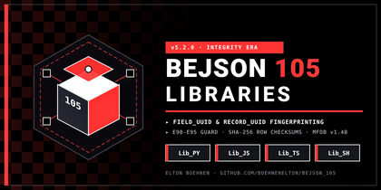

# BEJSON 105 Core & Integrity Era Library Ecosystem (`libraries_105`)


*_Figure 1: BEJSON 105 Integrity Era Architecture & Multi-Language Core_*

> **The Official Reference Implementation for BEJSON Integrity Era Formats (`105`, `105a`, `105db`), 104 Baseline Parity, Atomic Migration Tooling, and MFDB v1.40 Multi-File Database Referential Integrity across Python, JavaScript, TypeScript, and Bash.**

---

## Table of Contents
- [Prerequisites & Environment Setup](#prerequisites--environment-setup)
- [Installation & Quick Start](#installation--quick-start)
- [Core Features & Integrity Era Innovations](#core-features--integrity-era-innovations)
- [Multi-Language Quickstart Examples](#multi-language-quickstart-examples)
- [Visual Interface & Architecture Tour](#visual-interface--architecture-tour)
- [System Architecture & Repository Topology](#system-architecture--repository-topology)
- [BEJSON 105 Format Specifications & UUID Fingerprinting](#bejson-105-format-specifications--uuid-fingerprinting)
- [MFDB v1.40 Referential Integrity Engine](#mfdb-v140-referential-integrity-engine)
- [Atomic Format 104-to-105 Migration Pipeline](#atomic-format-104-to-105-migration-pipeline)
- [O(1) Field-Map Cache & Sanitization Mechanics](#o1-field-map-cache--sanitization-mechanics)
- [CLI Reference & Utilities Matrix](#cli-reference--utilities-matrix)
- [Testing & Quality Verification](#testing--quality-verification)
- [Frequently Asked Questions & Troubleshooting](#frequently-asked-questions--troubleshooting)

---

## Prerequisites & Environment Setup

`libraries_105` is engineered as a lightweight, zero-dependency multi-language runtime core compatible with modern Linux distributions, macOS, and Termux environments.

### System Requirements
- **Python**: Version 3.10 or higher (`json`, `pathlib`, `uuid`, `typing`, `hashlib`, `os`, `sys`).
- **Node.js**: Version 18.0.0 or higher with full ES2022 module and CommonJS support.
- **TypeScript**: Version 5.0 or higher for type-checked codebases.
- **Bash**: Version 4.4 or 5.x with standard core utilities (`jq`, `grep`, `sed`).

### Environment Variables Setup
To consume `libraries_105` without hardcoded filesystem paths in application logic, set the following environment variables in your active shell or configuration manager:

```bash
# Path to your local libraries_105 root checkout
export ADMIN_LIBRARIES_105="/path/to/your/libraries_105"

# Add libraries to runtime module resolution paths
export PYTHONPATH="${ADMIN_LIBRARIES_105}/Lib_PY:${PYTHONPATH}"
export NODE_PATH="${ADMIN_LIBRARIES_105}/Lib_JS:${ADMIN_LIBRARIES_105}/Lib_TS:${NODE_PATH}"
export PATH="${ADMIN_LIBRARIES_105}/Lib_SH/Core:${PATH}"
```

---

## Installation & Quick Start

Clone or extract the repository directly into your workspace:

```bash
git clone https://github.com/boehnenelton/BEJSON_105.git libraries_105
cd libraries_105
```

Execute the test suites to verify four-language engine readiness:

```bash
# Verify Python Core & MFDB v1.40
python3 Lib_PY/Core/tests/test_mfdb_spec_levels_suite.py

# Verify JavaScript Core & Referential Integrity
node Lib_JS/Core/tests/test_mfdb_spec_levels_suite.js
node Lib_JS/Core/tests/test_phase6_ref_integrity.js

# Verify TypeScript Core & Referential Integrity
npx tsc -p Lib_TS/tsconfig.json --noEmit

# Verify Bash Core
bash Lib_SH/Core/tests/test_mfdb_spec_levels.sh
```

---

## Core Features & Integrity Era Innovations

The 105 specification advances tabular data architectures by introducing deterministic UUID fingerprinting and active referential integrity enforcement.

1. **Deterministic UUID Fingerprinting**: Every schema field (`field_uuid`) and data row (`record_uuid`) is assigned an immutable UUIDv4, enabling collision-free distributed syncing.
2. **MFDB v1.40 Referential Integrity**: Real-time foreign key (`_fk`) validation with configurable `on_delete` policies (`restrict`, `cascade`, `null`) preventing orphaned records.
3. **Foundational Era Parity**: Full backward compatibility with 104, 104a, 104db, and Nested 104 documents inside the 105 engine.
4. **Atomic In-Place Upgrades**: Upgrade 104 documents to 105 with automated pre-upgrade backups, atomic file replacement, and structural verification (`E90-E95`).
5. **Universal 4-Language Core**: Exact functional and error code parity across Python, JavaScript, TypeScript, and Bash.

---

## Multi-Language Quickstart Examples

### 1. Python (`Lib_PY/Core`)
```python
from lib_bejson_Core_bejson_core_105 import (
    bejson_core_105_parse_document,
    bejson_core_105_insert_record,
    bejson_core_105_get_field_map
)
from lib_bejson_Core_mfdb_validator import (
    mfdb_validator_check_referential_integrity
)

# Load and validate an Integrity Era document
doc = bejson_core_105_parse_document("data/orders.105.bejson")
field_map = bejson_core_105_get_field_map(doc)

for row in doc["Values"]:
    order_id = row[field_map["order_id"]]
    customer_id = row[field_map["customer_fk"]]
    print(f"Order: {order_id} -> Customer: {customer_id}")

# Run active referential integrity audit on database manifest
ref_report = mfdb_validator_check_referential_integrity("105a.mfdb.bejson")
assert ref_report["is_valid"]
```

### 2. JavaScript (`Lib_JS/Core`)
```javascript
const {
  bejson_core_parse_bejson,
  bejson_core_get_field_map
} = require("./Lib_JS/Core/lib_bejson_Core_bejson_core");
const {
  mfdb_validator_check_referential_integrity
} = require("./Lib_JS/Core/lib_bejson_Core_mfdb_validator");

const doc = bejson_core_parse_bejson("data/orders.105.bejson");
const fieldMap = bejson_core_get_field_map(doc);

doc.Values.forEach(row => {
  console.log(`Order: ${row[fieldMap.order_id]}`);
});

const integrityReport = mfdb_validator_check_referential_integrity("105a.mfdb.bejson");
if (!integrityReport.is_valid) {
  console.error("Referential integrity defects detected:", integrityReport.errors);
}
```

### 3. TypeScript (`Lib_TS/Core`)
```typescript
import {
  parseBejson,
  getFieldMap
} from "./Lib_TS/Core/lib_bejson_Core_bejson_core";
import {
  checkReferentialIntegrity
} from "./Lib_TS/Core/lib_bejson_Core_mfdb_validators";
import { BEJSONDocument } from "./Lib_TS/Core/lib_bejson_Core_bejson_types";

const doc: BEJSONDocument = parseBejson("data/orders.105.bejson");
const fieldMap = getFieldMap(doc);

for (const row of doc.Values) {
  console.log(`Order ID: ${row[fieldMap["order_id"]]}`);
}

const audit = checkReferentialIntegrity("105a.mfdb.bejson");
console.log(`Integrity status: ${audit.isValid ? "Clean" : "Violations found"}`);
```

### 4. Bash (`Lib_SH/Core`)
```bash
source Lib_SH/Core/lib_bejson_Core_bejson_core.sh
source Lib_SH/Core/lib_bejson_Core_mfdb_validator.sh

# Run comprehensive Level 1, 2, and 3 MFDB audit
mfdb_validator_validate_database "105a.mfdb.bejson"
if [ $? -eq 0 ]; then
  echo "MFDB v1.40 database is fully valid."
fi
```

---

## Visual Interface & Architecture Tour

`libraries_105` acts as the authoritative multi-entity relational backbone:

```
[MFDB v1.40 Database Manifest: 105a.mfdb.bejson]
  ├── Network_Role: "Master"
  ├── Ref_Integrity: true
  ├── Entities:
  │     ├── Authors (data/authors.105.bejson) ── [PK: author_uuid]
  │     └── Books (data/books.105.bejson) ────── [FK: author_fk -> Authors.author_uuid]
  │                                               [on_delete: "cascade" | "restrict" | "null"]
  └── Subordinate Slaves:
        └── Worker Node (node_worker/105a.mfdb.bejson)
```

The core libraries interface seamlessly with canvas rendering modules (`Lib_PY/Canvas`, `Lib_JS/Canvas`) and graphics subsystems (`Lib_PY/Graphics`).

---

## System Architecture & Repository Topology

The `libraries_105` repository isolates the core runtime engines and taxonomy definitions:

```
libraries_105/
├── Lib_PY/                    # Python 3.10+ Implementation
│   ├── Core/                  # 105/105a/105db core engine, validators, and upgrade tooling
│   ├── Canvas/                # SVG canvas generators and visual renderers
│   ├── Graphics/              # Geometric layouts and graphics pipelines
│   ├── Standards/             # Canonical BEJSON Format 105 specification models
│   ├── Taxonomies/            # Domain entity definitions and write-owner models
│   └── Tax_Scaffolds/         # Automated schema registry generators
├── Lib_JS/                    # JavaScript CommonJS / ES2022 Implementation
│   ├── Core/                  # 105 engine, validators, and referential integrity suite
│   ├── Canvas/                # Dynamic in-browser canvas renderer
│   └── Graphics/              # Vector calculation and styling engine
├── Lib_TS/                    # TypeScript 5.x Typed Implementation
│   └── Core/                  # Strongly typed 105 engine, MFDB validators, and schemas
├── Lib_SH/                    # Bash 5.x POSIX Implementation
│   └── Core/                  # jq-backed 105 core engine and MFDB validator
└── images/banners/            # Project banners and visual release documentation
```

---

## BEJSON 105 Format Specifications & UUID Fingerprinting

Format 105 enforces structural identity across schemas and row vectors:

### Mandatory Top-Level Keys
1. `"Format"`: Must be `"BEJSON"`.
2. `"Format_Version"`: `"105"` (Table), `"105a"` (Metadata/Config), or `"105db"` (Multi-Table Store).
3. `"Format_Creator"`: Maintainer signature (`"Elton Boehnen"`).
4. `"Records_Type"`: Non-empty array of record names.
5. `"Fields"`: Array of schema objects including `"name"`, `"type"`, and `"field_uuid"`.
6. `"Values"`: Two-dimensional array of row vectors where index 0 is `"record_uuid"`.

### Example: Format 105 Document
```json
{
  "Format": "BEJSON",
  "Format_Version": "105",
  "Format_Creator": "Elton Boehnen",
  "Records_Type": ["Author"],
  "Fields": [
    {"name": "record_uuid", "type": "string", "field_uuid": "00000000-0000-4000-8000-000000000001"},
    {"name": "author_id", "type": "string", "field_uuid": "e3b0c442-98fc-1c14-9afb-4c72e04f0001"},
    {"name": "author_name", "type": "string", "field_uuid": "e3b0c442-98fc-1c14-9afb-4c72e04f0002"}
  ],
  "Values": [
    ["11111111-1111-4111-8111-111111111111", "auth_01", "Ada Lovelace"]
  ]
}
```

---

## MFDB v1.40 Referential Integrity Engine

MFDB v1.40 introduces true relational constraint handling:

1. **Foreign Key Mapping (`fk_target_entity`)**: Columns ending in `_fk` map directly to target entities registered in the manifest.
2. **Deletion Behaviors (`fk_on_delete`)**:
   - `"restrict"`: Halts deletion if foreign child rows reference the targeted primary key.
   - `"cascade"`: Recursively deletes referencing rows across linked entity tables.
   - `"null"`: Sets referencing foreign key values to `null`.
3. **Cycle Prevention**: Cascade execution detects circular relationship loops and halts cleanly with error code `[44]`.
4. **Standalone Audit (`mfdb_validator_check_referential_integrity`)**: Audits the entire multi-file database without mutating files on disk.

---

## Atomic Format 104-to-105 Migration Pipeline

Existing Foundational Era 104 files can be upgraded seamlessly:

```bash
# Upgrade a single 104 document to 105
python3 Lib_PY/Core/cli/bejson_upgrade_cli.py --input "data/legacy.bejson" --atomic

# Coordinator whole-database upgrade
python3 Lib_PY/Core/cli/upgrade_mfdb_to_105.py --manifest "104a.mfdb.bejson"
```

- **Verbatim Backup**: Copies the original file to `Backups/<filename>.104.bak` prior to modification.
- **UUID Generation**: Generates deterministic UUIDv4 identifiers for all fields and records.
- **Atomic Swap**: Writes to a temporary staging file before performing an atomic POSIX replace.

---

## O(1) Field-Map Cache & Sanitization Mechanics

### Field-Map Cache Lookup
Positional hardcoding is strictly avoided. Column positions resolve through the constant-time Field-Map Cache:

```python
field_map = bejson_core_105_get_field_map(doc)
author_id = row[field_map["author_id"]]
```

### Boundary-Layer Sanitization
Input dictionaries and raw rows undergo sanitization at serialization boundaries:
- Leading and trailing whitespace is stripped from keys and cell values.
- Unknown types are rejected against the closed type taxonomy (`string`, `integer`, `float`, `boolean`, `null`, `any`).
- Format 105 UUIDs are validated against RFC 4122 v4 regex specifications.

---

## CLI Reference & Utilities Matrix

| Language | Script / Tool | Primary Capabilities |
| :--- | :--- | :--- |
| **Python** | `Lib_PY/Core/cli/bejson_105_cli.py` | Format 105 schema validation, record generation, table inspection |
| **Python** | `Lib_PY/Core/cli/bejson_upgrade_cli.py` | Atomic 104-to-105 file upgrade engine with backup preservation |
| **Python** | `Lib_PY/Core/cli/upgrade_mfdb_to_105.py` | Full MFDB v1.31 to v1.40 database migration coordinator |
| **Python** | `Lib_PY/Core/lib_bejson_Core_mfdb_validator.py` | Referential integrity audit and cascade resolver engine |
| **Bash** | `Lib_SH/Core/lib_bejson_Core_mfdb_validator.sh` | Shell-based automated Level 1, 2, and 3 MFDB integrity checks |

---

## Testing & Quality Verification

Run the comprehensive test suites across runtimes:

```bash
# Python Core & MFDB v1.40 Suite
python3 Lib_PY/Core/tests/test_bejson_core_105.py
python3 Lib_PY/Core/tests/test_mfdb_spec_levels_suite.py

# JavaScript Core & Referential Integrity Suite
node Lib_JS/Core/tests/test_mfdb_spec_levels_suite.js
node Lib_JS/Core/tests/test_phase6_ref_integrity.js

# TypeScript Core & Referential Integrity Suite
npx tsc -p Lib_TS/tsconfig.json --noEmit

# Bash Core Suite
bash Lib_SH/Core/tests/test_mfdb_spec_levels.sh
```

### Error Code Summary
- `[30]`: Invalid Network Role string.
- `[34]`: Malformed manifest `Records_Type`.
- `[36]`: Missing or unresolvable `Parent_Hierarchy`.
- `[38]`: Broken bidirectional parent-manifest linkage.
- `[39]`: Unresolved foreign key reference.
- `[43-47]`: Referential integrity constraint violations.
- `[90-95]`: Format 105 migration and UUID integrity errors.

---

## Frequently Asked Questions & Troubleshooting

**Q: Does `libraries_105` replace `libraries_104`?**  
A: No. `libraries_105` is the Integrity Era engine for UUID-tracked schemas and relational constraints. `libraries_104` remains the stable repository for mature vertical domains (CMS, Gaming, Diagrams).

**Q: Can a 105 MFDB database contain 104 entity tables?**  
A: Yes. An MFDB v1.40 database manifest can register both 104 and 105 entity tables. However, active referential integrity enforcement only audits Format 105 entities declaring primary and foreign keys.

**Q: How does `restrict` handle deletes?**  
A: If any referencing child entity holds a foreign key pointing to the target record, the operation raises error code `[43]` without modifying either table.
