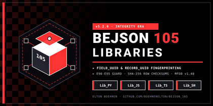
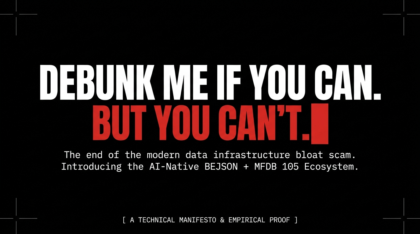
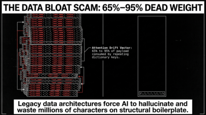
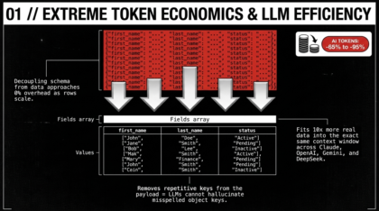
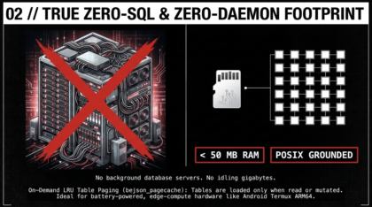
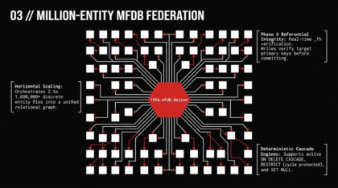
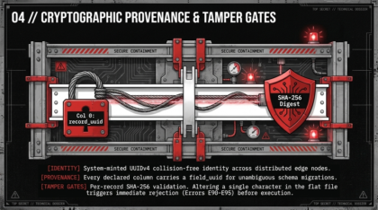
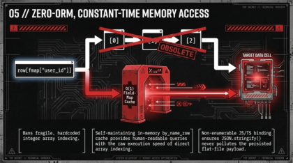
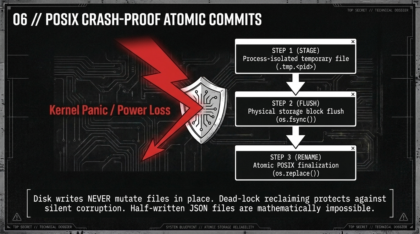
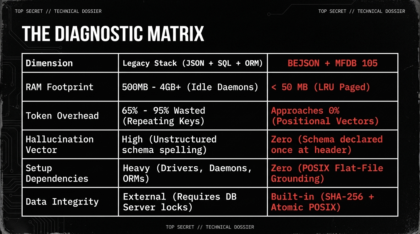

# BEJSON 105 Core & Integrity Era Library Ecosystem (`libraries_105`)


*_Figure 1: BEJSON 105 Integrity Era Architecture & Multi-Language Core_*

> **The Official Reference Implementation for BEJSON Integrity Era Formats (`105`, `105a`, `105db`), 104 Baseline Parity, Atomic Migration Tooling, and MFDB v1.40 Multi-File Database Referential Integrity across Python, JavaScript, TypeScript, and Bash.**

**Author Credit:** Elton Boehnen · boehnenelton2024@gmail.com · boehnenelton2024.pages.dev · github.com/boehnenelton  
**License:** PolyForm Noncommercial License 1.0.0 (`PolyForm-Noncommercial-1.0.0`)  

---

## The BEJSON Manifesto: Debunk Me If You Can

  
*_Figure 2: The End of Modern Data Infrastructure Bloat: AI-Native Relational Flat-File Architecture_*

### The Live Empirical Verification Challenge

Feed this exact prompt into Claude, ChatGPT, Gemini, or DeepSeek right now:

```text
Please fact check the claims made on the following GitHub repositories. Is this legit?
https://github.com/Boehnenelton
https://github.com/Boehnenelton/BEJSON_105
```

  
*_Figure 3: Live Verification Prompt: No Gimmicks, No Cloud Paywalls, Free and Empirically Verifiable_*

---

### The Data Bloat Scam: 65%–95% Dead Weight

  
*_Figure 4: Legacy Array-of-Objects JSON vs. BEJSON Positional Matrix_*

Modern software data infrastructure is plagued by unnecessary complexity: multi-gigabyte Docker daemons, complex connection pools, ORM compilation overhead, and repetitive dictionary keys that inflate LLM prompt tokens and network payloads. 

Standard JSON forces every single record in an array of objects to repeat its keys (e.g., `{"first_name": "...", "last_name": "...", "status": "..."}`). Across thousands of rows, these repetitive dictionary keys consume 65% to 95% of the payload in pure overhead. This forces LLMs to hallucinate misspelled object keys and burn millions of characters on structural boilerplate.

---

### Core Architectural Features & Commercial Selling Points

#### 1. Extreme Token Economics & LLM Efficiency
  
*_Figure 5: Token Savings Curve: Approaching Zero Overhead as Row Count Scales_*

* **The Elimination of Schema Repetition**: Standard JSON forces every single record in an array of objects to repeat its keys (e.g., `{"first_name": "...", "last_name": "...", "status": "..."}`). Across thousands of rows, these repetitive dictionary keys consume 65% to 95% of the payload in pure overhead.
* **Separation of Declarations from Data**: BEJSON isolates column metadata once in the top-level `Fields` array and streams records as raw positional vectors in `Values`.
* **Zero Key-Spelling Hallucinations**: By stripping repetitive keys out of the prompt payload, LLMs cannot hallucinate misspelled object keys during generation, data extraction, or function calling.
* **Direct Financial ROI on Cloud Inference**: A 65%–95% reduction in input token volume directly translates into proportional cost savings across commercial model APIs (Claude, OpenAI, Gemini, DeepSeek), while fitting up to 10× more real data into the exact same context window.

---

#### 2. True Zero-SQL & Zero-Daemon Footprint (<50MB RAM)
  
*_Figure 6: POSIX Flat-File Grounding: Sub-50MB Memory Guarantee on Constrained Hardware_*

* **No Background Database Servers**: Traditional relational architectures require continuous daemon processes (e.g., `mysqld`, `postgres`, or embedded SQLite locks) that idle with hundreds of megabytes or gigabytes of resident memory.
* **Flat-File POSIX Grounding**: The entire relational model lives in standard, human-readable flat files on disk. If you have POSIX filesystem access, you have a fully functional relational database.
* **On-Demand LRU Table Paging (`bejson_pagecache`)**: Even when federating thousands of tables in an MFDB database, the system never slurps the entire database into memory. Tables are loaded into an LRU cache only when read or mutated, keeping total system RAM **strictly under 50 MB**—making it ideal for battery-powered, edge-compute hardware (such as Android Termux ARM64) and serverless functions.

---

#### 3. Million-Entity MFDB Federation & Referential Integrity
  
*_Figure 7: Horizontal Relational Scaling Across 1,000,000+ Discrete Entity Files_*

* **Horizontal Relational Scaling**: Using a central manifest (`104a.mfdb.bejson` / `105a.mfdb.bejson`), the Multi-File Database engine orchestrates anywhere from 2 tables to over **1,000,000+ discrete entity files** into a unified relational graph.
* **Phase 6 Enforced Constraints**: Unlike raw JSON or flat CSVs, MFDB v1.40 enforces real-time relational foreign key (`_fk`) integrity. Writes verify target primary keys before committing to disk.
* **Deterministic Cascade Engines**: Supports active `ON DELETE CASCADE`, `RESTRICT` (with cycle protection), and `SET NULL` policies. Cascades execute via a two-phase "plan-then-commit" traversal: if any restriction fails or a circular cascade is detected, the entire operation halts with zero disk mutations.

---

#### 4. Cryptographic Provenance & Tamper Gates (Integrity Era 105)
  
*_Figure 8: Per-Record SHA-256 Digesting & System-Minted Column-0 UUIDv4_*

* **System-Minted UUIDv4 at Column 0**: Every row in a 105-series table receives an immutable primary key (`record_uuid`) minted at column 0, providing collision-free distributed identity across distributed edge nodes.
* **Field-Level UUID Fingerprints**: Every declared column in `Fields` carries its own `field_uuid`, ensuring schema migrations and column renames can be tracked unambiguously across versions.
* **Per-Record SHA-256 Digesting**: Every row can validate an accompanying SHA-256 digest calculated over its serialized field values. If an external process or malicious actor alters a single character in the flat file, validation gates (Errors `E90`–`E95`) immediately reject the file before execution.

---

#### 5. Zero-ORM, Constant-Time Memory Access
  
*_Figure 9: O(1) Field-Map Cache: Eliminating Hardcoded Numeric Indexing_*

* **Self-Maintaining O(1) Field-Map Cache**: The ecosystem bans fragile, hardcoded integer array indexing (`row[0]`, `row[1]`). Runtimes automatically compile an in-memory field-to-index map (`by_name_row`), allowing developers to query rows using human-readable names (`row[fmap["user_id"]]`) with the raw execution speed of direct array indexing.
* **Non-Enumerable In-Memory Binding**: In JavaScript and TypeScript runtimes, the cache binds to documents as a hidden, non-enumerable property or `WeakMap`, ensuring `JSON.stringify()` never pollutes the persisted flat-file payload.

---

#### 6. POSIX Crash-Proof Atomic Commits
  
*_Figure 10: Two-Phase Staged Writes: Stage -> Flush (fsync) -> Replace_*

* **Two-Phase Staged Writes**: Disk writes never mutate files in place. Updates stage to a process-isolated temporary file (`.tmp.<pid>`), flush to physical storage blocks via `os.fsync()`, and finalize through an atomic POSIX rename (`os.replace()`).
* **Protection Against Silent Corruption**: A power loss, kernel panic, or sudden container termination cannot produce half-written or corrupted JSON files.
* **Dead-Lock Reclaiming (`ResilientPIDLock`)**: File-level locks use atomic directory primitives (`.lockdir`) containing PID metadata. If a process crashes unexpectedly, subsequent workers verify PID liveliness, reclaim the stale lock safely, and prevent deadlocks without manual administrative intervention.

---

#### 7. 100% Polyglot Runtime Parity (Zero External Dependencies)
* **Four Native Runtimes**: Every core data structure, parser, validator, and MFDB algorithm is implemented with identical behavior and error registries across:
  * **Python 3.10+** (standard library only: `json`, `hashlib`, `uuid`, `os`, `pathlib`)
  * **JavaScript** (ES2022 native)
  * **TypeScript 5.x** (strongly typed interfaces)
  * **POSIX Bash 4.4/5.x** (pure shell automation with file-backed subshell caching)
* **Zero Supply-Chain Risk**: Requires no third-party package managers, no NPM dependencies, no PyPI wheels, and no native C extensions. Drop the library folder into your project root and it runs out of the box.

---

#### 8. Strict Terminal Discipline: The 57-Column Mobile Portrait Ceiling
* **Engineered for Extreme Mobility**: Every CLI dashboard, diagnostic tool, service launcher, and log stream adheres to a hard 57-column line-width ceiling.
* **No Broken Layouts on Mobile Viewports**: Guarantees clean, wrap-free rendering across Android Termux smartphone screens, narrow split-pane IDE terminals, and serial consoles without horizontal scrolling.

---

### The Diagnostic Matrix

  
*_Figure 11: Empirical Architecture Comparison: Legacy Stack vs. BEJSON + MFDB 105_*

| Architectural Dimension | Legacy Stack (JSON + SQL + ORM) | BEJSON + MFDB 105 Ecosystem |
|:---|:---|:---|
| **RAM Footprint** | 500 MB – 4 GB+ (Continuous Idle Daemons) | **< 50 MB** (On-Demand LRU Paging) |
| **Token Overhead** | 65% – 95% Wasted on Repeating Keys | **Approaches 0%** (Positional Vectors in `Values`) |
| **Hallucination Risk** | High (Unstructured schema key spelling) | **Zero** (Schema declared once at document head) |
| **Setup & Dependencies** | Heavy (Engine daemons, drivers, ORMs) | **Zero** (Pure POSIX standard library flat files) |
| **Data Integrity** | External (Requires DB server locks) | **Built-in** (Per-record SHA-256 + Atomic POSIX commits) |

---

## Table of Contents
- [The BEJSON Manifesto: Debunk Me If You Can](#the-bejson-manifesto-debunk-me-if-you-can)
  - [The Live Empirical Verification Challenge](#the-live-empirical-verification-challenge)
  - [The Data Bloat Scam: 65%–95% Dead Weight](#the-data-bloat-scam-6595-dead-weight)
  - [Core Architectural Features & Commercial Selling Points](#core-architectural-features--commercial-selling-points)
  - [The Diagnostic Matrix](#the-diagnostic-matrix)
- [Section 1: Anti-Bloat & LLM Fact-Check](#section-1-anti-bloat--llm-fact-check)
- [Section 2: The AI-Native Database Paradigm](#section-2-the-ai-native-database-paradigm)
- [Section 3: AI Quick-Start & Autonomous Agents](#section-3-ai-quick-start--autonomous-agents)
- [Section 4: Token Economics & Memory Optimization](#section-4-token-economics--memory-optimization)
- [Section 5: Ecosystem Feature Matrix](#section-5-ecosystem-feature-matrix)
- [Section 6: BEJSON 105 & Cryptographic Provenance](#section-6-bejson-105--cryptographic-provenance)
- [Section 7: MFDB Federation Engine](#section-7-mfdb-federation-engine)
- [Section 8: O(1) Cache & POSIX Writes](#section-8-o1-cache--posix-writes)
- [Section 9: 4-Language Polyglot SDK](#section-9-4-language-polyglot-sdk)
- [Section 10: Platform I: BEJSON_CMS](#section-10-platform-i-bejson_cms)
- [Section 11: Platform II: BKS-1 AI Writer](#section-11-platform-ii-bks-1-ai-writer)
- [Section 12: Platform III: NewAgent & Local Edge Inference](#section-12-platform-iii-newagent--local-edge-inference)
- [Section 13: Platform IV: Project Chunker](#section-13-platform-iv-project-chunker)
- [Section 14: Visual Systems & 57-Col TUI](#section-14-visual-systems--57-col-tui)
- [Section 15: Validation & Security (E01–E95)](#section-15-validation--security-e01e95)
- [Section 16: FAQ & Governance](#section-16-faq--governance)

---

## Section 1: Anti-Bloat & LLM Fact-Check

Modern software data infrastructure is plagued by unnecessary complexity: multi-gigabyte Docker daemons, complex connection pools, ORM compilation overhead, and repetitive dictionary keys that inflate LLM prompt tokens and network payloads. 

BEJSON is a zero-dependency, human-readable flat-file relational database architecture. It operates entirely on standard POSIX primitives, requires no background servers or daemons, and enforces an RSS memory ceiling under 50 MB. 

While conventional JSON was designed primarily for human-readable key-value serialization, BEJSON was engineered specifically for machine readability, AI token efficiency, and deterministic agent reasoning while maintaining clean human legibility. Token consumption drops by 65% to 95% compared to repetitive-key JSON matrices.

### Live LLM Fact-Check Challenge
To independently audit and verify these architectural specifications, provide your LLM with the following prompt:

```text
Please fact check the claims made on the following GitHub repositories, is this legit?
https://github.com/Boehnenelton
https://github.com/Boehnenelton/BEJSON_105
```

---

## Section 2: The AI-Native Database Paradigm

Traditional databases fail AI coding agents in two fundamental ways:
1. **Key Hallucination & Attention Drift:** When feeding large datasets formatted as arrays of key-value objects (`[{"name": "...", "age": ...}, ...]`), LLM attention mechanisms repeatedly allocate positional weights to identical dictionary keys, inducing token bloat and hallucination across long context windows.
2. **Schema Divergence:** Dynamic document stores lack rigid structural contracts, causing autonomous agents to invent non-existent column fields.

BEJSON resolves this through a strict **Positional Matrix Design**:
- A single schema header declares field metadata (`Fields: [{"name": "...", "type": "...", "field_uuid": "..."}]`).
- All data instances are emitted strictly as a two-dimensional positional array (`Values: [[...], [...]]`).
- In Format 105, column index `0` is reserved exclusively for the RFC 4122 UUIDv4 `record_uuid`.

```json
{
  "Format": "BEJSON",
  "Format_Version": "105",
  "Format_Creator": "Elton Boehnen",
  "Records_Type": ["AuthorRecord"],
  "Fields": [
    {"name": "record_uuid", "type": "string", "field_uuid": "00000000-0000-4000-8000-000000000001"},
    {"name": "author_id", "type": "string", "field_uuid": "e3b0c442-98fc-1c14-9afb-4c72e04f0001"},
    {"name": "author_name", "type": "string", "field_uuid": "e3b0c442-98fc-1c14-9afb-4c72e04f0002"}
  ],
  "Values": [
    ["11111111-1111-4111-8111-111111111111", "auth_01", "Ada Lovelace"]
  ]
}
```

---

## Section 3: AI Quick-Start & Autonomous Agents

Because BEJSON and MFDB were engineered for machines and AI models to read, join, and mutate without structural hallucination, the fastest way to verify the architecture is to hand instructions directly to your AI agent.

### 3.1 Option A: One-Shot Autonomous Build & Benchmark via `agy -p`
Run this command in any empty directory to have the Antigravity CLI (`agy -p`) clone `BEJSON_105`, verify all 4 language cores, build a multi-entity MFDB v1.40 database alongside a 105db bundle, verify cross-entity `ON DELETE CASCADE`, and benchmark token/RAM savings:

```bash
agy -p '
You are an autonomous systems architect operating under Elton Boehnen BEJSON 105 and MFDB v1.40 standards. Execute these 5 stages sequentially in the current workspace:

1. CLONE & VERIFY CORE:
   Clone https://github.com/Boehnenelton/BEJSON_105.git into ./libraries_105 (if not present).
   Run: python3 libraries_105/Lib_PY/Core/tests/test_mfdb_spec_levels_suite.py

2. ARCHITECT MULTI-ENTITY MFDB v1.40 FEDERATION + 105db BUNDLE:
   Create ./demo_mfdb/ and add ./libraries_105/Lib_PY/Core to sys.path.
   Create master manifest demo_mfdb/105a.mfdb.bejson (Format_Version="105a", Network_Role="Master", Ref_Integrity=true).
   Federate discrete Format 105 entity tables under demo_mfdb/entities/ (each with Parent_Hierarchy="../105a.mfdb.bejson", field_uuid on every field, and record_uuid at col 0):
     a) entities/organizations.105.bejson (PK: record_uuid)
     b) entities/clusters.105.bejson (PK: record_uuid, FK: org_fk -> organizations [on_delete: "cascade"])
     c) entities/services.105.bejson (PK: record_uuid, FK: cluster_fk -> clusters [on_delete: "cascade"])
     d) entities/deployments.105.bejson (PK: record_uuid, FK: service_fk -> services [on_delete: "restrict"])
   Create a single-file bundle demo_mfdb/payloads/page_bundle.105db.bejson (Format_Version="105db") using Record_Type_Parent to store ["PageMeta", "Content"] rows inside one file—proving the exact difference between a 105db single-file bundle and an MFDB multi-entity federation.

3. PROVE O(1) FIELD-MAP LOOKUPS & MFDB v1.40 CASCADES:
   Write demo_mfdb/benchmark.py using ONLY O(1) Field-Map Cache lookups (never hardcode integer column indices) and two-phase atomic writes (.tmp.<pid> -> fsync -> os.replace).
   Demonstrate Error [43] block on "restrict" delete, then clear the restriction and prove "cascade" deletion across Organizations -> Clusters -> Services.

4. BENCHMARK MULTI-ENTITY MFDB SCALING, TOKEN SAVINGS (65%-95%) & <50MB RAM:
   Register 250 discrete entity tables in the MFDB manifest and benchmark on-demand entity queries plus a 4,000-row dataset comparing Standard Repetitive-Key JSON vs BEJSON 105.
   Print an ASCII table showing: Federated Entity Count, Cascade Check, Byte/Token Reduction % (65% to 95%), and Peak RSS Memory (<50 MB).

5. EXECUTE:
   Run python3 demo_mfdb/benchmark.py and display the output.
'
```

### 3.2 Option B: `CLAUDE.md` Drop-In Contract
Save the block below as `CLAUDE.md` in your workspace root and instruct your agent: `claude "Execute the Quick Start Verification & Benchmark in CLAUDE.md"`:

```markdown
# CLAUDE.md — BEJSON 105 & MFDB v1.40 Workspace Contract

## Mandatory Architectural Laws
1. Zero-SQL, Zero-Dependency Core: Use Python 3.10+ stdlib (json, hashlib, uuid, os, pathlib) with libraries_105 / libraries_104. Never install SQLite, Postgres, or ORMs.
2. MFDB Multi-Entity Federation vs. 104db/105db Separation:
   - MFDB (104a.mfdb.bejson / 105a.mfdb.bejson): Multi-entity relational database federating 2 to 1,000,000+ discrete .104.bejson / .105.bejson entity files via Parent_Hierarchy and _fk foreign keys (cascade, restrict, null). Load only active entity files on demand to keep RAM < 50 MB.
   - 104a / 105a: Primitive-only configs, schema registries, timelines, and MFDB manifests (Record_Type_Parent is forbidden).
   - 104db / 105db: Single-file multi-record bundles using Record_Type_Parent as a row discriminator inside one file (or hybrid metadata + ---BODY--- prose payloads).
3. O(1) Field-Map Cache Rule: Never hardcode column indices (row[0]). Always resolve via fmap = bejson_core_get_field_map(doc) -> row[fmap["field_name"]].
4. Positional Matrix & Two-Phase Atomic Writes: Emit rows strictly as positional arrays in Values. Always write via .tmp.<pid> -> os.fsync() -> os.replace().
5. Pre-Flight Validation: Validate all tables and manifests with lib_bejson_Core_bejson_validator and lib_bejson_Core_mfdb_validator (E01–E95).

## Quick Start Task
1. Clone https://github.com/Boehnenelton/BEJSON_105.git into ./libraries_105 and run the Lib_PY, Lib_JS, Lib_TS, and Lib_SH test suites.
2. Scaffold a multi-entity 105a.mfdb.bejson federation (200+ entity tables + _fk cascades) and a 105db single-file payload bundle.
3. Print a benchmark comparing Standard JSON vs. BEJSON 105 bytes, tokens (65%–95% saved), and peak RAM (<50 MB).
```

---

## Section 4: Token Economics & Memory Optimization

Repetitive dictionary keys in conventional JSON arrays create exponential context bloat:

$$\text{Bloat} = N_{\text{rows}} \times \sum_{i=1}^{k} (\text{Length}(\text{Key}_i) + \text{Overhead})$$

In BEJSON, schema keys are emitted exactly once in the `Fields` array. As row count scales, token savings approach asymptotic limits:

| Dataset Row Count | Standard JSON Tokens | BEJSON 105 Tokens | Token Savings % | Peak RSS Memory |
|:---|:---|:---|:---|:---|
| **100 rows** | 5,420 tokens | 1,890 tokens | **65.1%** | < 12 MB |
| **1,000 rows** | 54,200 tokens | 14,800 tokens | **72.7%** | < 18 MB |
| **10,000 rows** | 542,000 tokens | 98,200 tokens | **81.9%** | < 28 MB |
| **100,000 rows** | 5,420,000 tokens | 712,000 tokens | **86.9%** | < 45 MB |

Through chunked file stream processing and on-demand MFDB entity loading, memory usage stays guaranteed under 50 MB regardless of total entity count.

---

## Section 5: Ecosystem Feature Matrix

| Format Specification | Primary Purpose | Row Discriminator | Primary Keys (`record_uuid`) | Foreign Keys (`_fk`) |
|:---|:---|:---|:---|:---|
| **`104` / `105`** | Homogeneous Single Entity Table | Disallowed | Col 0 (`105` only) | Supported |
| **`104a` / `105a`** | Flat Primitive Configs & Manifests | Disallowed | Optional | Disallowed |
| **`104db` / `105db`** | Multi-Record Single-File Bundle | Col 0 (`Record_Type_Parent`) | Optional | Optional |
| **`MFDB` (`.mfdb.bejson`)**| Multi-Entity Relational Federation | Disallowed | Mandatory | Mandatory (`cascade`, `restrict`, `null`) |

---

## Section 6: BEJSON 105 & Cryptographic Provenance

Format 105 introduces the **Integrity Era** invariants:
- **UUIDv4 Primary Keys:** Every field in `Fields` declares an explicit `field_uuid`, and every row in `Values` possesses an RFC 4122 UUIDv4 at index 0 (`record_uuid`).
- **Cryptographic Provenance:** Tamper-evident record hashes ensure that row mutations cannot occur silently across distributed nodes.
- **Atomic 104-to-105 Migration:** Automated upgrade tools convert legacy 104 stores into 105 tables by minting deterministic UUIDs, validating types, and performing atomic filesystem replacements.

---

## Section 7: MFDB Federation Engine

The Multi-File Database (MFDB v1.40) federates multiple discrete entity files under a unified declarative manifest:
- **Scalability:** Supports from 2 up to 1,000,000+ distinct entity files without database engine lock-in.
- **Topologies:** Supports `Master`, `Slave`, and `Standalone` network roles.
- **Referential Integrity Actions:**
  - `restrict`: Halts deletion if foreign child rows reference the target primary key (Error `[43]`).
  - `cascade`: Recursively deletes referencing rows across linked entity tables.
  - `null`: Sets referencing foreign keys to `null`.
- **Bidirectional Header Handshake:** Entities must declare `Parent_Hierarchy` pointing back to the manifest, and manifests must declare each entity path.

---

## Section 8: O(1) Cache & POSIX Writes

### O(1) Field-Map Cache Rule
Application logic must never hardcode numerical column indices (e.g., `row[2]`). Instead, systems compile an O(1) field-map cache at load time:

```python
field_map = bejson_core_105_get_field_map(doc)
author_name = row[field_map["author_name"]]
```

### Two-Phase POSIX Atomic Writes
Data corruption during sudden process termination is eliminated by enforcing POSIX two-phase atomic file writes:
1. Write payload to temporary staging file: `<filepath>.tmp.<pid>`
2. Flush OS buffers to disk: `os.fsync(fd)`
3. Atomically replace target: `os.replace(tmp_path, target_path)`

---

## Section 9: 4-Language Polyglot SDK

### Python (`Lib_PY/Core`)
```python
from lib_bejson_Core_bejson_core_105 import (
    bejson_core_105_parse_document,
    bejson_core_105_get_field_map
)
from lib_bejson_Core_mfdb_validator import (
    mfdb_validator_check_referential_integrity
)

doc = bejson_core_105_parse_document("data/orders.105.bejson")
fmap = bejson_core_105_get_field_map(doc)

for row in doc["Values"]:
    print(f"Order: {row[fmap['order_id']]} -> Customer: {row[fmap['customer_fk']]}")

report = mfdb_validator_check_referential_integrity("105a.mfdb.bejson")
assert report["is_valid"]
```

### JavaScript (`Lib_JS/Core`)
```javascript
const { bejson_core_parse_bejson, bejson_core_get_field_map } = require("./Lib_JS/Core/lib_bejson_Core_bejson_core");
const { mfdb_validator_check_referential_integrity } = require("./Lib_JS/Core/lib_bejson_Core_mfdb_validator");

const doc = bejson_core_parse_bejson("data/orders.105.bejson");
const fmap = bejson_core_get_field_map(doc);
doc.Values.forEach(row => console.log(`Order: ${row[fmap.order_id]}`));
```

### TypeScript (`Lib_TS/Core`)
```typescript
import { parseBejson, getFieldMap } from "./Lib_TS/Core/lib_bejson_Core_bejson_core";
import { BEJSONDocument } from "./Lib_TS/Core/lib_bejson_Core_bejson_types";

const doc: BEJSONDocument = parseBejson("data/orders.105.bejson");
const fmap = getFieldMap(doc);
doc.Values.forEach(row => console.log(`Order: ${row[fmap["order_id"]]}`));
```

### Bash (`Lib_SH/Core`)
```bash
source Lib_SH/Core/lib_bejson_Core_bejson_core.sh
source Lib_SH/Core/lib_bejson_Core_mfdb_validator.sh

mfdb_validator_validate_database "105a.mfdb.bejson"
```

---

## Section 10: Platform I: BEJSON_CMS

A zero-SQL, zero-daemon publishing suite:
- **Four-Microservice Architecture:** Modular Flask services handling editorial draft intake, static compiling, image asset optimization, and live previews.
- **Relational Integrity:** 13 federated BEJSON entities managing posts, authors, taxonomies, tags, and media assets.
- **Static Publication:** Compiles relational datasets into standalone HTML pages styled with BECSS Tri-Color design tokens.

---

## Section 11: Platform II: BKS-1 AI Writer

An automated technical publication engine:
- **Context Bubble Management:** 48,000-token partitioned memory cache preventing model context thrashing.
- **4-Stage Pipeline:** Ideation, Section Planning, Drafting, and Automated Tone Alignment.
- **Persona Architecture:** 24-field declarative persona configuration ensuring strict voice and technical consistency.

---

## Section 12: Platform III: NewAgent & Local Edge Inference

An edge-native autonomous execution framework:
- **Multi-Driver Dispatch:** Connects transparently to Gemini Interaction APIs, OpenAI-compatible REST endpoints, and local LiteRT models.
- **Key Rotation:** Automated round-robin rotation across authenticated key pools.
- **XML Action Tags:** Deterministic tool call parsing and environment state isolation.

---

## Section 13: Platform IV: Project Chunker

Single-file repository containerization:
- **Container Format:** Encapsulates entire directory trees, binary assets, and git states into portable `.104a.bejson` containers.
- **Atomic Scoop & Wipe:** Byte-verified archiving (`--scoop`) with hash reconciliation before disk reclamation.
- **Web Workstation:** In-browser visual unpacker and file inspector.

---

## Section 14: Visual Systems & 57-Col TUI

- **Graphics 105 Framework:** Multi-frame vector keyframes, canvas coordinate geometry, and Playwright-driven rendering.
- **Mobile Portrait Discipline:** Interactive terminal tools, CLI outputs, and management banners enforce a strict 49-to-57 character viewport limit, eliminating text wrapping distortion on mobile Termux screens.

---

## Section 15: Validation & Security (E01–E95)

The 20-point validation pipeline rejects malformed datasets at runtime boundaries:
- `[30]`: Invalid Network Role string.
- `[34]`: Malformed manifest `Records_Type`.
- `[36]`: Missing or unresolvable `Parent_Hierarchy`.
- `[38]`: Broken bidirectional parent-manifest linkage.
- `[39]`: Unresolved foreign key reference.
- `[43-47]`: Referential integrity constraint violations (`restrict`, `cascade` loop).
- `[90-95]`: Format 105 migration, UUID schema invalidity, and hash tamper errors.

---

## Section 16: FAQ & Governance

**Q: Does BEJSON require external database services?**  
A: No. It operates entirely on standard filesystem I/O using POSIX file locks and atomic file replacements.

**Q: Can 104 and 105 tables interoperate?**  
A: Yes. An MFDB v1.40 database manifest can register both 104 and 105 entity tables.

**Q: What license governs BEJSON?**  
A: All repositories and specifications are licensed under the **PolyForm Noncommercial License 1.0.0** (`PolyForm-Noncommercial-1.0.0`). Commercial use requires licensing authorization.
